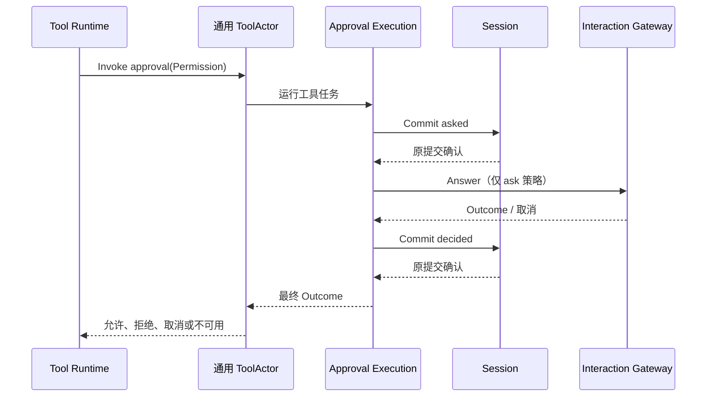

# Approval

本包拥有审批策略、asked/decided 审计规则和执行业务。根包不依赖 tools、GoAkt、Agent 或可变 Session。设计见 [Approval 模块](../zh-CN/actor-design/20-approval-module.md)。

## 对象与模块职责

| 对象 / 模块 | 职责 |
| --- | --- |
| Policy / Config | 默认与 Session 事件覆盖的 ask/never 策略 |
| Service / Decision | 校验开放 Turn，固定策略、请求 ID 和问题，生成审计草稿 |
| Execution | 执行 asked 提交、回答和 decided 提交，只有确认后才能返回 Outcome |
| Journal / audit | 使用 Session WritePlan 幂等提交固定审计，不分配 Session 序号 |
| Answerer | 等待客户端结论并观察取消，不拥有审批策略 |
| tool | 将普通命名工具调用适配到上述业务 |
| actor | 固定 Session 创建身份的消息客户端，不定义 Approval Actor |

Permission 来自原工具的前置策略，包含 toolName、callId、reason；SessionID 取自调用信封。默认 approval schema 对模型隐藏。通用 ToolActor 只调度业务任务，不解释审批阶段。组合根提供完整 Session 客户端和 Interaction Gateway，工具不关闭借用能力。

## 失败与取消

无开放 Turn 或非法策略明确拒绝。取消优先于晚到允许，never 不请求客户端，非法回答、回答失败或 panic 归为 unavailable。asked 确认前不提问，decided 确认前不放行。审计提交不被用户取消中断，Session 客户端等待实际提交回复；用户取消继续传入回答端。

Execution 的重试保留同一审计 ID、草稿和已取得的回答。幂等计划从 Session 历史中查找原事件并核对内容，禁止跨 Session 或跨 Turn 新增旧审批。工具的真实 Session 访问错误保持 error，不伪造审批结论。业务重试测试与正常生产取消链路分别验证，不能把内存故障注入测试当作进程崩溃恢复证明。

## 验证

业务测试覆盖策略、审计顺序、提交前失败、回复丢失、错误提交回执与取消。`internal/server/server_interaction_test.go` 使用真实 Registry、Runtime、通用 ToolActor、Session、HTTP 和 WebSocket，验证审批允许、拒绝、中途取消、Agent 关闭、重连保留原请求、重复回答拒绝，以及 asked/decided 与工具结果持久化顺序。外部模型由本地测试 HTTP 服务提供，不需要真实密钥。
