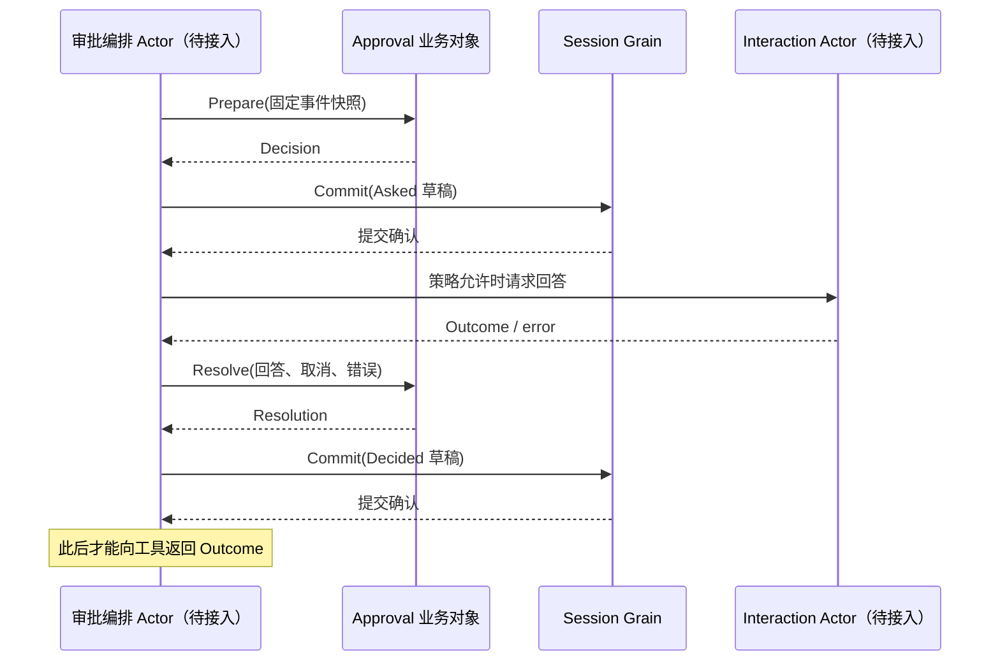

# Approval

本包拥有审批策略和审计草稿规则。Session Context 已退出业务契约；同步提交、Agent 注入和等待回答不再由 Service 执行。设计见 [Approval 模块](../zh-CN/actor-design/20-approval-module.md)。Actor 编排尚未完成。

## 对象与模块职责

| 对象 / 文件 | 职责 |
| --- | --- |
| Policy / policy.go | 从事件快照解析有效策略，生成说明文本 |
| Config、ValidatedConfig / types.go | 严格配置解码、验证与独立继承 |
| Service / service.go | 校验请求身份和开放 turn，准备 Decision |
| Decision、Resolution / decision.go | 固定策略和审计 ID，构造 asked/decided 草稿，取消优先且失败拒绝放行 |
| PolicyChange / service_policy.go | 策略变更草稿与提交后才注入的用户通知 |
| Question / Answerer | Interaction 回答请求契约，不携带可变 Agent 或 Session |

Service 不持有 Session、Agent、Answerer 或框架引用。Decision 不记录正在等待的请求，也不保证草稿已经提交。Asked / Decided 是持久化载荷，Question 是非持久化请求，两者通过 RequestID 关联。

## 目标交互流程

ChangePolicy 返回 nil 表示有效策略未变，否则返回草稿与用户通知；编排方必须先提交再注入消息。DelegationPolicyDraft 返回带 delegation 来源的 never 草稿，创建编排负责提交。业务方法本身不修改日志。

## 失败与生命周期

无开放 turn、非法策略或未准备的 Decision 明确拒绝。取消优先于晚到允许，never 策略拒绝交互，非法回答或回答失败归为 unavailable。输入 Question 与输出 Question 的指针字段复制隔离。

最终 decided 审计的不可取消提交、Answerer panic 转换、回答资源清理和关闭等待都属于尚待接入的 Actor 编排，不能以纯业务规则测试声称完成。工具与 API Proxy 的旧同步接口仍需迁移。

## 验证

业务测试覆盖 asked/decided 同 ID、草稿生成无写入、问题数据隔离、取消优先、never 拒绝、错误和非法回答、未准备 Decision 拒绝、开放 turn 约束、策略幂等和 delegation 来源。配置和策略文本测试保留。旧 Service 同步集成测试已删除，其编排语义仍需真实 Actor 测试替代。
