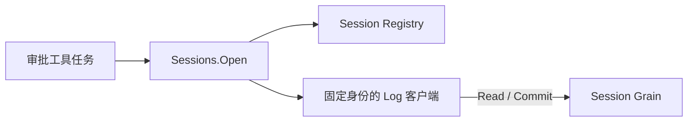

# Approval Session Client

本包仅实现审批工具所需的 Session 消息适配，没有 Approval Grain。设计见 [审批模块](../../zh-CN/actor-design/20-approval-module.md)。

Sessions.Open 先 FindSession，再按固定 CreationID ResolveSession；返回的 Log 客户端在 Snapshot / Commit 中始终使用同一个目标与身份。它只借用 ActorSystem，不拥有 Session，不重新创建或切换失效实例。

查找与读取使用配置超时。审计提交等待实际 Session 回复，用户取消只作用于回答端，不中断审计收尾。业务决定写入内容与幂等规则，适配器只转换消息与回复；错误不转成字符串或审批 Outcome。客户端运行在通用 ToolActor 的异步任务中，不占用 Grain dispatcher。
