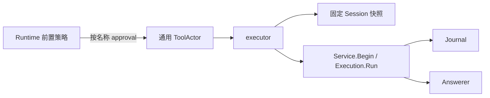

# Approval Tool

本包把审批业务接入通用 ToolActor；根 approval 包不依赖 tools。设计见 [Approval](../../zh-CN/actor-design/20-approval-module.md)。

Provider 绑定不可变 Service、Sessions 与 Answerer；Open 创建工具执行与渲染实现，不创建 Actor。Schema 返回名为 approval 的配置，组合入口设置为对模型不可见。Sessions.Open 固定当前调用的 Session，Log 提供快照与 Journal 提交。

工具参数不含 SessionID；执行信封提供身份。执行器不决定策略、审计 ID 或取消结果，只转换参数并调用业务流程。只有 decided 确认后才序列化 Outcome；读取或提交失败返回原 error。借用的客户端由组合根管理生命周期，不通过工具 Close 释放。
