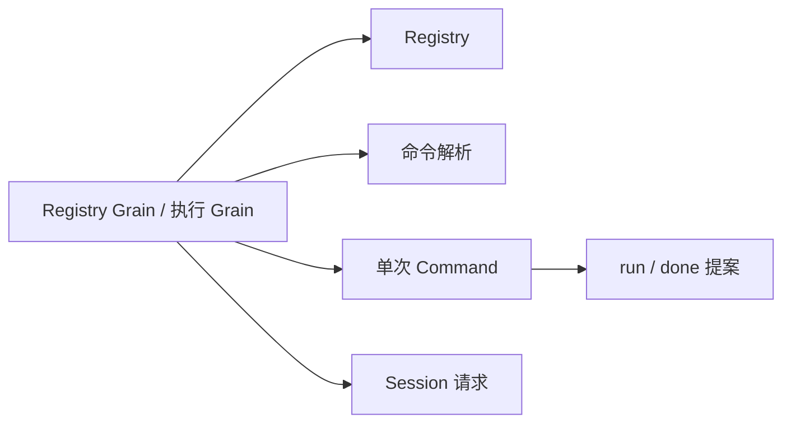

# Commands

迁移中。设计与上下游契约见 [Commands 模块设计](../zh-CN/actor-design/37-commands-module.md)。

当前业务职责：

| 对象/文件 | 职责 |
| --- | --- |
| Registry | 单层命令定义注册、查找、排序列表及确切身份撤销 |
| Catalog | 全局定义与 Session 覆盖的实时继承；调用方负责串行访问 |
| Registration | 分离的定义与注册身份，不反向引用 Registry，不持有运行资源 |
| Command | 单次命令准入、唯一结论与 run/done 幂等写计划；无 I/O |
| parser.go | 命令语法与原始参数提取 |
| result.go | 结果形状与 Session 来源事件校验 |
| values.go | 注册定义与结果的分离复制 |
| types.go | 命令描述、调用、结果和既有 run/done 事件字段 |

业务包不依赖 Plugin、Actor，也不持有 Agent 或 Session 实例。
Actor 层已实现 Registry Grain 的能力 Actor 地址注册与查询，以及执行 Grain 的异步调度、取消后的 handler 清理与关闭等待。
运行契约和验证范围见 [Actor README](actor/README.zh-CN.md)。

已删除旧 Plugin、Factory、注册句柄和 CommandRuntime。业务包构建通过；Registry 定向测试验证隔离复制、
重复注册、输入校验和旧身份不能误删新定义。纯解析、注册、结果及 Command 生命周期测试已迁移；旧 Runtime 测试与 Agent/Session 夹具已删除。
handler 调度与取消清理已有 Actor 测试；panic containment、Compaction 命令路径 和生产启动/关闭接线尚未验收。
