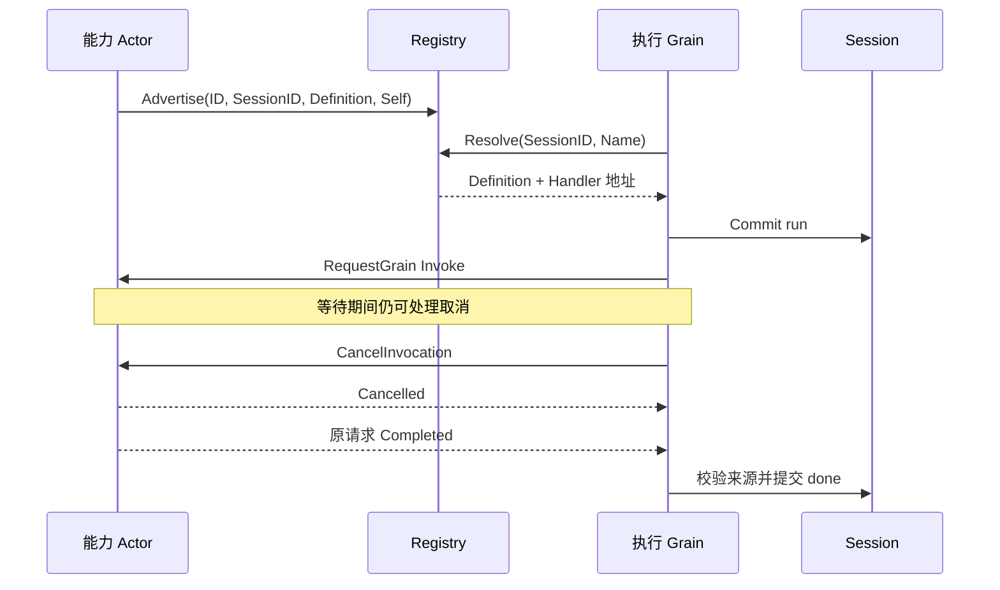

# Commands Actor

本包负责命令注册与执行调度。设计见 [Commands](../../zh-CN/actor-design/37-commands-module.md)。

Registry 是名称为 commands 的全局 LongLived Grain，合并全局定义与 Session 覆盖。
Register 发布配置定义与地址；Advertise 发布 Session 实例地址，保持全局元数据继承。
发送方使用固定发布 ID 重试；相同内容返回相同确认，撤销后拒绝迟到重试。
执行 Grain 按 Session 绑定 Registry 与 Session；commands.Command 拥有准入、唯一结论及事件提案。

| 文件 | 职责 |
| --- | --- |
| registry.go | 定义与地址的注册、解析、撤销 |
| client.go | 非 Actor 调用方的当前创建绑定、目录读取、命令执行与取消投递 |
| grain_directory.go | 校验创建后异步读取有效目录 |
| grain.go | 请求准入、框架调度和关闭等待 |
| grain_reply.go | 消费依赖结果，提交与确认 run/done |
| grain_cancel.go | 业务取消与 CancelInvocation 投递 |

正常调用只有一次请求与最终回复。取消可先提交 done 并回复用户；能力未结束时仍拒绝 Close。
收到晚到结果只完成清理，不覆盖已确定的命令结论。
Handler 是既有能力 Actor 的地址，没有普通 Handler/Runner 或每命令一个 Actor 的要求。
RequestGrain 的 Then 通过激活期 ScheduleOnce(0) 将后续 Session 调度交给当前邮箱上下文。

注册、取消、事件顺序和回复丢失重试见本包测试；真实 Compaction 注册与执行组合测试位于
[grain_command_test.go](../../compaction/basic/actor/grain_command_test.go)。生产装配尚未接通。

handlers 保存全局/Session 配置地址，instances 保存 Session 能力地址。
解析地址依次选择 Session 配置、Session 实例、全局配置；元数据由 Catalog 独立处理继承。

`Client` 只接收已初始化的 Commands 执行 Grain。ListCommands 通过该 Grain 校验当前创建后读取 Registry；客户端不绕过身份检查。Execute 使用调用方 Context 作为等待期限，取消后独立投递 Cancel。真实客户端测试覆盖旧创建拒绝、短查询超时不截断执行、取消传播、关闭等待与唯一 run/done 事实；生产 Resolver 仍待接线。

## 生命周期与服务地址

每 Agent Commands Grain 名称为 `<sessionID>.commands`，Initialize 显式携带 SessionID；消息文件定义 RuntimeName。Agent Registry 负责其启动和关闭，Commands 不依赖 AgentLoop；关闭确认仍等待已接收命令及其最终 Session 写入结束。
