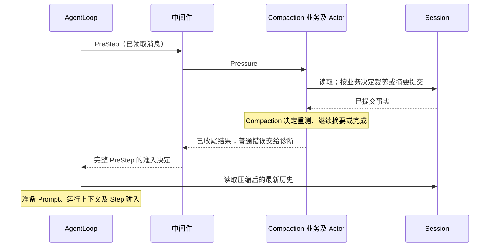
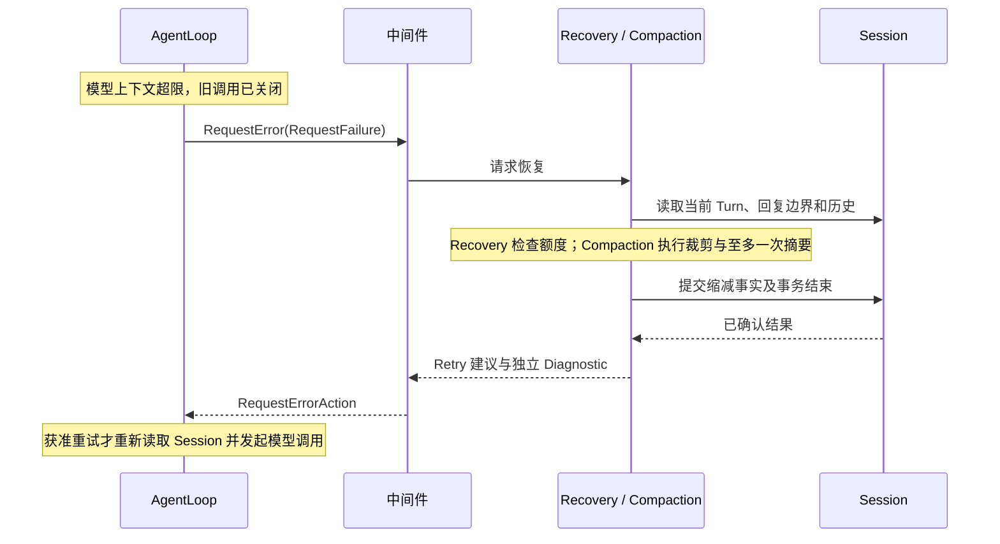
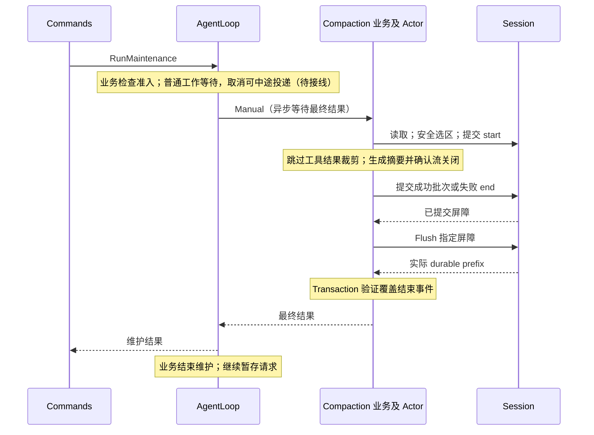
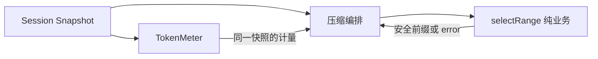
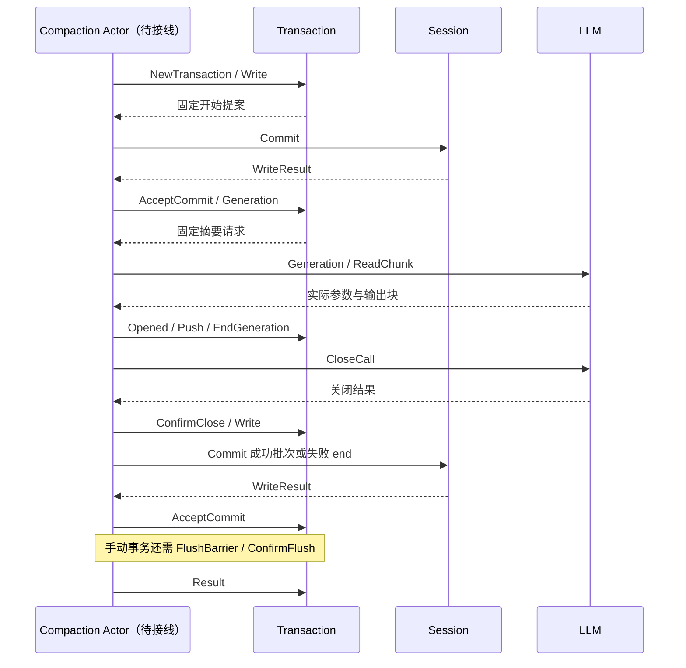
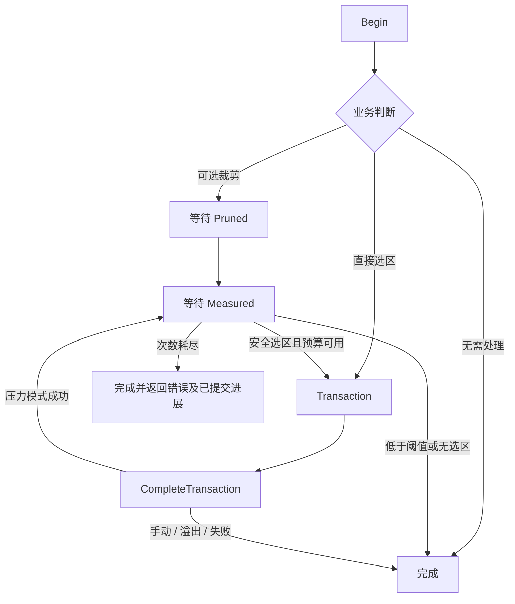

# Basic Compaction

状态：纯业务流程已迁移；Compaction Grain 已有实现及手动成功/持久化失败的真实 Grain 测试，PreStep/RequestError 模块调用已接通并有协调器测试，自动中间件中途取消已接通，AgentLoop 手动维护入口和生产装配尚未接通。下述与 Agent 的交互是目标流程，不是已运行的调用链。

当前迁移设计见 [Compaction 模块](../../zh-CN/actor-design/31-compaction-module.md)，整体进度见 [Actor 实施计划](../../zh-CN/actor-design/12-implementation-plan.md)。

## 与 Agent 的交互

AgentLoop 拥有执行准入、Turn/Step 和维护占用；Compaction 业务对象决定如何缩减历史、是否建议重试、何时满足完成条件。两侧 Actor 只负责请求、关联和调度。Compaction 不持有 Agent 对象，不回调或主动驱动 AgentLoop。

| 入口 | AgentLoop 发起位置 | Compaction 返回后由谁继续 |
|---|---|---|
| 自动压力 | 已领取输入，完整 PreStep 中间件链中，尚未准备 Step 输入 | 中间件继续原链；AgentLoop 随后读取最新 Session 并组装输入 |
| 溢出恢复 | 原模型调用已失败并关闭，进入 RequestError 中间件 | Recovery 给出建议；只有原 AgentLoop 决定并启动下一次模型请求 |
| 手动压缩 | Commands 请求 RunMaintenance，AgentLoop 业务状态机准入后 | 收尾与必要 Flush 返回成功或明确失败后，AgentLoop 结束维护并恢复暂存请求 |

### 自动压力：先完成钩子，再准备输入

无路由、禁用自动压缩或低于阈值时，业务返回无操作。普通且已收尾的压缩失败可报告后继续钩子；流关闭或事务尚未确认时不能继续下一次生成。Compaction 不向 Agent 提供完整对话或 Prompt。

### 溢出恢复：返回建议，不直接重启模型

无实际进展或未接管时继续下游恢复链。裁剪已有进展而摘要失败，只要已经收尾，仍可建议重试；取消优先。重试次数及重置由 Recovery 管理，不放进 Actor，也不由 Compaction 直接调用 Agent。

### 手动维护：AgentLoop 保持独占直到收尾

无安全选区时无需创建摘要事务或 Flush。已开始事务即使摘要失败，提交失败 end 后也需 Flush。手动跳过工具结果裁剪沿用原 TypeScript/Go 行为，不是 Actor 适配新增的要求。

维护外层采用异步请求等待结果，不建业务队列。取消必须可中途投递，原完整 StashNonReentrant 草案不再适用，手动维护入口尚待实现。关闭、结束提交未确认或 Flush 结果未知时不能回复最终结果；Flush 明确失败则以业务错误结束维护。关键业务结果通过 Session 的 start、摘要、SurfaceReplace 和 end 事件提交并通知订阅方，不提前回复维护请求。end 事件表示压缩事务已结束，手动维护仍须等待 Flush 成功或明确失败；只有最终 Result 才解除这次请求造成的暂停。Actor 不自行创建业务事件，事件草稿和提交结果解释由业务对象负责。详细契约、异常路径和待验收项见 [设计文档](../../zh-CN/actor-design/31-compaction-module.md)。

## 选区与计量

已迁移的 selection.go 只负责安全历史选区，输入为同一 Session Snapshot、对应 TokenMeter Measurement 和保留预算。它校验版本及节点顺序、价格和工具配对，不读取 Session、不调用 TokenMeter、不重试 I/O。旧 readSurface 同步补偿已删除；Plugin/automation 已删除，生产业务包可构建，业务整包测试已通过，Actor 接线仍待完成。

选区没有生命周期资源或后台任务；错误由执行 owner 处理，不在算法内重新取数。selection_test.go 的定向文件测试覆盖选区行为，不能证明整包或生产压缩完成。

## 主流程与内部组件

basic 当前承载 Compaction 主业务流程，不是工具算法集合。Compaction 应拥有三种入口的推进决策；选区函数和 Summarizer 是它内部使用的纯业务组件，没有独立 Actor 或资源生命周期。

Summarizer.Request 根据策略与 Session 事实准备摘要输入，Push 消费已投递的模型块，Result 返回安全文本、原始内容和用量。baseline.go 固定摘要使用的区域和原始 Surface；replacement.go 以已完成摘要和实际模型参数准备 checkpoint，并要求包装后的估算严格小于原区域。两者均不执行 I/O。同步 LlmRuntime 及 bind/release 已从该组件移除。实际模型参数来自 LLM 生成结果，关闭确认与事务终结属于完整执行流程。

定向测试覆盖截断、Provider 错误、取消、图片、仅推理内容、空文本、路由覆盖和返回值隔离。包装后摘要必须缩小历史的既有约束由 replacement_test.go 和 transaction_failure_test.go 覆盖，后者还验证失败结束不会替换 Surface。

transactionStart 与 transactionEnd 使用 Session.IdempotentWrite 确认原开始/失败结束事件。相同提案返回原提交，不重复追加；同一事务的不同来源、Turn 或结束原因报冲突。定向真实 Session 测试已覆盖开始、事务锁、失败结束重放及结束后重放开始不会重新加锁。transactionCompletion 同批提交 summary、replacement 与 end，并精确重放原三事件结果。不能把结束确认当作资源关闭或持久化完成。

## 事务职责与交互

| 对象 | 职责与依赖 |
|---|---|
| Compaction | 根据模式、压力与已提交进展管理裁剪、重新计量和摘要次数；只持有当前 Transaction，不请求外部组件 |
| Transaction | 管理一次已选范围的事务阶段，依赖纯 Summarizer、基线、估算接口与幂等提案；不持有 Actor 地址或 Session 实例 |
| transactionStart | 在 Session 提交点验证事务准入，确认相同开始事件 |
| transactionCompletion | 再验证选区，原子提交成功三事件批次，校验重放结果 |
| transactionEnd | 提交固定失败原因，校验已存在结束事实 |
| Summarizer | 固定请求输入与策略，组装并验证摘要内容 |

Stage 是事务推进的唯一来源。关闭失败保留 SummaryClosing，失败结束提交被拒绝保留 CommitPending，Flush 结果未知保留 FlushPending；这些阶段不能取最终结果。明确 Flush 失败则结束事务，返回 persistence，或保留此前压缩错误；不再等待下一次 Flush 成功。未知提交结果重发原 Write，不调用仅用于确定拒绝的 rejectWrite。普通错误保持 error，只有持久化失败 end 将诊断固定为文本。

旧 regionCompactor 同步执行文件已删除；Plugin/automation 已删除；旧同步接口测试与夹具已替换，Actor 接线仍待完成。transaction_test.go 使用真实 Session 日志验证开始确认、禁止重复生成、关闭与 Flush 屏障、失败 end 和原始错误保留。Basic 整包 race 测试、vet 和 build 通过，不代表 Actor 接线或整个压缩模块已完成。

## 触发流程

Begin 接受 Invocation 的同一 Snapshot/Measurement 与模式。压力模式仅超过阈值时进入可选裁剪，随后必须重新计量；溢出模式不依赖容量，最多执行一次摘要；手动模式跳过裁剪并通过 Transaction 等待 Flush。自动模式必须已有持久化模型路由，备用模型只用于摘要输入解析。

compaction_flow_test.go 验证手动不裁剪、禁止重入、事务与 Flush 屏障、压力阈值及裁剪后计量、混合版本拒绝、自动路由要求、溢出不要求容量，以及实际事务循环达到次数上限后停止。中间件模块调用已接通，生产注册仍未接线，溢出恢复预算由下述 Recovery 实现；不能据此声称 AgentLoop 已接入压缩。

## 恢复与配置

Recovery 每 Agent 独立，消费 RequestFailure 和 Session Snapshot。只在已确认缩减历史时批准并计数重试；新 Turn 或新 AssistantMessage 提交重置预算，取消优先且不消耗次数。Complete 拒绝未完成 Compaction；摘要失败但此前已裁剪成功时，可同时返回 Retry 与用于报告的 Diagnostic。业务对象不持有 Agent/Session 引用或框架状态。

DecodeConfig 保留未知字段、重复字段及策略约束的严格校验，返回 ResolvedConfig。Plugin、Factory、RuntimeOptions 和观察回调已删除，装配者直接构造普通业务对象。

recovery_test.go 覆盖额度耗尽、无进展、取消、Turn/回复重置与旧快照；config_decode_test.go 迁移原 Factory 的配置验证用例。`go test -race -count=1 ./compaction/basic`、`go vet ./compaction/basic` 和 `go build ./compaction/basic` 通过；Actor 接线仍待完成。

Diagnostics 只保存本 Agent 已报告过的容量配置目标，返回应报告的 error，不持有回调，也不决定钩子是否继续。diagnostics_test.go 验证同目标去重、不同目标和普通错误不被抑制。transaction_replay_test.go 验证 system/tools、实际模型参数、用量、原始推理输出、来源引用与 checkpoint 日志重放。

重新计量的明确业务失败通过 Compaction.RejectMeasurement 结束当前调用，并保留此前已提交的 Outcome；该入口仅在 MeasurementPending 有效，不能跳过摘要事务、关闭或 Flush。请求超时等未知交付结果不能伪装成明确计量拒绝。

DSH 最新对照已确认正常顺序为 end → Flush → 维护返回；这不是新增事件协议。Go 业务层已对齐 Flush 明确失败即结束调用：单独持久化失败返回 persistence，此前压缩错误优先，保留已提交事件。生产维护接线仍待完成。见 [最新 DSH 对照](../../zh-CN/actor-design/31-compaction-module.md#93-最新-dsh-对照结束事件flush-与维护返回)。
