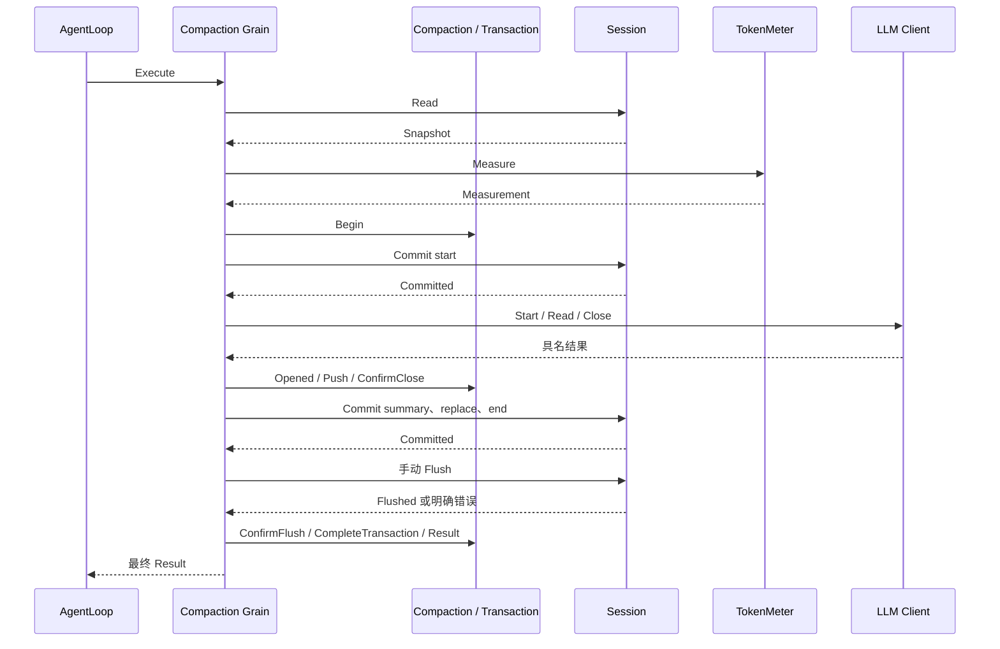
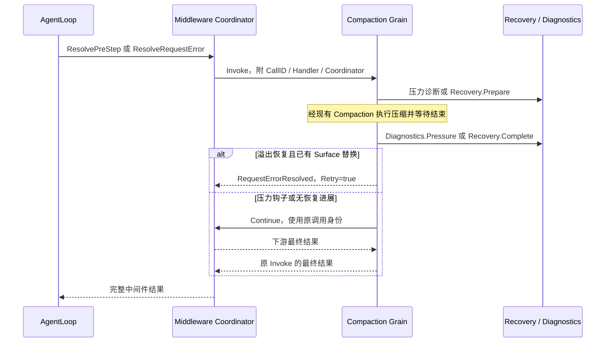

# Compaction Actor

Grain 编排一个 Agent 的 Compaction 业务对象。Initialize 绑定 Session、TokenMeter 和现有 LLM Router，启用异步 RequestGrain；不创建这些上游资源。业务流程、接口与阶段见 [模块设计](../../../zh-CN/actor-design/31-compaction-module.md)。

| 对象 / 文件 | 职责 |
|---|---|
| Grain / grain.go | 初始化、调用准入、最终回复与关闭绑定 |
| grain_session.go | 读取、计量、提交、Flush 的异步投递，按业务 Stage 调度 |
| grain_model.go | 使用 LLM Client 生成、读取、关闭，把具名结果交给 Transaction |
| Compaction / Transaction | 决定阈值、选区、错误优先级和业务完成条件 |

Session 发布已提交的关键业务事件，Compaction 不另建事件发布路径。传输失败保留原请求参数；明确 Commit/Flush 结果由业务对象解释。LLM Client 管理通信关联及超时，Compaction 不复制该状态；关闭失败仍调度关闭同一 Call。正常 Close 只接受空闲绑定。框架强制停用只报告投递失败，不宣称远端资源已关闭。

grain_test.go 使用真实 GoAkt Grain、真实 TokenMeter 和 Session Log，LLM 与 Flush 回复由测试控制，覆盖成功和持久化失败的完整手动事务。生产中间件注册/维护接线、事件发布与目标异常恢复尚未完成；此处测试不代表生产调用链验收。

## Agent 中间件交互

Grain 也可作为中间件 Route.Target，直接消费 InvokePreStep 和 InvokeRequestError；不创建第二个压缩实例。grain_hooks.go 只适配中间件 Invocation 与 Continue 消息，Recovery 拥有溢出重试预算和进展判定，Diagnostics 拥有压力告警抑制。

压缩准入失败时 Recovery.Reject 释放本次恢复准入，不能消费上一次压缩结果。原模型错误不会被普通压缩错误覆盖；有进展但摘要失败仍可建议重试，细节由 Recovery 决定。Continue 不设外层超时，不把“下游仍在运行”解释成当前钩子已经结束。

grain_hooks_test.go 覆盖 PreStep 无路由继续、元数据超时后继续、非溢出错误不启动压缩、真实 Surface 替换后才返回 Retry。CancelInvocation 与模型取消已接通并通过 grain_cancel_test.go；中间件配置注册、AgentLoop 手动维护及生产装配尚未完成，这些测试不代表全量自动压缩验收。

## 中途取消

CancelInvocation 必须匹配活动钩子的 CallID 和 Handler。收到后立即向同一 LLM Call 投递 Cancel，并把原因交给 Compaction；不会等摘要自然生成结束，也不会在取消后继续读取摘要或提交新的摘要替换。取消的 Completion 仅确认请求已接受，原 Invoke 在模型关闭和失败 end 提交后结束。首个取消原因保留，重复取消不重复投递，迟到取消不影响其他调用。

正在等待提交时保留原幂等提案，已提交的摘要/Surface 不回滚；必要 Flush 的明确结果仍须消费，取消错误优先。手动维护入口还未接线，不能把自动中间件的这条测试链描述为所有产品入口已支持取消。
