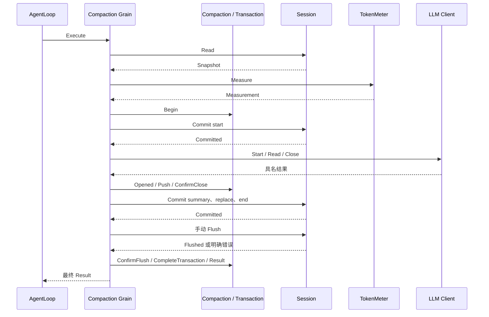
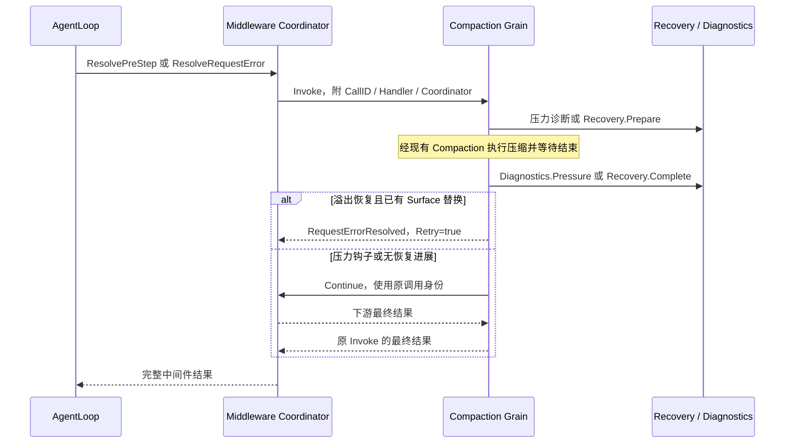

# Compaction Actor

Grain 编排一个 Agent 的 Compaction 业务对象。Initialize 绑定 Session、TokenMeter 和现有 LLM Router，启用异步 RequestGrain；不创建这些上游资源。业务流程、接口与阶段见 [模块设计](../../../zh-CN/actor-design/31-compaction-module.md)。

| 对象 / 文件 | 职责 |
|---|---|
| Grain / grain.go | 初始化、调用准入、最终回复与关闭绑定 |
| grain_session.go | 读取、计量、提交、Flush 的异步投递，按业务 Stage 调度 |
| grain_model.go | 使用 LLM Client 生成、读取、关闭，把具名结果交给 Transaction |
| Compaction / Transaction | 决定阈值、选区、错误优先级和业务完成条件 |

Session 发布已提交的关键业务事件，Compaction 不另建事件发布路径。传输失败保留原请求参数；明确 Commit/Flush 结果由业务对象解释。LLM Client 管理通信关联及超时，Compaction 不复制该状态；关闭失败仍调度关闭同一 Call。正常 Close 只接受空闲绑定。框架强制停用只报告投递失败，不宣称远端资源已关闭。

grain_test.go 使用真实 GoAkt Grain、真实 TokenMeter 和 Session Log，LLM 与 Flush 回复由测试控制，覆盖成功和持久化失败的完整手动事务。生产中间件注册/维护接线、事件发布与目标异常恢复尚未完成；此处测试不代表生产调用链验收。

## Agent 中间件交互

Grain 也可作为中间件 Route.Target，直接消费 InvokePreStep 和 InvokeRequestError；不创建第二个压缩实例。grain_hooks.go 只适配中间件 Invocation 与 Continue 消息，Recovery 拥有溢出重试预算和进展判定，Diagnostics 拥有压力告警抑制。

压缩准入失败时 Recovery.Reject 释放本次恢复准入，不能消费上一次压缩结果。原模型错误不会被普通压缩错误覆盖；有进展但摘要失败仍可建议重试，细节由 Recovery 决定。Continue 不设外层超时，不把“下游仍在运行”解释成当前钩子已经结束。

grain_hooks_test.go 覆盖 PreStep 无路由继续、元数据超时后继续、非溢出错误不启动压缩、真实 Surface 替换后才返回 Retry。CancelInvocation 与模型取消已接通并通过 grain_cancel_test.go；中间件配置注册、AgentLoop 手动维护及生产装配尚未完成，这些测试不代表全量自动压缩验收。

## 中途取消

CancelInvocation 必须匹配活动钩子的 CallID 和 Handler。收到后立即向同一 LLM Call 投递 Cancel，并把原因交给 Compaction；不会等摘要自然生成结束，也不会在取消后继续读取摘要或提交新的摘要替换。取消的 Completion 仅确认请求已接受，原 Invoke 在模型关闭和失败 end 提交后结束。首个取消原因保留，重复取消不重复投递，迟到取消不影响其他调用。

正在等待提交时保留原幂等提案，已提交的摘要/Surface 不回滚；必要 Flush 的明确结果仍须消费，取消错误优先。手动维护入口还未接线，不能把自动中间件的这条测试链描述为所有产品入口已支持取消。

手动 Execute 现在必须提供唯一 RequestID；Cancel 使用相同 RequestID，Completion 仅确认意图接纳。
迟到的旧 RequestID 不影响当前调用；重复取消保留首个原因。Execute 的 Result 仍等待事务及所需 Flush。
`grain_test.go` 验证 Flush 挂起期间取消不会提前回复，已提交进展保留，最终结果携带取消原因。
这只是 Compaction 执行器的内部协议，`compaction/command` 与 AgentLoop 通用维护接线仍未完成。

OnReceive 将绑定生命周期与调用消息分别交给 grain_receive.go 的 receiveBinding、receiveInvocation；
异步 dependency continuation 和 LLM 协议回复保留在统一入口。前者只配置/关闭空闲绑定，
后者调度手动维护与自动中间件，不能通过取消确认结束原调用。
手动 Execute 提供 Agent 路由，先申请维护，Flush 结束后释放维护，释放确认后才返回最终 Result。
Session/TokenMeter 请求在 PipeToSelf 后台任务中直接 AskGrain，返回 replyReceived。
OnReceive 接收结果后推进业务或安排 retryRequest，重试保持同一请求与提交身份，不嵌套 Then 或等待 channel。
维护握手同样使用后台 Ask；握手超时仅返回投递失败并保留调用，不假定维护释放成功。
Ask 使用 Initialize.Timeout 的正值；GoAkt 的 AskGrain 零超时不表示无限等待。
目标需要延迟回复时必须已启用重入，生产 Session 在初始化中启用；测试替身保持一致。

`grain_test.go` 另覆盖手动流式读取中途取消：模型收到 Cancel，Close 确认前不进入 Flush，
Flush 完成前保持维护占用，最终没有摘要或 Surface 替换。测试使用真实 Compaction Grain 与
LLM 协议替身；AgentLoop 协议单独由 grain_maintenance_test.go 验证，尚非 Commands 生产链路验收。
维护冲突通过 agent.ErrBusy 转换为 ManualErrorBusy，其他准入错误不改变类型。

Session/TokenMeter 调度职责：

| 文件 | 职责 |
| --- | --- |
| grain_session.go | 根据业务阶段发送读取、计量、Commit 或 Flush 请求 |
| grain_request.go | 后台 Ask、replyReceived、retryRequest；重试复用原请求 |
| grain_reply.go | 按请求用途校验回复、接受历史或计量结果、推进调度 |

read/measure 回调包装与 exchange.accept 函数字段已删除。replyPurpose 只标识某次依赖回复应交给哪段调度，
不是可独立推进的业务运行状态。准备历史与裁剪后历史各自进入对应处理，避免闭包隐藏步骤依赖。

## 全局命令注册

grain_command.go 在既有 Compaction Grain 初始化后主动向全局 Commands Registry 发布命令。
装配层启动固定身份 commands，并通过 Initialize.Commands 提供地址；Compaction 不创建或查找 Registry。
立即注册并用框架定时器重试，收到匹配 ID 的 Registered 后取消定时器，忽略已排队的 tick。

Advertise 建立缺省命令定义和 Session 实例地址；Session 继承全局定义，独立配置可以覆盖。
Close 停止重试并撤销当前发布，确认后释放资源；压缩期间拒绝关闭。
没有独立 Compact Actor、普通 Handler/Runner 或能力自身维护的全局路由表。
完整交互与验证范围见 [Commands 设计](../../../zh-CN/actor-design/37-commands-module.md)。
