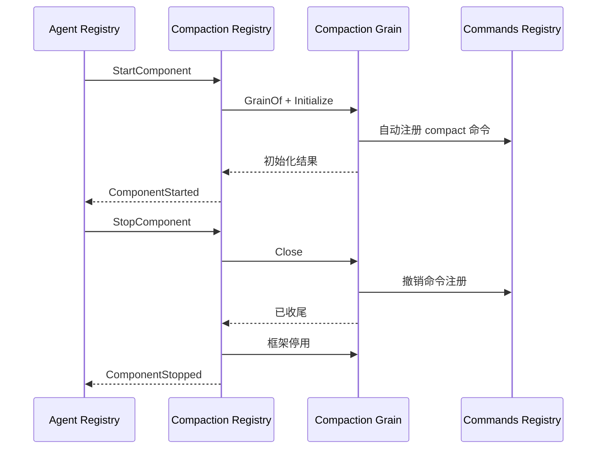

# Compaction Registry

本包管理每 Agent 的 Compaction 实例生命周期，设计见 [Agent 生命周期](../../../zh-CN/actor-design/39-agent-activation.md)，压缩业务见 [Compaction](../../../zh-CN/actor-design/31-compaction-module.md)，进度见 [实施计划](../../../zh-CN/actor-design/12-implementation-plan.md)。

Grain 保存已验证并复制的 Configure，以及以 AgentID 为 key 的实例记录。记录包含 CreationID、Agent/Session 地址、Compaction runtime 地址与启动/关闭进度；不包含业务 Compaction 对象。grain.go 处理配置和启动，grain_close.go 处理关闭、框架停用与重试，messages.go 定义能力配置契约。

Compaction 同时提供 PreStep、RequestError 和 compact 命令，不随模型工具集合卸载。Agent Registry 负责跨组件顺序和 Session 最终关闭，本包只启动和关闭自己的实例。Configure 不允许活跃期隐式替换策略；业务普通错误使用 error。

同一创建的重复启动共享结果；关闭中的启动被拒绝。初始化期间关闭等待原请求返回，再执行关闭。Close 返回忙或失败时保留身份，重试继续；已确认业务关闭后框架停用失败，重试不重复业务关闭。成功关闭留下原 CreationID 的幂等结果，旧请求不能关闭替代实例。名称为 `<sessionID>.compaction`，业务身份通过消息字段传递。

[Agent Registry 集成测试](../../../agent/registry/grain_creation_test.go) 使用本包和真实 Compaction/Commands Grain 验证启动、重复请求、命令撤销、关闭与身份复用；不据此宣称模型压缩的真实 provider 调用已执行。
