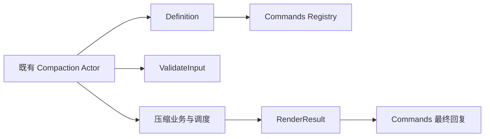

# `/compact` 命令业务适配

本包对应 DSH `packages/compaction/command-compact` 的定义、参数校验和结果文案转换。
设计见 [Commands](../../zh-CN/actor-design/37-commands-module.md) 和 [Compaction](../../zh-CN/actor-design/31-compaction-module.md)。

Definition 返回注册元数据；ValidateInput 保留无参数约束；RenderResult 转换 no-op、摘要和 ManualError。
未知错误原样返回；来源序号与 provider 结果分离复制。
本包没有 Actor、Handler、Runner、Plugin 或生命周期状态。

Compaction Actor 注册自身，处理 Invoke 与 CancelInvocation；Commands 记录 run/done，
Compaction 负责维护、事务和 Flush。本包只提供业务函数，不维护运行地址或请求表。
业务测试覆盖参数、全部手动错误、无历史、成功来源序号及未知错误；
直接注册和执行测试见 [grain_command_test.go](../basic/actor/grain_command_test.go)。
