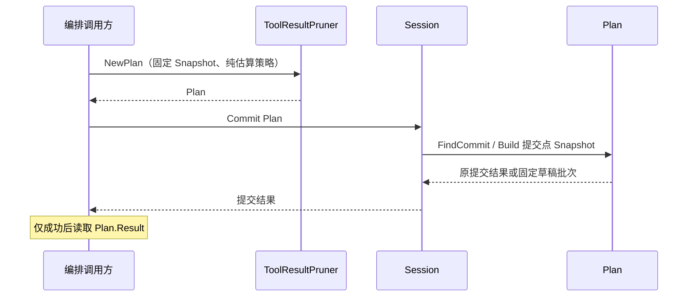

# Tool Result Pruner

本包提供不调用模型的工具结果裁剪业务，设计见 [Compaction 迁移方案](../../zh-CN/actor-design/31-compaction-module.md)，整体进度见 [实施计划](../../zh-CN/actor-design/12-implementation-plan.md)。

## 职责划分

ToolResultPruner 校验字符预算，按 Unicode code point 保留头部、标记和尾部，保持非文本内容块的顺序。Estimator 只提供纯 token 估算，不执行 Session I/O 或 Actor 请求。Plan 实现 Session IdempotentWrite，基于准备时的固定 Snapshot 构造不可变批次。提交点只校验修订与原批次，不重新计价或修改 Result。

每个被裁剪结果对应相邻的 compaction prune 计价事件和 tool/result 替换事件。原始事件不被修改；Surface replacement 指向新的结果，保留重放与计价来源。任一候选计算失败时整批不提交。

Plan.Result 返回分离的结果，不构成 Session 提交确认。调用方必须先验证 Commit 成功。取消或构造失败由 error 返回，不返回部分成功的业务结果。

已删除 Plugin、Factory、Pruner Service、Session 对象入口与动态 bind/release。业务测试覆盖 Unicode、富内容、扩展字段保留、计价及替换顺序、失败不提交和重放。独立 Pruner Grain 候选已删除，统一由 Compaction Actor 调度；其接线仍待完成；本包测试通过不代表生产压缩链可用。

Plan 在原起始位置验证每项草稿、相邻序号和来源引用，重发后返回原批次结果。原位置被其他写入占用、只存在半个批次或内容不符时拒绝；不重新计算成“无变化”。无变化计划没有持久化批次身份。plan_test.go 验证重复确认不重计价、不追加、保留原结果、后续追加不影响原收据，以及冲突/部分批次拒绝。
