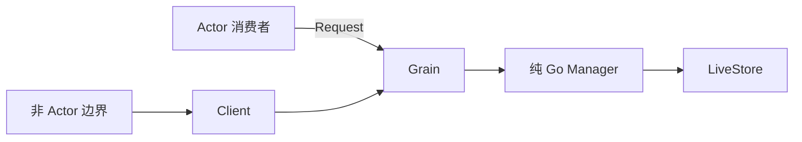

# Credentials Actor 适配

本包把纯 Go Manager 接入 GoAkt。Grain 是简单 get/set Grain，在一次消息处理中完成操作；
顺序和生命周期交给框架，不维护额外队列或关闭状态。业务规则属于根 credentials 包，文件 I/O 属于 LiveStore。

Initialize 由组合根安装 Manager。Resolve/Describe/Set/Unset 使用明确消息及响应，业务 Err 保留 Go error。Resolve 缺失时返回 ErrNotFound，没有额外 Found 标记。
Client 构造后不改变目标；不维护 mutex 或 Bind/Unbind。
Client 只服务现有非 Actor 调用方；Actor 应直接 RequestGrain。调用期限由 context 控制，取消不回滚已发生的文件效果。
正常停止使用框架生命周期，Grain 每次调用没有遗留 task。异常重新激活保持未初始化，需装配恢复。

接口、上下游及测试证据见[模块设计](../../zh-CN/actor-design/15-credentials-module.md)。
旧外部契约见[22 Credentials](../../zh-CN/22-credentials-and-api-key-management.md)，
历史实施记录见[08 实施进度](../../zh-CN/08-implementation-progress.md)；本次迁移不更新历史设计。
