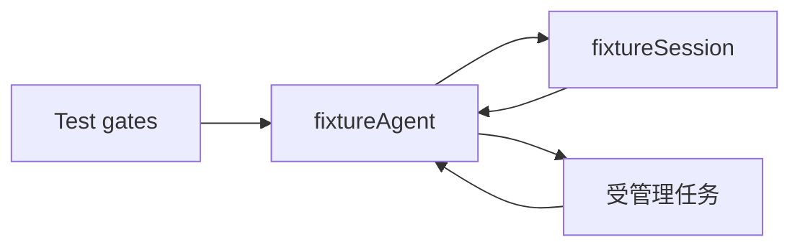

# GoAkt 协议验证实验

固定版本：`github.com/tochemey/goakt/v4 v4.5.3`。独立 Go module，生产模块没有引入此依赖。
目的：验证 [actor 运行时草案](../../zh-CN/actor-runtime-draft.md) 中的异步 Request、取消、提交确认与迟到结果处理方式。

`fixtureAgent` 串行拥有执行状态，`fixtureSession` 拥有内存记录；普通 Go 消息跨 actor 传递，
异步任务通过 PipeTo 回传完成消息。任务错误放入消息字段，避免将业务失败只投递到 dead letters。
fixture 的 channel 仅用于测试精确控制完成顺序或输出测试观测，不能作为生产消息设计。
测试驱动中的 Ask 用于从 actor 外观察状态；新增 Request 实验的 actor 间没有同步 Ask/SendSync。



执行：

```sh
cd experiments/goakt
go test -count=1 -timeout=60s ./...
go test -race -count=1 -timeout=60s ./...
go vet ./...
```

验证用例：

- `TestCancelWhileCommitPendingDoesNotPretendRollback`：提交未确认期间仍能取消，已提交输入保留，被取消的执行不启动。
- `TestCancelJoinsWorkerAndRejectsLateGeneration`：取消到达 worker，未退出前不能开启后继执行，旧 generation 结果不能污染后继日志。
- `TestCommitFailureDoesNotLaunchWorker`：提交失败不启动模型任务，不写入成功记录。
- `TestShutdownCancelsAndJoinsCooperativeWorker`：显式 cancel/join 可以完成 cooperative task 的框架关闭。
- `TestStandalonePubSubFansOutCommittedFacts`：standalone WithPubSub 模式，两个确认订阅的 actor 都收到提交后事实，提交前不发布。

限制：仅同进程 actor + 内存 fixture；没有接入生产 Agent/Session、SQLite、客户端协议、真实 LLM 或 MCP。
fixtureSession 遇到并发 write 会拒绝，不是生产所需完整 FIFO；测试中的 generation 也不覆盖 actor 重建后的 incarnation。
未覆盖 mailbox overflow、PubSub 订阅释放竞争与重放、持久化 flush、提交结果未知后的恢复、完整 Turn/Step 事件、监督重启与业务父子关闭。
PostStop 测试只证明合作任务可取消并 join，不证明框架能强制终止忽略取消的 I/O。
根目录 `go test ./...` 不包含本模块，必须单独运行。

## Request 契约验证与阻塞项

新增 [request_test.go](./request_test.go)，固定 v4.5.3，使用真实 ActorSystem 与 AllowAll Reentrancy。

| 用例 | 验证内容与结果含义 |
| --- | --- |
| TestRequestImmediateResponseAndContinuation | 同一次 Receive 中 Response 能完成 Request，Then 更新调用方状态且只触发一次 |
| TestRequestCancelKeepsBothMailboxesResponsiveAndDoesNotCancelWork | 请求待完成时双方仍响应探测；RequestCall.Cancel 结束请求但不取消目标业务；独立取消 Request 只确认取消接纳 |
| TestRequestTimeoutCanQueryFinalStateWithoutReexecuting | 请求超时后操作仍能完成；新 Request 能查询结果，不重新执行操作，旧完成不再次触发原 Then |
| TestRequestCompletionInNewReceiveDoesNotReplyToOriginalCall | 限制复现：完成消息的 Response 不关联原 Request，原调用最终超时 |
| TestRequestNestedContinuationCannotReplyUsingFreshReceive | 限制复现：Runtime 的下游 Request/Then 已完成，但新 Receive 的 Response 无法回复上游 Agent，外层 Request 超时 |

后两项断言的是已观测到的限制，测试 PASS **不代表目标链路通过验收**。没有保存失效的 ReceiveContext，
没有导入 GoAkt internal 包或修改依赖来绕过问题。requestTarget 仅保留一次操作状态，用控制消息模拟任务完成，
不是完整 ToolActor、工具更新事务或持久化实现。

固定版本源码中，ReceiveContext 只允许在当前 Receive 内使用；Response 依赖该消息的请求元数据。
没有找到普通 Actor 的公开延迟回复句柄，DeferResponse 仅由 GrainContext 提供。
来源：[ReceiveContext 生命周期与 Response](https://github.com/Tochemey/goakt/blob/v4.5.3/actor/receive_context.go)、
[GrainContext.DeferResponse](https://github.com/Tochemey/goakt/blob/v4.5.3/actor/grain_context.go)。
这意味着原定“每层 Request 的结果直接代表异步业务最终完成”尚不能按已选公开 API 落地。
保留异步 Request 方向，将普通 Actor 的延迟回复机制列为设计阻塞项；不自动改成同步等待、Grain 或两次 Tell。

| 原定验收 | 本轮状态 |
| --- | --- |
| Agent → Tool Runtime → ToolActor 的最终结果返回 | 未通过；下游完成后回复上游的机制存在缺口 |
| A → 工具更新 → B 的完整业务屏障 | 未验证；依赖上项回复机制，原五项实验不覆盖此队列 |
| 取消与超时、最终状态查询 | 基础框架语义已验证；真实任务退出、资源收尾与状态保留策略仍待完整链路验证 |
| Session pending commit、flush 与 Agent/Session 关闭顺序 | 新 Request 协议未验证；旧实验仅有内存提交与 cooperative worker 关闭，不证明 flush 或完整关闭链路 |

## 本轮验证记录

2026-09-07，Go 1.26.6，darwin/arm64，GoAkt v4.5.3：

- `go test -count=1 -timeout=60s ./...`：十个顶层用例通过，非缓存结果；其中两项是限制复现。
- `go test -race -count=1 -timeout=60s ./...`：十个顶层用例通过，未报告 data race；不等于目标链路验收通过。
- `go vet ./...`：通过。
- 相对 Markdown 链接与新增文件 whitespace 检查：通过。

Request 的基础异步行为可用，但普通 Actor 延迟回复机制需先解决，再继续目标链路验证。生产迁移与完整生命周期验收未通过。

## Grain 验证记录

2026-09-07，新增 [grain_test.go](./grain_test.go)，使用 GrainOf、WithLongLivedGrain、
WithGrainReentrancy(AllowAll)、RequestGrain 和 DeferResponse；未修改框架依赖。

- TestGrainDeferredRequestChain：三层 Grain 分别模拟 Agent、Tool Runtime、ToolActor；末端完成前各层仍响应查询。成功结果经过两层处理返回，失败沿请求链返回，重复回复不重复结算。
- TestGrainCancellationAndLateReply：调用方取消 Request 不停止目标业务；独立业务取消只确认接纳；完成后可查询最终状态，迟到 GrainReply 不再次触发旧回调。
- TestGrainPoisonPillRequestAndExplicitDeactivation：Request 包装的 PoisonPill 未触发停用并超时；TellGrain(PoisonPill) 触发 OnDeactivate。测试驱动依次观察 Agent、Session 停用，并确认目录移除后旧身份仍能激活新实例，原内存状态没有自动恢复。

首次 Grain 关闭测试曾假设 PoisonPill 能作为 Request 获得停用确认，该测试失败；现保留为明确的限制复现。
停用顺序由外部测试驱动和观测 channel 控制，不能算生产 Registry 关闭协调已通过。
末端完成使用测试消息模拟，没有真实工具 I/O、任务 join、Session FIFO/flush、更新屏障、父子关闭、
多 Agent 权限隔离或自动恢复实验。不同 Grain 类型共享同一业务 ID 的映射也尚未验证。

本轮完整独立模块：13 个顶层测试（Grain 链路另含成功/失败子用例）；普通测试、race、vet 通过。
Grain 已解决本实验的跨消息延迟回复问题，无需普通 Actor 回复补丁。但完整迁移仍需业务 Close/Quiesced、
最终停用确认、旧身份再激活防护及前述生命周期验收，不能直接宣布 Grain 架构全面通过。

## PipeToSelf、业务关闭、代际与 flush 验证

2026-09-07，新增六个顶层测试，完整独立模块共 19 个顶层测试。普通测试、race、vet 通过。

| 文件 / 测试 | 实际证据 |
| --- | --- |
| [pipe_grain_test.go](./pipe_grain_test.go)：TestPipeToSelfReadsFileAndReturnsIOFailure | 使用临时文件和 os.ReadFile；内容正确返回，文件不存在作为带错误的完成消息返回 |
| TestPipeToSelfCancelAndCloseWaitForTaskCompletion | Gate 模拟尚不能退出的任务；取消可达但不会提前结算；Close 拒绝新操作，等完成消息处理后才回复 Quiesced |
| [lifecycle_grain_test.go](./lifecycle_grain_test.go)：TestBusinessUpdateBarrierAndCloseAfterSessionFlush | A、更新、B 按接纳顺序排队；A 写入后进入更新屏障，屏障放行后 B 使用 v2；关闭排空既有队列，等实际文件 Sync 后确认，Session 不能在 flush 前关闭 |
| TestSessionFlushFailureRetainsCloseAndCanRetry | 关闭文件句柄后调用 Sync 产生真实错误；Committed 保留、Flushed 不推进、接纳仍关闭；重试成功且不重复追加日志 |
| TestSessionFIFOFlushBarrier | 暂停第一项写入，将第二项写入及 flush 排队；磁盘文件顺序正确，barrier=2 的 flush 在前两项完成后返回 |
| [grain_epoch_test.go](./grain_epoch_test.go)：TestRetiredIdentityReactivationCannotExecuteOldGeneration | Registry 保留当前 epoch/active；旧 Grain 已从活动目录移除后，以旧身份发送命令触发再激活但被拒绝；启用新代后旧命令仍被拒绝，新代只执行一次 |

Agent 和 Session 的 fixture 使用不同 Grain 类型及同一个名称 session-42，验证框架身份互不冲突。

本轮定位并处理的框架约束：

- 本地 ActorSystem.TellGrain 的实现会等待目标处理确认。在 Then 中 TellGrain 给自己会等待自己的消息处理，导致超时；不能按名称推断其不阻塞。
- 需要重新进入 OnReceive 的 continuation，实验在原 OnReceive 启动 PipeToSelf 等待一个容量为 1 的结果 channel；Then 只投递一次结果，task 将它送回 mailbox。Actor 不等待 channel，不保存旧 GrainContext。直接在 Then 内完成状态更新及 GrainReply 回复不需要这个桥接。
- 消费 PipeToSelf 的单向完成消息后，fixture 显式 NoErr 完成处理确认。
- 首次 GrainOf 配置的 Reentrancy 在本实验的自动再激活路径没有保留；GuardedGrain 在处理请求前通过 EnableReentrancy 恢复 AllowAll，之后才能异步询问 Registry。

验证边界：

- 工具更新 Gate 代表“准备、发布及退役完成”的边界，验证的是 Agent 的业务顺序，不是完整 Tools Registry 原子发布、多工具交换或旧工具资源释放实现。
- 旧身份防护仅覆盖本进程内 Registry 存活、先停用再重新激活的路径。未覆盖 Registry 崩溃恢复、校验与退休并发、已授权未执行操作的排空、迟到更新/完成消息及多节点。实际效果处仍须执行权限检查。
- Session 使用串行真实文件追加及 Sync；没有 SQLite、进程崩溃/断电恢复、目录 fsync、生产事件 schema 或未知提交结果恢复。Sync 成功只证明本测试调用成功，不证明全部平台的断电持久性。
- Close 的通过项是业务 Quiesced 与 flush 屏障；最终框架停用确认、同 ID 关闭/重建竞争、父子 child-first 仍未完成端到端验证。
- FileGrain 的 Gate 并不使 os.ReadFile 本身可取消；取消后仍读取完成，再报告取消事实。没有声称强制终止 goroutine。

本轮未修改生产代码、依赖版本、AGENTS.md 或历史设计文档。上述实验支持继续实现 Grain 业务协议，
不作为完整生产迁移完成的声明。

## P1 局部接续与 error 契约（2026-09-07）

本批先形成[设计文档](../../zh-CN/actor-design/14-continuation-design.md)，再新增：

- [continuation_grain_test.go](./continuation_grain_test.go)：4 项顶层测试，含多阶段接续、错误/超时、取消/排空、旧完成拒绝及重新激活后请求。
- [deactivation_grain_test.go](./deactivation_grain_test.go)：1 项顶层测试，停用 hook 成功/失败的返回时机。
- [error_reply_grain_test.go](./error_reply_grain_test.go)：1 项顶层测试，对照进程内业务 Err error 与框架错误 envelope 的类型保真。

合计 25 项顶层测试。普通测试 `go test -count=1 -timeout=60s ./...`、race 版本及 `go vet ./...` 均通过。
仍为实验模块；未迁入生产，未证明 Registry 故障恢复及停用/新授权并发安全。当前重构规则已更新 AGENTS.md，
此前章节中的“本轮”指各自历史实验批次。根模块已重新检查，既有 5 处命名失败见[迁移基线](../../zh-CN/actor-design/13-migration-baseline.md)。
