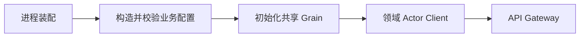

# 生产 Server

本包是 Actor 生产组合根，替换 internal/assembly 的 Plugin Catalog 与树装配。设计、接口与待完成验收见 [Server 装配方案](../../zh-CN/actor-design/41-server-composition.md)，进度见 [项目记录](../../zh-CN/08-implementation-progress.md) 和 [集成问题](../../zh-CN/actor-design/40-integration-findings.md)。

当前已迁入 Credentials、LLM 配置和 Prompt 初始化代码；这些函数创建业务 owner，交给已启动的 Grain，再返回领域客户端。它们不启动独立 ActorSystem、不开放 HTTP，也不提供兼容 assembly 的公开转发函数。其他共享资源、API 装配和进程 Start/Close 仍在实现，不能把本包局部测试视为生产启动成功。

资源顺序由本包统一管理；业务配置验证由各领域 owner 执行，错误保持 error 类型。模型配置初始化与 provider/worker 初始化分开，成功初始化配置不代表 provider 已可调用。关闭必须等待 Agent/组件及 Session flush，不能直接停止 ActorSystem 代替业务关闭。
