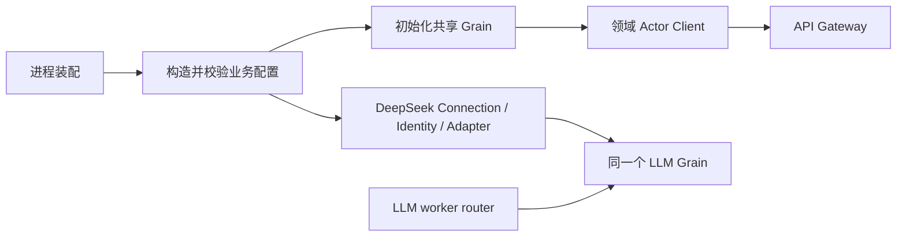

# 生产 Server

MCP 基本接入由 Web「MCP 服务器」、`Config.MCP` 或 CLI `-mcp-server` 启用；连接、动态目录和工具问答流程见
[MCP 模块](../../mcpclient/README.zh-CN.md)与 [Actor MCP 设计](../../zh-CN/actor-design/42-mcp-client.md)。
Server 先完成启动配置的 MCP 订阅与发现，再开放 HTTP；Web 连接由同一 Manager 动态管理。
目录变化按整个来源更新，已运行 Turn 延续现有工具快照。
关闭先停止目录刷新，随后排空 Agent，再释放 MCP 连接。没有自动重连策略。

本包是 Actor 生产组合根，替换 internal/assembly 的 Plugin Catalog 与树装配。设计、接口与待完成验收见 [Server 装配方案](../../zh-CN/actor-design/41-server-composition.md)，进度见 [项目记录](../../zh-CN/08-implementation-progress.md) 和 [集成问题](../../zh-CN/actor-design/40-integration-findings.md)。

真实配置 owner 的 Agent 创建验收已通过：Session 可用后由 Tools Runtime 准备实例并发布定义，再初始化 Prompt。agent_creation_test.go 使用真实 Registry、SQLite 和 ToolActor，覆盖空工具、非空工具、初始化失败清理、实现执行以及取消后等待退出；完整对话与内置工具另由下述 HTTP 测试验收。

当前已迁入 Credentials、LLM 配置、DeepSeek Provider 和 Prompt 初始化代码；这些函数创建业务 owner，交给进程中的 Grain，再返回领域客户端或注册 ID。它们不启动独立 ActorSystem、不开放 HTTP，也不提供兼容 assembly 的公开转发函数。Server.Start/Close 已接入共享资源、API 和 HTTP，具体验证范围见下文。

资源顺序由本包统一管理；业务配置验证由各领域 owner 执行，错误保持 error 类型。模型配置初始化与 provider/worker 初始化分开，成功初始化配置不代表 provider 已可调用。关闭必须等待 Agent/组件及 Session flush，不能直接停止 ActorSystem 代替业务关闭。

`llm.go` 负责默认 DeepSeek Adapter 的具体装配和注册，保留注册 ID 与错误同时返回的语义。凭据在调用时解析，初始化不要求密钥或进行网络请求。`llm_test.go` 使用真实 Credentials Actor、LLM Grain、双 worker router 与 DeepSeek Adapter 访问本地 HTTP 流，验证启动后写入凭据、流读取以及调用关闭；不依赖真实远端密钥，也不证明 AgentLoop／Session／API 完整链路已完成。

`agents.go` 的 closeAgents 先停止 Registry 准入，再逐个关闭返回的根创建；子树、组件与 Session flush 沿用 Registry 协议。一个根失败仍尝试其他根，合并返回错误；失败时调用方保留 ActorSystem 和存储，后续重试重新查询剩余根，不维护第二份生命周期表。该函数已接入 Server.Close。

`titles.go` 配置共享 Title 生命周期 Registry 和标题投影；Agent 创建模板通过 Components 引用 Title owner。生产配置集成测试现在通过 API Titles 客户端重命名、Logs/Projections 客户端读取同一标题，随后经 Agent Registry 关闭并从 SQLite 验证标题事件已 flush。配置要求模型标题却缺 Provider 时在创建共享生命周期之前失败。默认模型标题 Provider 的 Actor 接线仍需完成，不能将此项标题集成测试称为完整对话验收。

旧 internal/assembly 已删除。cmd/goren/main.go 通过 New → Start → 等待信号/传输出错 → Close 启动本包；配置解析保留原有参数。被移除旧装配测试的其他业务覆盖缺口仍见装配方案。

`workspaces.go` 在共享 Session Registry 与持久化 Reader 可用后构造 Headers，要求 PubSub，再打开 Workspace SQLite 并启动唯一 Workspace Actor；成功移交存储责任，失败关闭未移交存储。测试使用真实 Session/Workspace 数据库和 Registry，验证在线空 Session 的 CWD 归属、不匹配拒绝、flush 后关闭重开成员及归档恢复。Server 已接入该资源与 API 通知订阅，没有新增进程 Runtime 或第二份业务注册表。

## 当前进程链路

server.go 管理打开数据库、启动 ActorSystem、绑定 HTTP 和依赖顺序关闭；server_api.go 构造共享 owner 和领域客户端，等待 Session / Workspace 订阅确认后才允许监听。Host Description 只持有读取端口，不反向引用 Server。生命周期 mutex 仅串行化外部 Start/Close/Address 调用，业务 Actor 不使用该锁。

Checkpoint SQLite 的 LoadAll 结果配置到现有缓存的生命周期 Registry，API 使用其客户端，冷 Session 的标题和列表元数据经原 Replay/Projection 恢复。Query 请求现在直接刷新来源，API 不需要预先发 Observe。

server_test.go 通过真实 HTTP 创建与重命名 Session、真实 WebSocket 接收 Workspace 通知、关闭监听、重启后读取标题，并验证监听冲突回滚后可以重新启动。CLI 已构建并验证无 API key 启动、host.describe、SIGTERM 退出 0。

server_conversation_test.go 已验证真实 HTTP 流式对话与关闭；server_interaction_test.go 已验证默认 ask_user_question、隐藏 approval、客户端回答/取消/重连与审计持久化。server_tools.go 在 HTTP 准入前一次性安装依赖完整的 Provider，具体实例仍归每 Agent Tool Runtime。QuestionService 直接借用 Interaction Gateway，不增加 UserQuestions Actor。默认工具集包含提问与审批，已连接 MCP 的工具由稳定 ProviderSource 动态提供；不宣称已装配文件系统或 Compaction 工具。其他迁移缺口仍以 Actor 方案为准。
