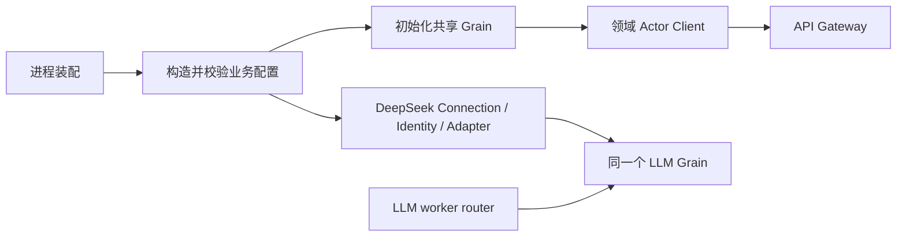

# 生产 Server

本包是 Actor 生产组合根，替换 internal/assembly 的 Plugin Catalog 与树装配。设计、接口与待完成验收见 [Server 装配方案](../../zh-CN/actor-design/41-server-composition.md)，进度见 [项目记录](../../zh-CN/08-implementation-progress.md) 和 [集成问题](../../zh-CN/actor-design/40-integration-findings.md)。

真实配置 owner 的 Agent 创建验收已通过：Session 可用后由 Tools Runtime 准备实例并发布定义，再初始化 Prompt。agent_creation_test.go 使用真实 Registry、SQLite 和 ToolActor，覆盖空工具、非空工具、初始化失败清理、实现执行以及取消后等待退出；这仍不代表 AgentLoop 完整对话主驱动或 HTTP 服务入口已完成。

当前已迁入 Credentials、LLM 配置、DeepSeek Provider 和 Prompt 初始化代码；这些函数创建业务 owner，交给进程中的 Grain，再返回领域客户端或注册 ID。它们不启动独立 ActorSystem、不开放 HTTP，也不提供兼容 assembly 的公开转发函数。其他共享资源、API 装配和进程 Start/Close 仍在实现，不能把本包局部测试视为生产启动成功。

资源顺序由本包统一管理；业务配置验证由各领域 owner 执行，错误保持 error 类型。模型配置初始化与 provider/worker 初始化分开，成功初始化配置不代表 provider 已可调用。关闭必须等待 Agent/组件及 Session flush，不能直接停止 ActorSystem 代替业务关闭。

`llm.go` 负责默认 DeepSeek Adapter 的具体装配和注册，保留注册 ID 与错误同时返回的语义。凭据在调用时解析，初始化不要求密钥或进行网络请求。`llm_test.go` 使用真实 Credentials Actor、LLM Grain、双 worker router 与 DeepSeek Adapter 访问本地 HTTP 流，验证启动后写入凭据、流读取以及调用关闭；不依赖真实远端密钥，也不证明 AgentLoop／Session／API 完整链路已完成。

`agents.go` 的 closeAgents 先停止 Registry 准入，再逐个关闭返回的根创建；子树、组件与 Session flush 沿用 Registry 协议。一个根失败仍尝试其他根，合并返回错误；失败时调用方保留 ActorSystem 和存储，后续重试重新查询剩余根，不维护第二份生命周期表。该函数尚待接入最终 Server.Close。
