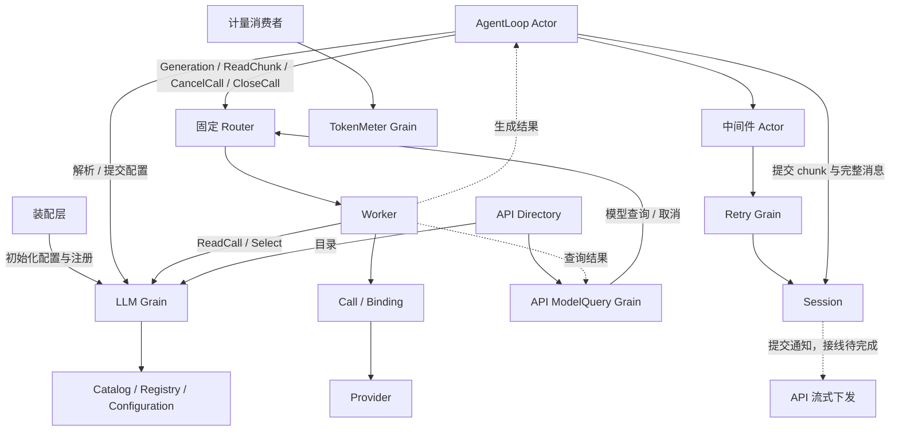

# LLM

LLM 管理模型配置、提供者注册和模型调用。业务对象独立实现；Actor 只负责消息编排、异步 I/O 调度和运行资源。设计见 [LLM 模块](../zh-CN/actor-design/33-llm-module.md)，整体进度见 [实施计划](../zh-CN/actor-design/12-implementation-plan.md)。

## 模块内职责

| 业务对象 | 职责 |
|---|---|
| modelconfig.Catalog | 校验配置定义、版本化替换、读取配置及解析 Agent 覆盖 |
| Registry | 校验与管理 Adapter 注册、可配置提供者目录，返回固定 Binding |
| Configuration | 按 AgentID 保存执行配置；显式更新或删除，不随 Agent 关闭删除 |
| Binding | 固定 Provider 实现，解析模型能力、参数与模型列表 |
| Call | 单次生成、流读取、终止和资源关闭规则 |
| BlockAssembler | 聚合 chunk；提交与确认时序属于 AgentLoop |

已配置内容通过 Catalog.Read 获取。远端模型列表通过 Provider 的 ListModels 查询。不提供独立 ModelDiscovery 注册、Discovery 对象或 DiscoverModels 协议，不以占位扩展层替代实际功能。

## 全部 Actor 职责

| Actor | 运行职责与调用关系 |
|---|---|
| actor.Grain（LLM Grain） | 串行编排 Catalog、Registry、Configuration；接收配置初始化、解析、更新与注册；向 Worker 返回一次 mailbox 处理内取得的配置与 Binding |
| GoAkt Router | 固定 Worker 工作池；调用按 CallID、模型查询按 RequestID 分发 |
| actor.Worker | 管理活跃 Call 和查询任务，异步执行 Provider I/O，处理取消、关闭，向 ReplyTo 返回具名结果 |
| retry/actor.Grain | Agent 中间件的恢复调度；Recovery 决定规则，Actor 执行 Session 读写和等待；不自行派发生成 |
| tokenmeter/actor.Grain | 接收快照进行计量，按 Session 创建身份隔离状态；不拥有生成流、不主动读取 Session |
| apiproxy/modelquery.Grain（API 边界） | 关联 API 模型查询与 Worker 回复，处理期限和显式取消；不属于 LLM，不参与生成流 |

ModelsClient 和 API Directory 是普通调用方适配器，SpawnPool 是装配函数；Call、DeepSeek Adapter、Connection 和 Identity 是普通对象。没有独立 ModelConfig、Configuration 或 Registry Grain，也不为每次调用创建 CallActor。

## 生成、Session 与下发

AgentLoop 解析配置并执行配置钩子后，将执行配置提交给 LLM Grain。Worker 收到 Generation 后一次读取配置与 Binding，异步解析精确参数并打开流，返回 GenerationStarted。AgentLoop 先提交实际请求参数，再发送 ReadChunk。

每次只读取一块。AgentLoop 将块提交为 AssistantChunked，收到 Session Committed 后才组装该块并读取下一块。流结束并成功关闭后，提交完整 AssistantMessaged。LLM 不写 Session，也不拥有 Turn/Step 或重试决策。

Session Committed 表示内存日志提交；磁盘持久化由 Flush 确认。API 下发消费提交后的 Session 通知，不直接读取 Provider 流；当前旧 LiveFrameSource 到 CommitNotice 的 Actor 接线仍未完成。

## 生命周期与失败

配置按 AgentID 保留，可在下次运行复用，显式变更影响后续调用。内存保留不等于进程重启持久化。已开始的调用固定配置与 Binding，不跟随注册变更。

Call 只允许一次派发。没有 Adapter 时允许中间件提供替代流；进入终端才报告 NO_ADAPTER。Provider 打开/读取错误转为终止块，中间件错误保持 error。Close 失败保留资源；成功后删除 Call，Worker 继续复用。

取消确认只表示处理了取消命令，不代表关闭完成。Worker 等待进行中的 I/O 退出后关闭资源。同一 Call 不能并发 Next/Close。迟到回复按 CallID/RequestID 排除；超时不能自动重复 Generation。Agent 关闭不触发配置删除。

## 验证边界

LLM、AgentLoop 内部请求路径和 API ModelQuery 的定向测试已通过。API 完整链路、Compaction、生产装配、完整 Turn 主驱动和异常停机回收仍未完成；局部测试不代表整仓重构完成。
