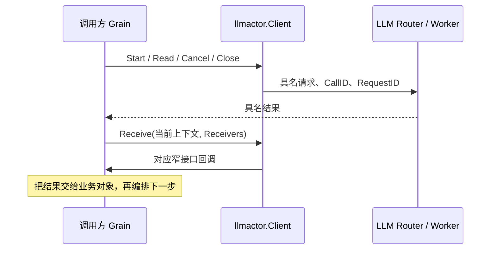

# LLM Actor

本包将消息映射到独立业务对象，不实现配置覆盖、模型选择或生成业务规则。完整对象清单、调用图和生命周期见 [LLM README](../README.zh-CN.md)，接口设计见 [LLM 模块](../../zh-CN/actor-design/33-llm-module.md)，整体进度见 [实施计划](../../zh-CN/actor-design/12-implementation-plan.md)。

Grain 持有独立的 Catalog、Registry、Configuration，统一串行处理配置与注册。ReadModels 读取配置定义；InitializeAgent 根据 Session 地址与创建身份请求历史，再由 Catalog 恢复缺失的 Agent 配置，Agent Registry 不读取或传入模型历史；ResolveAgent 仅供 LLM 配置消费者解析覆盖；SetConfiguration 保存 Agent 执行配置；ReadCall 在一次 mailbox 处理内取得配置与 Binding。配置仅在显式 RemoveConfiguration 时删除。

SpawnPool 创建固定一致性哈希 Router，并逐个初始化 Worker，成功后才公开入口。Worker 只接受一个 LLM Grain 地址；Provider I/O 经异步任务执行，结果回到 mailbox 后更新调用资源。

Generation、ReadChunk、CancelCall、CloseCall 通过 CallID 固定路由，RequestID 区分操作，ReplyTo 指定结果接收者。取消与关闭分别确认。失败关闭保留同一 Call，不能重新生成。

模型查询仅包括 ListModels、ResolveModel、ResolveConfig，不创建 Call、不修改 Agent 配置。API 请求关联位于 apiproxy/modelquery，其他 Actor 直接接收 Worker 回复。不存在 LLM QueryGrain 或独立 Discovery 注册路径。

GoAkt v4.5.3 的 TellGrain 等待处理确认，因此 Worker 在异步任务中投递结果；接收 Grain 使用 NoErr 确认。该确认不能替代具名业务结果。

测试覆盖固定 Worker 复用、阻塞读取取消、失败关闭重试、配置与注册读取，以及 API 查询并发、期限和显式取消。生产装配和框架异常退出时的资源清理仍需完成。

Generation 表示一次模型生成，Settings 明确选择 AgentConfig（读取该 Agent 已登记配置）或 Parameters（本次完整参数）。两者共用同一 Worker 调用流程；临时参数不写回 Agent 配置。未选择配置或参数非法时返回 GenerationStarted.Err，不分配 Call 资源。

## Actor Client

Client 供 AgentLoop、Compaction 等 Grain 共用。Start、Read、Cancel、Close、ResolveModel 只投递异步消息；Receive 在当前 mailbox turn 关联回复、校验 CallID/RequestID、处理超时，再调用 Receivers 中对应的单方法接口。每个调用方只提供自己消费的结果接口。Client 不保留调用方对象或 GrainContext，不建立反向对象引用，不创建 Actor、不持有业务队列或 mutex。

Client 的 pending 表只保存尚未收到回复的通信请求；框架定时器负责截止时间。完成后删除请求并取消定时器，迟到回复不触发第二次业务回调。超时保留 context.DeadlineExceeded 类型；不自动重发 Generation，也不把取消确认当作关闭。是否再次读取、重试关闭、写入 Session 或结束压缩由调用方业务对象决定。

AgentLoop 和 Compaction 已共用此 Client 的生成、读取和关闭通信，AgentLoop 的取消投递也已迁入。ModelsClient 仍只适配非 Actor 调用方的同步模型配置查询，不承担生成通信。

client_test.go 验证错误身份隔离、读取超时、迟到回复隔离以及关闭沿用原 CallID。Compaction 的真实 Grain 测试使用真实 TokenMeter 和 Session Log，验证完成事件已提交但 Flush 未回复时不会结束维护；Session 发布及生产装配仍需集成验证。

API 的模型配置读写通过 Actor Client 直接发送 ReadConfiguration/SetConfiguration。AgentLoop 不读写配置，只发送 AgentConfig 和请求内容；GenerationStarted 返回实际参数供 Session 记录。

Router 与 Worker 存活到服务关闭。GoAkt 4.5.3 的 SpawnRouter 没有停用策略参数，因此 SpawnPool 在初始化屏障前发送框架 PausePassivation，防止空闲两分钟后 Router 停止并连带释放 Worker。
