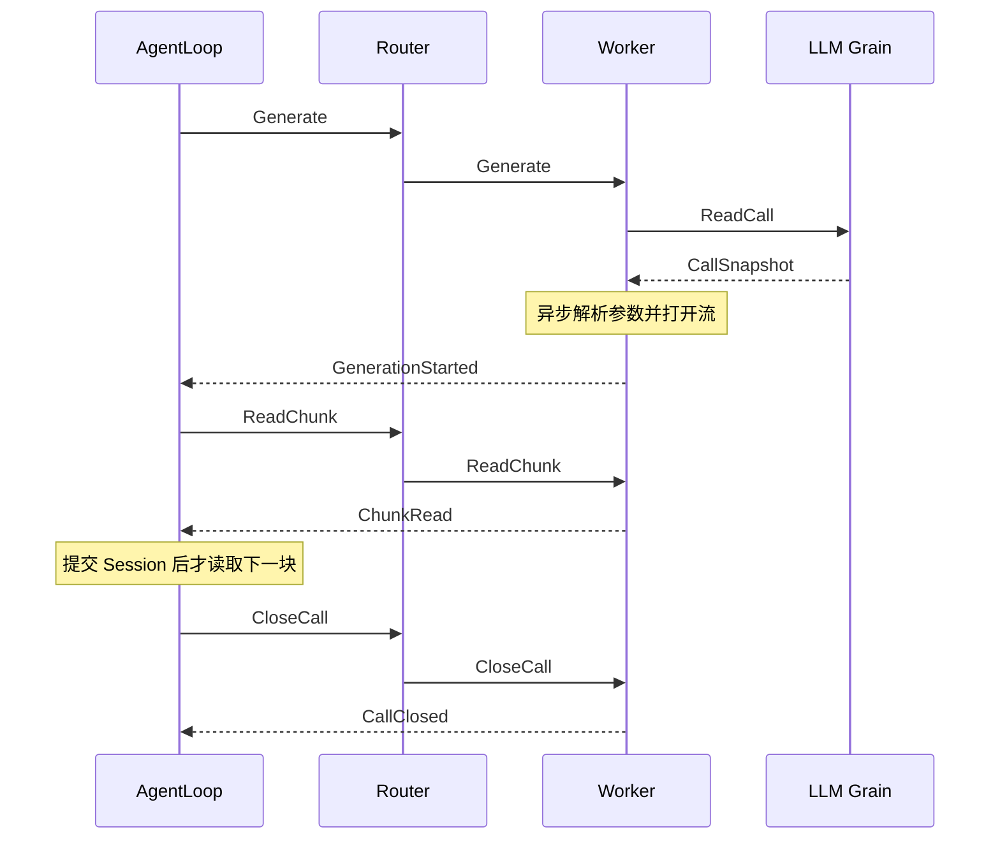

# LLM Actor

本包将消息映射到独立业务对象，不实现配置覆盖、模型选择或生成业务规则。完整对象清单、调用图和生命周期见 [LLM README](../README.zh-CN.md)，接口设计见 [LLM 模块](../../zh-CN/actor-design/33-llm-module.md)，整体进度见 [实施计划](../../zh-CN/actor-design/12-implementation-plan.md)。

Grain 持有独立的 Catalog、Registry、Configuration，统一串行处理配置与注册。ReadModels 读取配置定义；ResolveAgent 解析覆盖；SetConfiguration 保存 Agent 执行配置；ReadCall 在一次 mailbox 处理内取得配置与 Binding。配置仅在显式 RemoveConfiguration 时删除。

SpawnPool 创建固定一致性哈希 Router，并逐个初始化 Worker，成功后才公开入口。Worker 只接受一个 LLM Grain 地址；Provider I/O 经异步任务执行，结果回到 mailbox 后更新调用资源。

Generate、ReadChunk、CancelCall、CloseCall 通过 CallID 固定路由，RequestID 区分操作，ReplyTo 指定结果接收者。取消与关闭分别确认。失败关闭保留同一 Call，不能重新生成。

模型查询仅包括 ListModels、ResolveModel、ResolveConfig，不创建 Call、不修改 Agent 配置。API 请求关联位于 apiproxy/modelquery，其他 Actor 直接接收 Worker 回复。不存在 LLM QueryGrain 或独立 Discovery 注册路径。

GoAkt v4.5.3 的 TellGrain 等待处理确认，因此 Worker 在异步任务中投递结果；接收 Grain 使用 NoErr 确认。该确认不能替代具名业务结果。

测试覆盖固定 Worker 复用、阻塞读取取消、失败关闭重试、配置与注册读取，以及 API 查询并发、期限和显式取消。生产装配和框架异常退出时的资源清理仍需完成。
