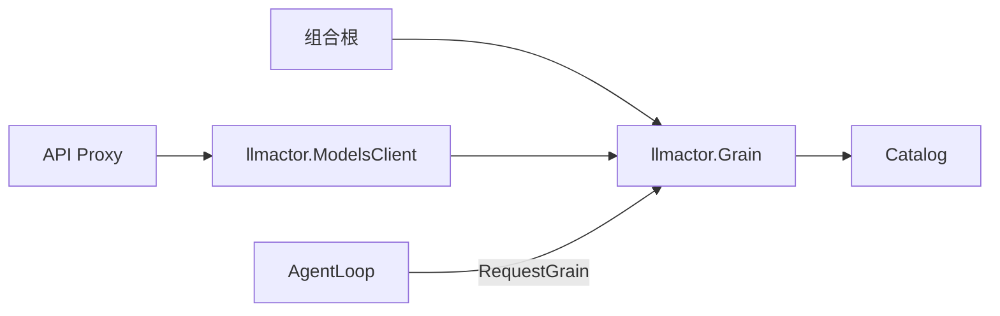

# 模型配置

`Catalog` 是纯 Go 配置 owner，保存当前版本、provider 定义、默认参数和凭据引用。它负责验证、覆盖解析和完整配置更新，不执行模型 I/O，不持有 SDK、秘密值或 Actor 引用。调用方负责串行访问；生产路径由 GoAkt Grain 的邮箱保证。

`Current` / `Read` 返回深复制快照，`Resolve` 返回具名 `Resolved`，`Replace` 在版本匹配且完整验证通过后发布下一版本。旧版本读取明确失败；正在执行的请求继续持有自己的快照。模型能力、reasoning 支持等厂商规则仍属于实际 adapter。

Host describe 和 Session 默认模型读取的切换仍在未提交的集成改动中；AgentLoop 版本化 Resolve 接入仍属于后续主循环迁移。配置错误不静默替换模型；框架请求失败向调用方传递。Catalog 无外部资源，关闭由框架负责。

接口、上下游契约和验证边界见[模块设计](../../zh-CN/actor-design/16-model-config-module.md)。历史实现基线见[实施进度](../../zh-CN/08-implementation-progress.md)，该历史文件不作为本轮 Actor 完成声明。
