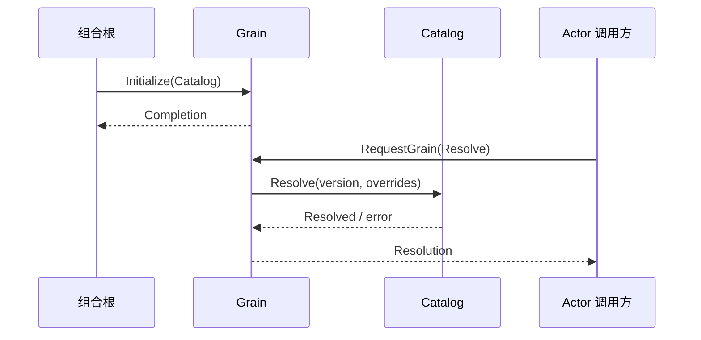

# ModelConfig Grain

`Grain` 只把具名消息转交 `modelconfig.Catalog`，不维护第二套队列或运行状态。组合根在进程共享的 GoAkt 实例中发送 Initialize；之后 Read、Resolve、Replace 顺序执行，业务 error 通过具名响应保留。

非 Actor 边界可以使用不可变 Client；Actor 内直接 RequestGrain。`any` 仅出现在框架入口和内部请求辅助方法，公开消息和 Client 方法使用具名类型。读取及更新不执行 I/O，框架停用无需额外业务关闭确认。

契约与测试边界见[模块设计](../../../zh-CN/actor-design/16-model-config-module.md)及[业务包说明](../README.zh-CN.md)。
