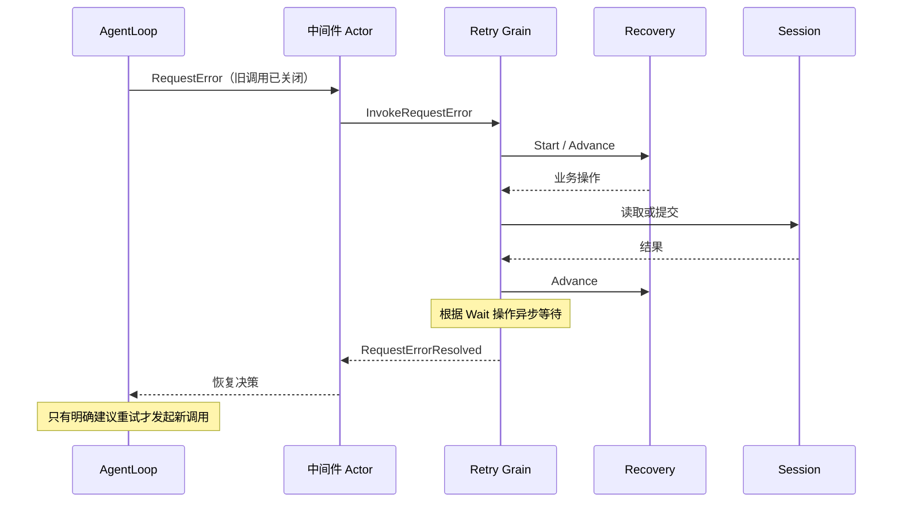
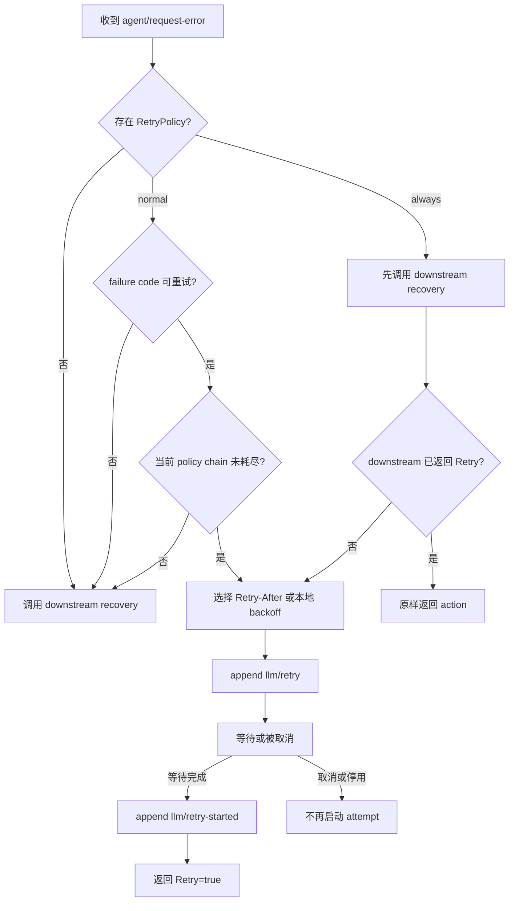
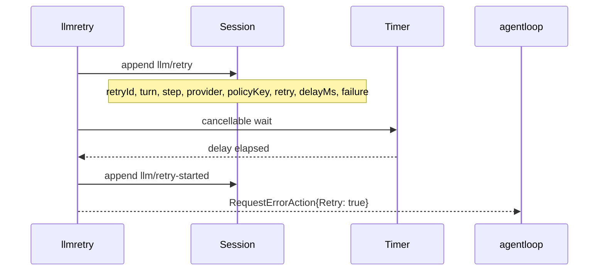

# LLM Retry

本包拥有请求失败后的恢复决策、退避预算及重试事实。LLM 提供策略值，AgentLoop 执行新的模型调用，Session 管理日志；Retry 不执行 Generation。接口设计见 [Retry 模块](../../zh-CN/actor-design/34-retry-module.md)，整体进度见 [实施计划](../../zh-CN/actor-design/12-implementation-plan.md)。

## 业务与调度职责

| 对象 | 职责 |
|---|---|
| Recovery | 无 I/O 的单次恢复状态机，选择继续下游、读历史、提交或等待 |
| policy.go | normal/always 规则、延迟和预算计算 |
| retryWrite | 按稳定业务身份识别原提交并校验冲突 |
| history.go | 校验持久化重试事件的顺序、所属请求和预算链 |
| actor.Grain | 绑定当前 Agent 的 Session 地址与创建身份，执行异步请求、定时等待和取消，返回中间件结果 |

不再包含 Plugin、Factory、Service listener 或动态 bind/dispose。业务对象不持有 Actor 地址、Session 对象或定时器。

## 调用关系

## 5. 决策流程

normal policy 只接管配置中的 retryable code，并受 `maxRetries` 限制。always policy 先给更专门的 downstream recovery 机会；只有 downstream 未接管或发生已上报的 recovery failure 时，才使用本地无限重试策略。这样后注册的专门 recovery 可以覆盖默认行为，而默认恢复处理器 仍提供兜底。

延迟选择规则：

1. `failure.providerRetryAfterMs` 为正有限值且不超过 policy `maxDelayMs` 时，原样使用；
2. Provider delay 超过上限时，normal policy 委托 downstream，always policy 改用本地 backoff；
3. 本地 delay 为 `min(initialDelayMs * 2^(retry-1), maxDelayMs)`，再应用 `[1-jitterRatio, 1+jitterRatio]` 区间的随机抖动并最终封顶。

## 6. Durable event 与恢复投影

每个实际等待由一对非 surface event 表示：

`llm/retry` 在等待前提交，说明 retry 已经排期；`llm/retry-started` 只在等待完整结束后提交，说明 Agent Loop 可以开始下一次 attempt。取消发生在两者之间时只保留 schedule fact，不伪造 started fact。

`ValidateHistory` 以一次有序扫描恢复并校验：

- retry 必须位于仍打开的 Turn 和 Step；
- event 中的 Provider 必须等于该请求 header 的 effective Provider；
- 同一 `turn + step + provider + policyKey` 的 retry 从 1 连续递增并复用一个 `retryId`；
- 一个 `retryId` 不能属于另一条 chain；
- 每个 `llm/retry-started` 必须匹配此前 schedule，且不能重复。

当前投影用于执行前预算恢复和历史校验，不负责进程重启后自动恢复未完成 timer。cold load、crash repair 和 pending retry 恢复必须由 Session Persistence/Recovery 阶段定义，不能由存储 adapter 猜测。

## 取消与生命周期

Grain 接收具名 CancelInvocation，将原因交给 Recovery 并取消正在等待的任务。Session 提交已经进行时仍处理提交结果，取消不代表回滚。恢复结束前不得把取消确认当作资源已释放或下一次调用可以启动。

停用时终止等待并向未完成请求返回错误；不会由后台 timer 直接调用 Agent。调用方负责创建、初始化和关闭 Grain，初始化绑定 AgentID、Session 与 CreationID，后者只用于运行身份校验。

## 验证边界

业务测试覆盖策略分派、预算、Retry-After、退避、取消、历史与幂等；Actor 测试覆盖真实框架的 Session 请求和恢复回复。AgentLoop 内部请求测试覆盖默认重试集成，但完整 Turn 主驱动与生产装配仍未完成，不能从本包通过推断整仓可用。
