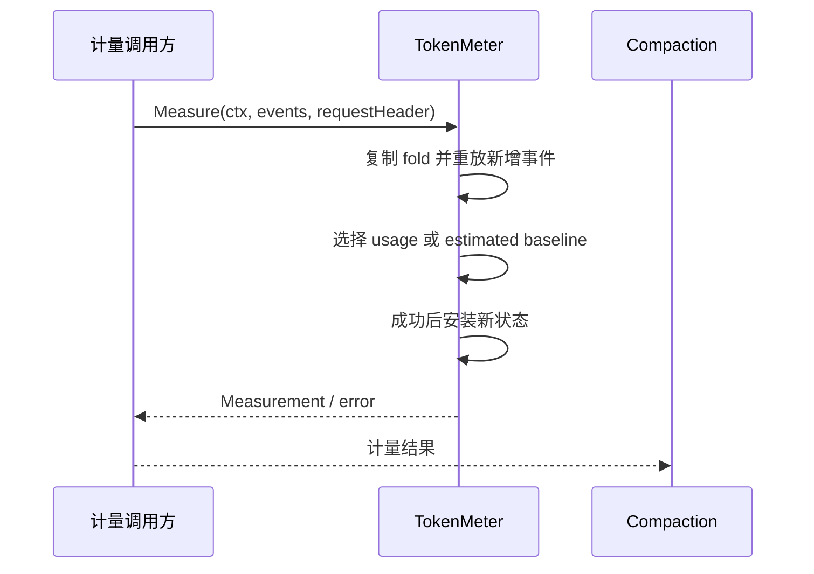

# TokenMeter

本包实现单份追加日志的 token 计量和三个纯 Projection Unit。Actor 迁移设计见 [TokenMeter 模块](../../zh-CN/actor-design/25-token-meter-module.md)。业务算法已迁移；Actor、Compaction 和默认服务器接线尚未完成。

## 对象职责与模块划分

| 对象 / 文件 | 职责 |
| --- | --- |
| TokenMeter / token_meter.go | 单日志增量重放，管理请求头、Surface 节点、step 与 usage anchor，返回 Measurement |
| estimate.go | 固定估算算法与安全整数运算；不选择模型或压缩策略 |
| surface.go | 根据 Session Surface operation 计算节点替换与 token 差量 |
| codec.go | 解码并验证计量所需的 Session 事实 |
| usage_projection.go | tokenUsage：累计 provider usage，同一步的后续样本替换前一个样本 |
| pressure_projection.go | contextPressure：展示最近压力与上下文窗口 |
| breakdown_projection.go / surface_projection.go | contextBreakdown：请求头与消息的固定估算分解 |
| Units / units.go | 返回三个 Unit，由外部 Projection owner 注册 |

TokenMeter 不持有 Session 对象、存储或框架引用，不使用 mutex。它的拥有者负责串行访问，并为不同 Session 创建使用不同对象。零值可用，不需要 Factory。Projection Unit 不反向引用 TokenMeter。

## 上下游与交互流程

Session 拥有追加事实和模型可见 Surface。调用方传入完整事件前缀及可选请求头，TokenMeter 只重放尚未计量的部分；Compaction 根据返回值决定行为。EstimateMessage 使用与 Measure 一致的固定估算口径。

输入必须属于同一次创建的追加日志。历史前缀可重新计算，但不会倒退已安装的在线进度；不能把另一份同长度日志传给已有对象。CreationID 隔离属于后续 Actor 层，不进入业务计量字段。

Measurement 保留 LogRevision、Baseline、SurfaceDeltaTokens、TotalTokens、SurfaceTokens 和 Nodes。实际 JSON 名称不变。Baseline 为 none、estimated 或 usage；请求头匹配时复用 usage anchor 并叠加 Surface 差量，否则重新估算。固定估算不是 provider tokenizer，提供跨重放和替换的一致口径。

## 生命周期、失败与取消

旧 Plugin、EventObserver、全局 Session map 和 Factory 已删除。创建计量对象即获得空重放状态，拥有者释放对象即回收内存；计量不执行 I/O，也没有后台任务需要关闭。Units 的注册、回滚与移除由 Projection Grain 请求编排负责，尚待接线。

Measure 检查 context 取消、事件序号、step 配对、JSON、Surface 范围和 token 溢出。任何失败都不安装部分结果。返回的节点、usage 与 baseline 数据和内部状态分离。计算失败不修改 Session 日志。

## 验证与剩余工作

业务测试覆盖请求头覆盖、usage anchor、assistant chunk 来源、Surface replacement、估算一致性、三个投影及 checkpoint 恢复。另验证失败不安装部分重放，历史读取不倒退在线进度。

尚需验证 Actor 创建隔离、异步请求、注册回滚和关闭，迁移 Compaction 消费者并接入默认服务器。旧 Plugin 测试删除不能证明这些行为已经完成。
