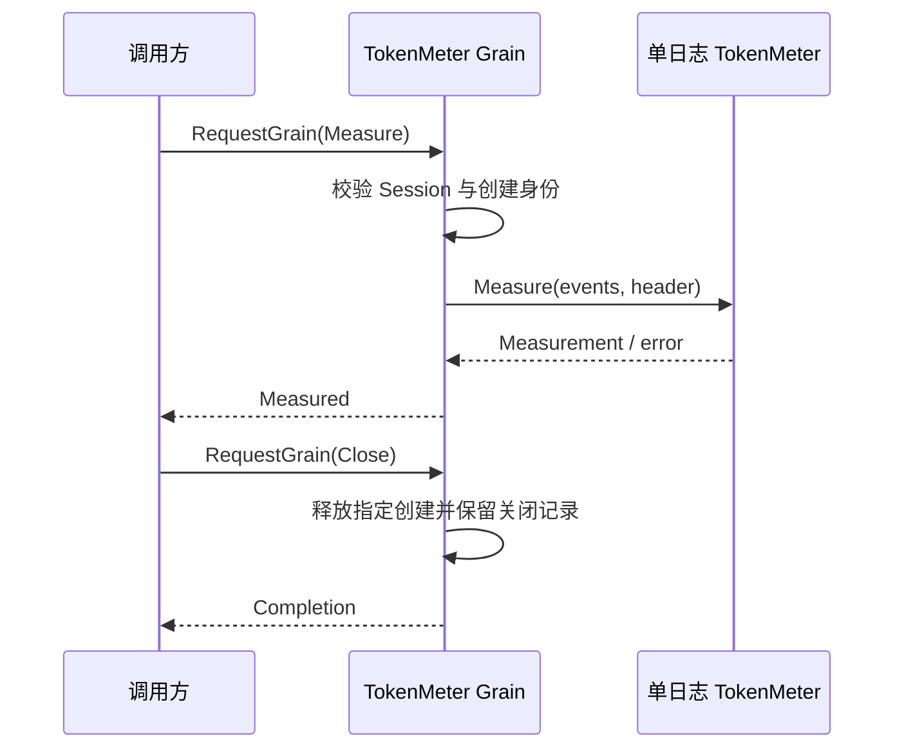

# TokenMeter Grain

本包实现计量请求与创建隔离，契约见 [TokenMeter 设计](../../../zh-CN/actor-design/25-token-meter-module.md)。

Grain 以 SessionID 为框架名称。meters 将 CreationID 映射到独立 TokenMeter，nil 项保留本次激活中的关闭记录。业务对象不持有身份或框架引用。Measure 接收已选择的完整事件前缀；EstimateMessage 不分配重放状态。Close 和定向转发的 Session ClosedNotice 只释放指定创建。

处理器只进行内存计算，直接回复；调用者通过框架异步请求收取结果。无队列、锁、任务或共享存储。取消和计算错误由业务对象返回，失败不安装新状态。停用会丢弃所有可重建状态和本地关闭记录；跨激活授权仍由 Session 生命周期控制。

真实 RequestGrain 测试覆盖相同 Session 不同创建的状态隔离、重复关闭、延迟请求拒绝、旧关闭不影响新创建，以及错误 Session 拒绝。尚未接入 PubSub 转发、Unit 注册、Compaction 和生产组合根，模块测试不代表这些链路完成。

## 生命周期与服务地址

TokenMeter Grain 名称为 `<sessionID>.tokenmeter`，通过消息文件的 RuntimeName 生成。Measure、Close 和 Session 事件已有显式 SessionID，业务 ID 不从名称解析。
