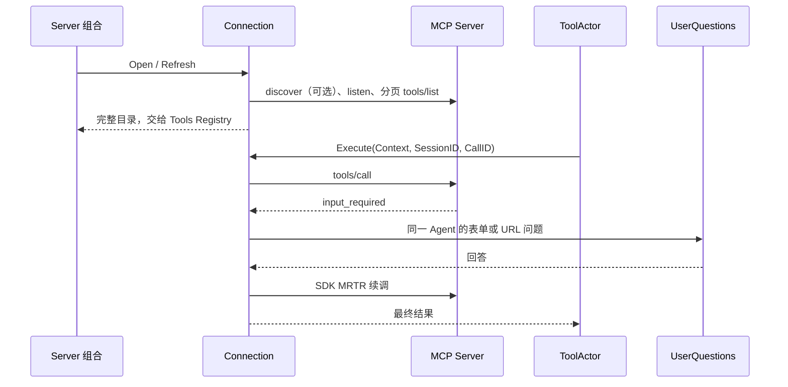

# MCP Client

连接外部 MCP Server，向 Goren ToolActor 提供工具实现。采用 `mcp-go v1.0.0`，只接受 `2026-07-28`。
设计、所有权与验收见 [Actor MCP Client](../zh-CN/actor-design/42-mcp-client.md)；
[复制范围](../zh-CN/01-porting-scope-and-baseline.md)拥有协议基线，
[历史进度](../zh-CN/08-implementation-progress.md)不代表本次 Actor 接线的验证结果。

## 配置与入口

Web 左侧「MCP 服务器」输入名称和 Streamable HTTP 地址即可连接；显示连接状态、工具数并可断开。
对当前 Host 的所有 Agent 生效，下一轮读取更新后的目录；Web 连接不跨进程重启保留。
仅连接可信服务，URL 不得携带凭据；详细管理边界见 [API 说明](../apiproxy/mcp/README.zh-CN.md)。

Server 使用 `Config.MCP`；CLI 支持重复 `-mcp-server <JSON 文件>`。每个文件配置一个 Server：

```json
{
  "serverName": "local",
  "transport": "stdio",
  "command": "/absolute/path/to/mcp-server",
  "args": [],
  "cwd": "/absolute/path/to/workspace"
}
```

HTTP 配置使用 `{"serverName":"remote","transport":"streamable-http","url":"http://127.0.0.1:9000/mcp"}`。
启动示例：`go run ./cmd/goren -mcp-server ./mcp-local.json`。
`DecodeConfig` 拒绝未知字段与混合传输配置。stdio 不经过 shell，继承进程环境；配置不得放入秘密。
本次不包含 HTTP credential header、OAuth、stdio env override、MCP Server 或自动重连策略。

`skipDiscover: true` 省略远端 discover；SDK 所需初始化在本地完成，随后实际请求仍固定版本并要求现代结果。
禁止 legacy initialize、HTTP GET 和 connection-scoped session。
`requestTimeoutMs` 默认 30000，限制单次网络 round；`elicitationTimeoutMs` 默认 600000，限制完整工具执行。
分页数、工具数、MRTR 回合与结果大小也有可配置上限。

## 工作模型

`Connection` 拥有 SDK、订阅与在途调用；独立 `subscription` 保存通知状态，回调不反向持有 Connection。
`Open` 等待订阅确认并读取全部分页；`Refresh` 完整验证后替换目录，失败保留上一快照。
`Provider` 保存显式 public/raw 名称绑定，不通过解析模型名称还原远端名称。
Goren 名称以 `mcp_<serverName>_<rawName>` 为基础，必要时规范化并附加摘要，长度不超过 64；
不以 DSH 命名或投影为兼容目标。



form 先询问同意，再映射 flat primitive schema；答案校验成功后才返回 accept。
URL 展示完整地址与 host，用户自行打开后明确确认，Goren 不预取；仅接受 HTTPS 或 loopback HTTP，拒绝 userinfo。
无准确调用身份、无 Provider、失效或 delegated Agent 均不会借用其他 Agent 的交互通道。
结果保留 `content` 和可选 `structuredContent`；text 直接展示，其他块以 JSON 展示，远端 isError 进入 Tools failure。

## 取消与关闭

Context 覆盖全部 MRTR 与用户等待；stdio 取消发送同 request ID 的 notifications/cancelled，HTTP 取消关闭本次 response/SSE。
UserQuestions Provider 负责 pending correlation 与清理。ToolActor 借用共享连接，不关闭它。
`Done` 在订阅流正常或异常结束时关闭，`Cause` 报告异常；Server 撤下该来源并关闭连接，不自动重试工具副作用。
`Close` 冻结接纳，取消请求并关闭传输 I/O，再等待订阅与调用全部退出；调用者超时后可继续等待同一次清理。
Server 先停止目录刷新，再排空 Agent / ToolActor，最后关闭共享连接。
