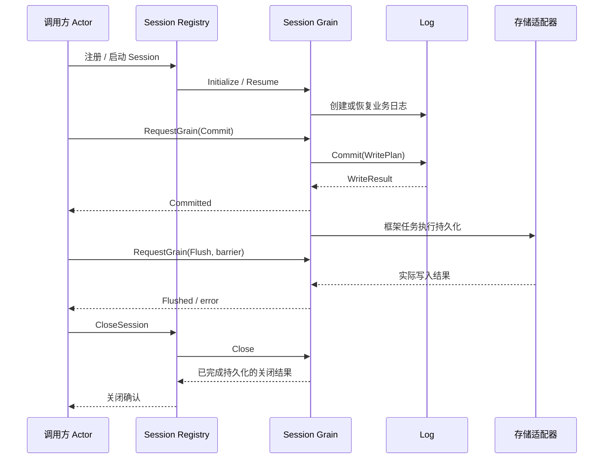

# Session

Session 根包拥有追加日志、模型可见 Surface 与事务规则，Actor 层拥有调度和生命周期。迁移设计见 [Session 模块](../zh-CN/actor-design/22-session-module.md)。旧 Context、MemoryStore、Preparation、Plugin、Factory 及生命周期事件实现已删除；生产消费者仍在迁移。

## 主要对象与模块划分

| 路径 / 对象 | 职责 |
| --- | --- |
| Log / log.go、log_commit.go | 单份内存日志、原子事务、分离快照与派生消息缓存 |
| Event / events.go、event_types.go、event_codec.go | 持久化事实、canonical 名称、严格编码和事件定义 |
| Surface / surface.go | 模型可见事件节点及合法替换规则 |
| WritePlan / write.go | 在固定快照上构造一次原子写入 |
| actor | Session Grain，初始化、读取、提交、写入与 flush、恢复和关闭 |
| registry | 创建授权与生命周期协调，防止旧创建影响新创建 |
| subscriber | 消费 Agent 创建通知，发起 Session 初始化并发布结果 |
| persistence | 持久化读取校验、恢复规则与 SQLite 存储适配器 |
| projection | 纯 Unit 算法注册及投影 Grain |
| projectioncache | checkpoint 规则、缓存 Grain 与冷读取 |
| query / title | 仍有旧消费者接口，尚未完成 Actor 迁移 |

Log 不持有框架、存储、Agent 或生命周期对象。它的所有方法由拥有者串行调用；没有读写锁。返回的 Header、Events、Surface、Snapshot 与模型消息均和内部状态隔离。框架任务使用这些分离数据，不并发访问 Log。进程级事件类型注册表仍单独同步共享定义注册。

## 交互与依赖

提交到内存不等于持久化。CommitNotice 发布已经提交的分离事件；Flush 是需要回复的定向请求。ClosedNotice 表示 Session 关闭完成，不表示所有订阅者已完成清理。Projection 已消费提交与关闭通知，其余消费者见各模块当前设计。

## 失败、取消与生命周期

Log.Commit 在应用前校验整批草稿，失败不提交部分事件；取消和 WritePlan panic 明确返回错误。Log 不承担请求排队或旧创建授权。Session Grain 和 Registry 分别拥有存储完成、flush 前缀、创建身份与业务关闭确认。失败时保留身份及可重试状态，具体边界见 [Actor README](actor/README.zh-CN.md) 和 [Session 生命周期设计](../zh-CN/actor-design/22-session-module.md)。

原始 Message 与内容协议复用 [agentmessage](../agentmessage/README.zh-CN.md)。Header、持久化 Event 和 wire 字段不因生命周期实现替换而重命名。

## 当前验证边界

纯业务测试保留 seed、Surface replacement、请求头、派生消息、输入输出复制、事务原子性、取消及 panic 后可继续提交。旧 MemoryStore/FIFO 实现测试已删除；框架顺序与关闭应由 Actor 测试验证。

Agent Inbox、AgentLoop、Query、Title、API Proxy、Subagent 等仍有旧 Context 和 Service 调用，生产编译与端到端验收尚未完成。不能补回 Context 别名、New 包装或 Factory 来掩盖这些断点。

### 提交提案与返回事件核对

EventDraft.ValidateEvent 用于核对当前 Commit 返回的事件是否保留原草稿的 type、原始 payload、来源序号、surface 操作及 ignorable，并检查 Seq/Time 合法性。它不暴露草稿内部字段，不改变日志形状。它不证明事件属于哪个 Session，也不比较任意历史 JSON 的语义等价；请求方仍须检查 WriteResult 中的 Session 身份和提交区间。AgentLoop 的使用边界见 [模型尝试提交确认](../zh-CN/actor-design/30-agentloop-business.md)。

### 幂等提交

IdempotentWrite 由用例定义稳定写入身份及内容冲突，Session 在同一串行提交中执行 FindCommit 与追加。找到原提交时核对日志后返回原 WriteResult，复制事件，保留原序号与 Barrier。普通 Batch 仍允许重复追加。恢复仅依赖已有事件，不新增内存回执表或持久化字段。Grain 仅为新追加发布通知，返回原结果不再次发布。规则见 [Session 幂等契约](../zh-CN/actor-design/22-session-module.md#幂等提交与原结果返回)。
