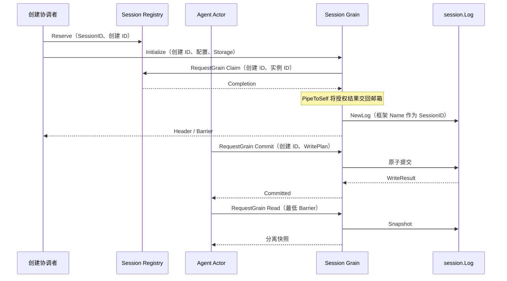
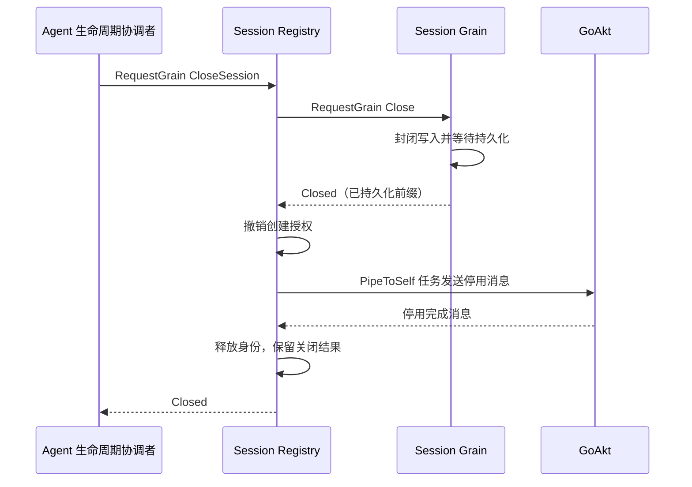
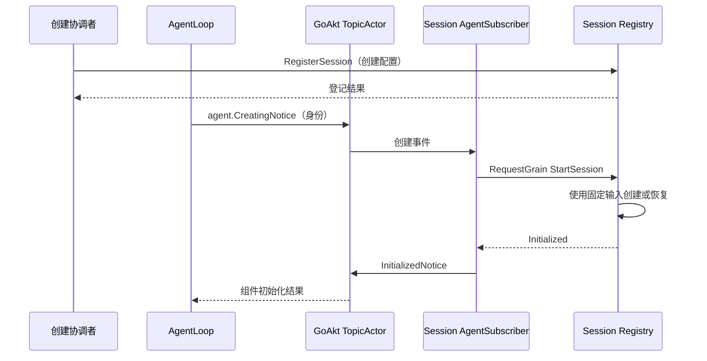

# Session Grain

本包实现 Session 的框架消息入口。目标职责及上下游契约见 [Session 模块设计](../../zh-CN/actor-design/22-session-module.md)，[历史实施进度](../../zh-CN/08-implementation-progress.md)不代表当前 Actor 重构进度。

## 模块内职责与依赖

| 对象 | 职责 |
| --- | --- |
| Grain | 独占 session.Log，取得 Registry 创建授权后串行处理内存操作 |
| 外部 RegistryGrain / registry.authority | 串行管理创建预留和实例绑定；不持有日志或替代框架路由 |
| session.Log | 原子提交、事件序号、surface 和分离快照；不依赖 GoAkt |
| Initialize / Resume / Commit / Read / Flush / Close | 具名消息值；回复保留普通 error，不返回可变 owner |

按 SessionID 创建长驻 Grain。Initialize 必须提供具名 Storage（Load、AppendBatch）；共享 adapter 的关闭仍由组合根负责。Initialize 不允许另一个创建 ID 覆盖已有日志；相同创建 ID 重试返回现有头信息与前缀，不重复创建。未初始化拒绝操作。Read 可以返回比最低 barrier 更新的快照，不承诺历史精确版本；外部 Session、负序号或未来前缀明确失败。

Commit 只确认内存事实，不确认磁盘持久化。Plan 保留无 I/O、确定性及输入不可保留的业务约束；取消或验证失败不提交部分批次。请求超时不代表没有提交，当前不提供提交去重，不能盲目重试。

旧 sessionContext、Store publisher 与根包队列已删除。Log 的读写锁也已移除，所有访问由拥有者串行执行；异步存储任务只使用分离快照。

已实现单个在途持久化任务和按 WriteBarrier 的异步 Flush。业务 Close 已实现并通过真实 SQLite 验证；Registry Claim 已接入初始化/恢复，Session Registry 关闭入口已实现，Agent 侧调用和生产装配尚未接通。OnDeactivate 取消存储任务并令未完成 flush 返回错误，不是任务已退出或业务关闭确认。当前创建 ID 检查不能单独证明整个系统的重新激活安全。

真实 GoAkt 测试使用 RequestGrain，覆盖原子提交、快照字节隔离、重复初始化、错误创建身份和最低前缀校验；Session 全包 fresh race 测试通过。

## 持久化与失败恢复

内存提交后，Grain 捕获分离快照并用 PipeToSelf 启动存储任务；任务不访问 Log 或 Grain 字段。后续提交在日志中积累，下一个任务覆盖剩余前缀，不另建事件 pending 队列。flushes 仅保存请求前缀和 GoAkt 延迟回复，不执行线程调度。

Flush 使用 RequestGrain，只有 Backend 确认目标前缀后才回复。外部取消不能撤销共享写任务；写失败保留内存事实并向待完成 Flush 返回 error。首次写入及错误后的重试会核对存储已有前缀，拒绝不同头信息、不同事件或损坏尾部；已完成但回复丢失的相同事件不会再追加。Resume 已接入恢复与 repair；写任务自身仍拒绝猜测损坏尾部的修复方式。

真实 SQLite 测试覆盖写任务阻塞期间的内存读取、后续提交、目标前缀 flush，以及事务成功后返回错误时重试不重复 AppendBatch。没有把这一证据扩展到 JSONL 或生产装配。

## 业务关闭

Close 固定当时的提交前缀并永久封闭写入；Initialize 也不能重新打开该日志。当前写任务继续完成，不因关闭请求而取消。全部已提交事实持久化且任务完成回到邮箱后，Grain 返回 Closed 并释放自身对共享 Storage 的引用。

shutdown 只保存固定前缀和框架延迟回复。重复关闭共享同一目标；失败返回原 error，保留写入封闭状态，重试继续完成原前缀。没有额外 active/closed 标志，也不创建关闭线程。成功后仍允许只读查询和已满足前缀的 Flush。

真实 SQLite 测试覆盖阻塞写入时延迟关闭、关闭期间拒绝写入、重复关闭、失败后保持封闭并重试、Initialize 不能重开，以及关闭不误关共享数据库。Agent 何时发起 Close 仍由其完整业务消息结束条件决定，生产 AgentLoop 尚未接入。

## 恢复

Resume 接收原创建 ID 和 RecoveryStorage，以 PipeToSelf 读取、验证、核对 revision、执行业务决定的修复并重新读取。它复用 persistence.Recover，旧持久化准备路径也调用同一业务规则，不另建工具结果修复算法。

修复后的独立 Log 只在任务成功完成后交给 Grain；错误不安装半成品。既有中断工具结果、Step/Turn 结束与 end-seed 规则保留，历史工具效果不会重新执行。恢复期间拒绝新的初始化/恢复；关闭协调者须等待恢复结果后再关闭，不能把未初始化错误当作关闭完成。CloseSession 在此阶段保留延迟回复和身份，Registry 等待恢复结算后自动继续关闭。

真实 SQLite 测试覆盖中断 Turn/Step 修复、原 CreatedAt 保留、必要 end-seed、重复恢复不重复追加，以及缺失日志/修复失败后保持未初始化并允许重试。

## 创建授权

创建协调者先向共享 RegistryGrain 发送 Reserve。Initialize/Resume 首次执行必须取得 Claim 授权，Registry 将创建 ID 绑定到本次 OnActivate 产生的实例 ID。相同实例可重试失败的恢复；不同实例无法沿用旧创建授权。授权前仅可构造无 I/O 的私有 Log，不对外安装，也不读写存储。

授权只保留一个 admission 操作及框架延迟回复。RequestGrain 的 Then 把结果写入容量为一的任务结果通道，由已启动的 PipeToSelf 投递完成消息；这不是业务消息队列。GoAkt 4.5.3 的 TellGrain 等待处理确认，因此不能在 Grain 回调中向自身调用 TellGrain。回调和任务都不保留 GrainContext。

正常关闭后的再次打开必须撤销、确认停用并释放旧创建，再预留新创建。Registry.Release 本身不证明这些步骤已完成；强制停用后存储任务是否退出仍需协调者确认，不自动恢复旧授权。真实框架测试已覆盖未授权无存储访问、重新激活拒绝旧授权以及新创建不受旧提交影响；这些测试没有证明生产关闭协调已经实现。

## Registry 关闭入口

Agent 生命周期协调者完成 Agent 工作后，通过 RequestGrain 调用 CloseSession。Registry 先等待 Session.Close 返回已持久化前缀，再撤销创建授权，在 PipeToSelf 任务中停用 Grain，最后释放预留。业务关闭失败保持身份占用；已完成业务关闭但停用失败时，重试从停用步骤继续。

同一次关闭的并发请求共享业务操作。成功结果按 Session 保留一份，重复 CloseSession 返回原结果；新的创建预留替代这份结果，旧关闭不影响新创建。同一个已完成创建 ID 不允许重新 Reserve。Registry 重启不恢复这些内存结果，不将空状态解释为原关闭成功。

真实 SQLite/GoAkt 测试覆盖阻塞写入、并发关闭、持久化失败重试、成功回复前实际停用、重复结果读取和关闭期间禁止替代。生产 AgentLoop 仍使用旧创建链，本入口尚未替代 API/Agent 生命周期调用方。

## Registry 创建入口

CreateSession / ResumeSession 负责预留身份并异步初始化对应 Session Grain。Registry 等待初始化期间仍可处理 Grain 发回的 Claim。首次请求固定输入与存储端口，同创建的并发请求共享结果，失败重试沿用原输入；不同创建方式或创建配置明确拒绝。CreateOptions.Clone 隔离种子和元数据，返回给多个调用方的 Header 也分别复制。

外部请求超时不终止内部初始化；Registry 到 Session 使用不自动超时的 RequestGrain。初始化期间 CloseSession 保留延迟回复和身份，Registry 通过 PipeToSelf 等待初始化结算后自动继续关闭。关闭成功移除固定输入，新创建可通过 ResumeSession 恢复原日志。

真实 GoAkt/SQLite 测试覆盖创建、关闭、重新恢复、重复输入与返回值隔离、初始化时身份占用、并发恢复只执行一次。Session 全包 race 测试通过；AgentCreating 的 Session 订阅已实现，旧 Factory 调用替换尚未完成。

## 生命周期数据归属

RegistryGrain 的 sessions 按 SessionID 保存一份 lifecycle：创建 ID、initialization、closure 和最终 Closed 结果。initialization 固定创建输入并保存本次请求回复；closure 保存关闭过程及其已完成步骤。关闭成功清除前两项，只留下可重读的结果；新创建预留成功时整体替换旧记录。原三张独立表及子对象重复创建 ID 已移除。

业务预留和实例授权仍由纯业务 registry.authority 负责；lifecycle 保存框架交互所需的信息，不持有 Session.Log 或替代 GoAkt 调度。初始化成功后自动关闭与初始化失败后的自动清理，均用真实 GoAkt/SQLite 测试验证。

## Agent 创建事件

创建协调者先调用 RegisterSession，固定 Session 创建/恢复方式、原创建 ID、选项与存储端口。登记不创建 Session Grain，也不读写存储。AgentSubscriber 订阅 agent.CreatingTopic，在收到 agent.CreatingNotice 后异步请求 Registry.StartSession。事件只包含 AgentID 和创建 ID，配置与存储对象留在 Registry。

组合根必须等 AgentsSubscribed 确认后才允许 Agent 创建。InitializedNotice 只表示 Session 组件结果，不能当作整个 Agent 就绪；消费方核对 SessionID 与创建 ID。事件不保证可靠投递，StartSession 是同次初始化的显式补发入口。重复事件沿用原输入与日志，关闭后旧事件不能重新取得授权。

实际实现与测试已覆盖图中的登记、订阅、初始化、结果发布及关闭后旧事件拒绝；AgentLoop 发布和消费两端仍待生产迁移，图中相应两端是目标契约。真实 SQLite 测试证明登记无 I/O、重复触发仅写一个种子批次、缺登记与恢复失败保持 error 类型。

事件订阅与结果发布已移至 [session/subscriber](../subscriber/README.zh-CN.md)。本包通过具名初始化请求提供能力，不导入订阅器。Registry Grain 已移至 [session/registry](../registry/README.zh-CN.md)。本包从 Initialize、Resume 和空日志 Close 接收授权方 GrainIdentity，通过本包 Claim / Claimed 消息取得授权，不依赖 Registry 实现。

## 生命周期与服务地址

Session Grain 名称由消息文件中的 RuntimeName 生成，格式为 `<sessionID>.session`。Initialize、Resume、Close 显式携带 SessionID；Header 和持久化事件使用业务 ID，不读取或拆分 Actor 名称。Read 返回同一提交视图的 Header 和 Snapshot。
