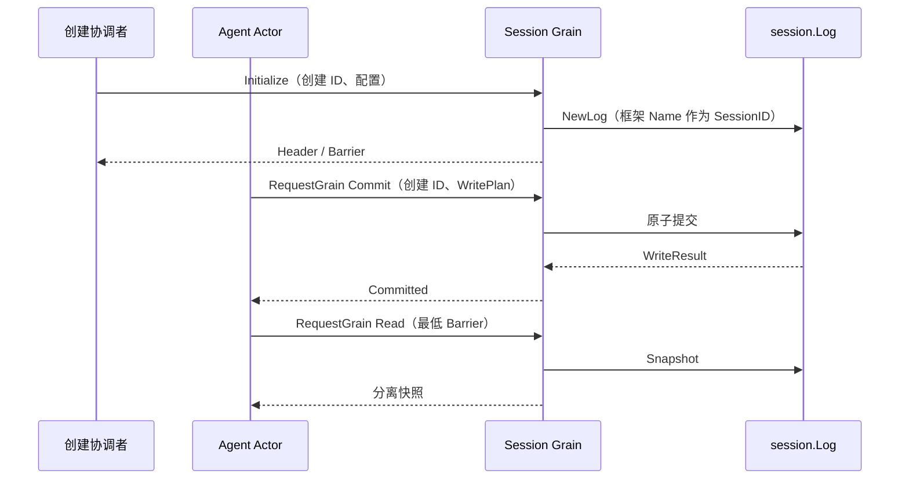

# Session Grain

本包实现 Session 的框架消息入口。目标职责及上下游契约见 [Session 模块设计](../../zh-CN/actor-design/22-session-module.md)，[历史实施进度](../../zh-CN/08-implementation-progress.md)不代表当前 Actor 重构进度。

## 模块内职责与依赖

| 对象 | 职责 |
| --- | --- |
| Grain | 独占 session.Log，核对当前创建身份，串行处理内存操作 |
| session.Log | 原子提交、事件序号、surface 和分离快照；不依赖 GoAkt |
| Initialize / Resume / Commit / Read / Flush / Close | 具名消息值；回复保留普通 error，不返回可变 owner |

按 SessionID 创建长驻 Grain。Initialize 必须提供具名 Storage（Load、AppendBatch）；共享 adapter 的关闭仍由组合根负责。Initialize 不允许另一个创建 ID 覆盖已有日志；相同创建 ID 重试返回现有头信息与前缀，不重复创建。未初始化拒绝操作。Read 可以返回比最低 barrier 更新的快照，不承诺历史精确版本；外部 Session、负序号或未来前缀明确失败。

Commit 只确认内存事实，不确认磁盘持久化。Plan 保留无 I/O、确定性及输入不可保留的业务约束；取消或验证失败不提交部分批次。请求超时不代表没有提交，当前不提供提交去重，不能盲目重试。

本入口不使用旧 sessionContext、Store publisher 或自建队列，没有新增 mutex。Log 仍为旧 Context 的并发读者保留原锁，后续随调用方迁移移除。

已实现单个在途持久化任务和按 WriteBarrier 的异步 Flush。业务 Close 已实现并通过真实 SQLite 验证；Registry 授权及强制停用后的身份重建防护尚未接通。OnDeactivate 取消存储任务并令未完成 flush 返回错误，不是任务已退出或业务关闭确认。当前创建 ID 检查不能单独证明整个系统的重新激活安全。

真实 GoAkt 测试使用 RequestGrain，覆盖原子提交、快照字节隔离、重复初始化、错误创建身份和最低前缀校验；Session 全包 fresh race 测试通过。

## 持久化与失败恢复

内存提交后，Grain 捕获分离快照并用 PipeToSelf 启动存储任务；任务不访问 Log 或 Grain 字段。后续提交在日志中积累，下一个任务覆盖剩余前缀，不另建事件 pending 队列。flushes 仅保存请求前缀和 GoAkt 延迟回复，不执行线程调度。

Flush 使用 RequestGrain，只有 Backend 确认目标前缀后才回复。外部取消不能撤销共享写任务；写失败保留内存事实并向待完成 Flush 返回 error。首次写入及错误后的重试会核对存储已有前缀，拒绝不同头信息、不同事件或损坏尾部；已完成但回复丢失的相同事件不会再追加。Resume 已接入恢复与 repair；写任务自身仍拒绝猜测损坏尾部的修复方式。

真实 SQLite 测试覆盖写任务阻塞期间的内存读取、后续提交、目标前缀 flush，以及事务成功后返回错误时重试不重复 AppendBatch。没有把这一证据扩展到 JSONL 或生产装配。

## 业务关闭

Close 固定当时的提交前缀并永久封闭写入；Initialize 也不能重新打开该日志。当前写任务继续完成，不因关闭请求而取消。全部已提交事实持久化且任务完成回到邮箱后，Grain 返回 Closed 并释放自身对共享 Storage 的引用。

shutdown 只保存固定前缀和框架延迟回复。重复关闭共享同一目标；失败返回原 error，保留写入封闭状态，重试继续完成原前缀。没有额外 active/closed 标志，也不创建关闭线程。成功后仍允许只读查询和已满足前缀的 Flush。

真实 SQLite 测试覆盖阻塞写入时延迟关闭、关闭期间拒绝写入、重复关闭、失败后保持封闭并重试、Initialize 不能重开，以及关闭不误关共享数据库。Agent 何时发起 Close 仍由其完整业务消息结束条件决定，生产 AgentLoop 尚未接入。

## 恢复

Resume 接收原创建 ID 和 RecoveryStorage，以 PipeToSelf 读取、验证、核对 revision、执行业务决定的修复并重新读取。它复用 persistence.Recover，旧持久化准备路径也调用同一业务规则，不另建工具结果修复算法。

修复后的独立 Log 只在任务成功完成后交给 Grain；错误不安装半成品。既有中断工具结果、Step/Turn 结束与 end-seed 规则保留，历史工具效果不会重新执行。恢复期间拒绝新的初始化/恢复；关闭协调者须等待恢复结果后再关闭，不能把未初始化错误当作关闭完成。该 Registry 协调仍未接入。

真实 SQLite 测试覆盖中断 Turn/Step 修复、原 CreatedAt 保留、必要 end-seed、重复恢复不重复追加，以及缺失日志/修复失败后保持未初始化并允许重试。
