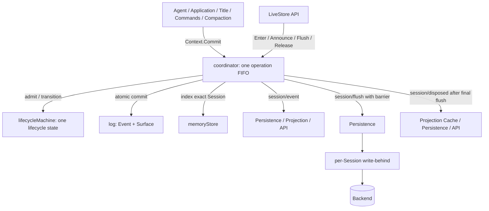
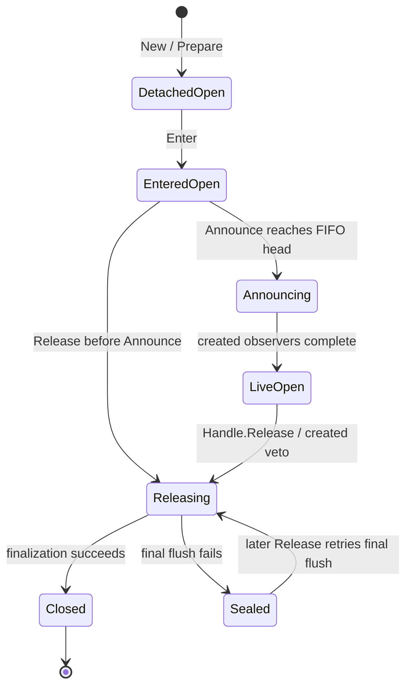
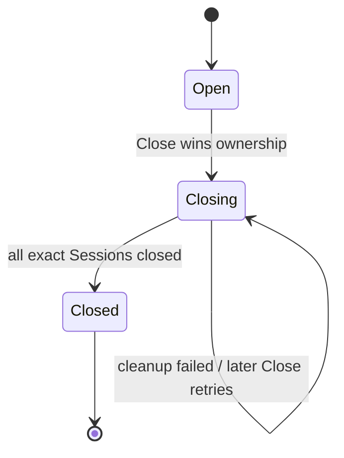
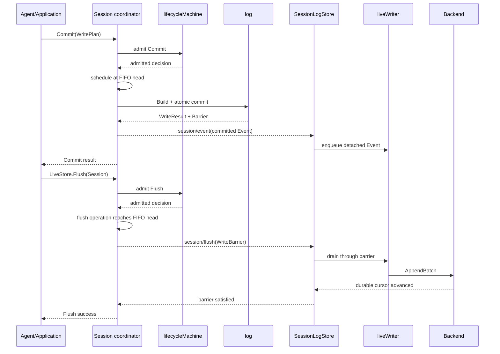

# Session Core、唯一写协调与生命周期设计

状态：Accepted；Implemented；Verified

本文是 `session` Core 的唯一权威设计，拥有 Header、Event envelope、内存 append-only log、Surface、单 Session operation coordinator、独立 lifecycle state machine、LiveStore 生命周期以及与 Persistence 之间的 committed-prefix barrier。本文同时记录当前实现边界；仓库级实施证据仍由[08 实施进度](../../zh-CN/08-implementation-progress.md)统一汇总。持久化设计见[19](../../zh-CN/19-session-persistence-and-sqlite.md)，Projection Cache 见[Session Projection Cache 最终设计](../../zh-CN/SessionProjectionCache最终设计方案.md)，Context Compaction 如何消费写契约见[24](../../zh-CN/24-context-compaction.md)。

Session 保存和派生的 Message/source/content 由[Agent Message 协议重构设计方案](../../zh-CN/AgentMessage协议重构设计方案.md)拥有，当前公开签名使用 `[]agentmessage.Message`。迁移完成证据只见[08 实施进度](../../zh-CN/08-implementation-progress.md)。

## 1. 设计来源与 Go 差异

Session Core 的固定源基线是 `47f943859bef60e4160492346772ded9b24f765a`。Context Compaction 仅按[01](../../zh-CN/01-porting-scope-and-baseline.md)使用 `b150a55` capability-scoped exception，不把其他 Session 行为升级到新基线。

| DeepSeek Harness 证据 | Go owner | 保留的职责或语义 |
| --- | --- | --- |
| `packages/core/session/src/types.ts` | `Header`、`Event`、typed event key | format、Header、Event envelope、Surface metadata |
| `packages/core/session/src/index.ts` 的 `Session` | 包内 `log` | seed、连续 `seq`、append-only log、Surface、detached read |
| 同文件的 `SessionStore` | `LiveStore`、包内 `memoryStore` | prepare、enter、announce、live membership、flush、detach |
| `packages/core/session/src/surface.ts` | `SurfaceOperation` 与内部 Surface fold | append/replace、provenance、model-visible history |
| `session/created`、`session/event`、`session/flush`、`session/disposed` | Session Plugin Event | 创建 veto、post-commit feed、durability checkpoint、dispose |

源 `Session.append()` 依靠 JavaScript run-to-completion：以当前 `log.length` 分配 `seq`，在两个 `await` 之间的连续同步 append 不会被其他 Promise continuation 穿插。源代码没有 `WritePlan`、Go FIFO 或另一套写领域模型。

已核对 `47f9438..b150a55`：`src/index.ts`、`surface.ts`、`preparation.ts`、`json.ts` 与 `request-header.ts` 完全一致，因此写协调、Surface 和 Store 生命周期证据没有版本差异。较新版本只在 Session package 增加 `assistant/message.interrupted?: true` 和四个 `team/*` known event，并调整文档、版本与测试类型断言；前者属于尚未升级的 AgentLoop 事件契约，后者属于未纳入的 Agent Teams，均不随本次写协调重构静默进入。

Go producer 可以来自多个 goroutine。若同时公开 raw append 和可选串行入口，调用方就必须自行判断并发风险，Session 无法完整保护顺序不变量。因此 Go 在同一职责边界内增加每 Session 一个 FIFO，并只公开一个 `Commit(context.Context, WritePlan)`。`WritePlan` 是 Go 并发适配 seam；DeepSeek Harness 只作为 owner、事件、顺序和生命周期语义的证据，不作为 Go 队列设计模式的来源。

## 2. 分层、所有权与依赖方向

外部调用方只获得 `session.Context`、`session.LiveStore` 和 `session.Handle` capability。包内具体对象不跨领域暴露。当前结构按一致性和变化原因分为六层；调度与状态转换规则分离，但状态事实仍然只有一份。

| 层 | 唯一 owner | 负责 | 明确不负责 |
| --- | --- | --- | --- |
| 领域值与日志层 | 包内 `log` | Header、Event、连续 `seq/time`、append-only log、Surface、detached Snapshot | membership、Plugin Event、Persistence、operation 排队 |
| 单 Session 状态层 | 包内 `lifecycleMachine` | 唯一 lifecycle state、合法转换、operation 准入判断、转换结果 | FIFO、mutex、callback、I/O、Event 发布、Store 索引 |
| 单 Session 协调层 | 包内 `coordinator` | 唯一 FIFO、operation 调度、调用 `lifecycleMachine`、publication baton、final barrier 与跨层编排 | 自行保存 lifecycle state、Store 全局索引、SQLite、Projection policy |
| LiveStore 层 | 包内 `memoryStore` | 进程内 exact Session 索引、进入顺序、Store `open/closing/closed`、Prepare/Enter/Create、Close 编排 | 单 Session 状态转换、Event log、durable cursor |
| Plugin 适配层 | `session.Plugin` | 发布 `LiveStore` Service，把 Core 事实交给 Plugin Runtime | 业务状态、队列、持久化和 rollback 决策 |
| 下游 Consumer 层 | Persistence、Projection、Projection Cache、API | 消费 committed Event、durability request、membership edge | 反向决定 Session lifecycle 或直接修改 log |



依赖和主动调用关系固定如下：

- Agent/Application 主动调用 `Context.Commit`；coordinator 主动调用 `log` 完成原子提交，再主动发布 `session/event`。
- `LiveStore.Enter/Announce/Flush` 和 `Handle.Release` 主动把 lifecycle operation 交给同一个 coordinator FIFO；coordinator 调用 `lifecycleMachine` 判断准入和执行转换，`memoryStore` 不越过 coordinator 直接修改单 Session 状态。
- coordinator 主动发布 `session/flush`；Persistence 被动满足指定 `WriteBarrier`，不能反向发起 Session Release。
- coordinator 在 final flush 成功并从 `memoryStore` 移除 exact Session 后主动发布 `session/disposed`；Projection Cache 和 Persistence 只做后置 cleanup。
- Session Core 不依赖 persistence、projection、API、SQLite 或 Agent。所有下游依赖都指向 `session` contract。

业务 owner 决定“要写哪些事实”；`lifecycleMachine` 决定“当前状态是否允许该 operation、成功或失败后进入哪个状态”；coordinator 决定“operation 何时执行、基于哪个 committed Snapshot、调用哪些 collaborator 以及何时发布结果”；Persistence 只证明指定 prefix 已经 durable。

### 2.1 为什么不再由 `registration` 拥有第二套状态机

`memoryStore -> registration -> coordinator -> registration` 的双向关系会让 membership、写准入和 release 进度分别受不同 mutex 保护。每把锁单独正确，也不能形成跨对象原子事实；`Get`、`Flush` 和 `Disposed` 之间因此存在 TOCTOU。

最终设计不保留一个拥有独立 mutex/state machine 的 `registration`。`Handle` 可以是指向 exact coordinator lifecycle 的不可变 capability，但不能再保存另一份 `entered/live/releasing/closed` 状态。Store map 是进程内可发现性索引；独立 `lifecycleMachine` 是单 Session lifecycle 的唯一状态事实，coordinator 只调度并调用它。

### 2.2 合理保留的锁

- `log` RWMutex：保护 Event/Surface value snapshot；
- coordinator queue mutex：只保护短时 admission、队首移交，以及对无锁 `lifecycleMachine` 的串行调用；
- `memoryStore` mutex：只保护全局索引、进入顺序和 Store 状态；
- Persistence `liveWriter` mutex：只保护 timer、pending batch 和正在执行的写。

`lifecycleMachine` 不拥有 mutex；它依赖 coordinator 提供串行调用，不得形成新的锁层。任何一层都不得持有自己的 mutex 调用 I/O collaborator 或 Plugin observer。跨层调用前先在锁内取得不可变引用/状态机决定，释放锁后再执行副作用；完成后由 coordinator 在短 queue mutex 下把结果交还状态机。FIFO baton 可以跨 callback 保持顺序，但不是跨层 mutex。

### 2.3 Session coordinator 与 `SessionLogStore`

两者都是具名协调对象，但协调不同的一致性域，不是可以合并的重复抽象：

| 对象 | 一致性域 | 主动调用 | 保存的运行时事实 | 明确不负责 |
| --- | --- | --- | --- | --- |
| Session `coordinator` | 一个 exact live Session 的 operation 顺序 | `lifecycleMachine`、`log`、Store collaborator、Plugin Event publisher | FIFO request、baton、terminal waiter；不保存 lifecycle state | durable cursor、write-behind、cold load、repair、Backend |
| `SessionLogStore` | 多个 Session 的 durable prefix、cold/prepared state 与 storage operation | `liveWriter`、recovery policy、prepared cache、`Backend` | exact live persistence state、durable cursor、pending batch、prepared reservation、per-ID storage gate | Session operation 准入、lifecycle 转换、Event/seq 分配、Release |

`SessionLogStore` 位于 persistence capability 内，是 `Persistence` 的具体服务和 persistence coordinator；它不是 storage adapter。`Backend` 是它拥有的 outbound storage port，`session/persistence/sqlite.Adapter` 才是基础设施 adapter。

Core 与 Persistence 之间不共享 mutex、状态机或可变 registration。coordinator 发布 committed `session/event`，`SessionLogStore` 被动接收并排入 write-behind；coordinator 发布带 exact `WriteBarrier` 的 `session/flush`，`SessionLogStore` 只返回“指定 prefix 已 durable”或错误。`SessionLogStore` 不能反向调用 Release 或改变 `lifecycleMachine`；coordinator 也不能查询 durable cursor 后自行推断 flush 成功。

## 3. 公开上下文契约

```go
type Reader interface {
    Header() Header
    ID() SessionID
    FirstLiveSeq() int64
    Seq() int64
    Events() []Event
    Surface() Surface
    Snapshot() Snapshot
    DeriveMessages() ([]agentmessage.Message, error)
}

type Writer interface {
    Commit(context.Context, WritePlan) (WriteResult, error)
}

type Context interface {
    Reader
    Writer
}
```

`session.New`、`LiveStore.Get/List`、`Handle.Session` 和 persistence preparation 都返回 `Context`。其他领域不保存 `*session.Session`，也不能取得 aggregate mutex、FIFO、coordinator 或 publication attachment。

读取返回 detached value：调用方修改 `Header()`、`Events()`、`Surface()`、`Snapshot()` 或 `WriteResult.Events` 的返回值，不能反向修改 Session。需要同时校验 Event 位置和 Surface 的调用方使用一次 `Snapshot()`，不能分别读取后自行拼接 revision。

`Snapshot` 表示同一个 committed revision：

```go
type Snapshot struct {
    Events  []Event
    Surface Surface
    Barrier WriteBarrier
}
```

## 4. EventDraft 与 Surface

`EventDraft` 是尚未分配 `seq`、`time` 的不可变候选。调用方只能通过 owner-defined `EventKey[D]` / `SurfaceEventKey[D]` 创建 draft；字段保持 private，不能伪造 event type 或绕开 payload snapshot。

`NewEventDraft` 和 `NewSurfaceEventDraft` 在进入 FIFO 前完成 JSON snapshot 与 lossless validation。`Batch` 再次 detach draft slice 及其 payload/provenance，调用方在 admission 前后修改自己的值都不能改变计划内容。

只有 `user/message`、`assistant/message` 与 `tool/result` 能进入 model-visible Surface：

- `SurfaceAppend()` 把当前 Event 的 `seq` 加到 Surface 尾部；
- `SurfaceReplace(start, end)` 用当前 Event 替换 Surface 上对应的连续区间。

replace 在提交前校验边界顺序、只引用更早 Event 的唯一 provenance，以及对全部 shadowed node 的覆盖。`tool/result` replacement 只能替换一个当前 result 的 content，并保持 call identity、metadata 与其他字段。任何 draft 或 Surface transition 失败时，整个 batch 都不增长日志、不改变 Surface，也不推进 replacement generation。

## 5. 唯一写入口

```go
type WritePlan interface {
    Build(context.Context, Snapshot) ([]EventDraft, error)
}
```

`Context.Commit(requestContext, plan)` 是唯一公开写入口。所有 plan 都进入同一个 FIFO；没有 raw append、另一个 serialized API、公开 queue item、request-local event queue 或调用方可选的锁。

一个 FIFO request 包含一个 `WritePlan`。`Build` 一次返回完整、有序的 `[]EventDraft`，slice 顺序就是 batch 内 Event 顺序；它不是内层 FIFO，因为没有独立 admission、head、drainer、mutex 或调度。

### 5.1 固定 batch

如果全部 draft 能在提交前确定，调用方使用 `Batch`，不实现自定义 plan。

```go
draft, err := session.NewEventDraft(
    session.TurnStarted,
    session.TurnStart{
        Turn: turn,
    },
)
if err != nil {
    return err
}

_, err = conversation.Commit(
    requestContext,
    session.Batch(draft),
)
return err
```

固定多事件同样使用 `Batch`：

```go
_, err = conversation.Commit(
    requestContext,
    session.Batch(firstDraft, secondDraft),
)
```

“有多个 Event”或“Event 彼此相关”都不是自定义 `WritePlan` 的理由。只要完整 drafts 能提前构造，`Batch` 就能保证它们原子且不被其他 producer 插入。

### 5.2 基于 FIFO 头部状态构造 batch

只有无法在 admission 前确定完整 drafts 时，业务 use case 才实现 `WritePlan`。典型原因是：

- payload 或 provenance 需要本 request 真正执行时的下一个 `seq`；
- 候选集合必须从 FIFO 头部看到的最新 Event log 或 Surface 计算；
- 必须在“校验当前 revision”和“提交完整 batch”之间禁止其他 request 插入。

例如 skipped Tool call 需要让 `tool/result.sourceEventSeqs` 指向同一 batch 中将要提交的 `tool/call`。排队前不知道前方还有多少 request，所以在 `Build` 看到 head `Snapshot.Barrier.NextSeq` 后才能构造 result draft：

```go
type skippedCallPlan struct {
    callDraft session.EventDraft
    result    session.ToolResult
}

func (plan *skippedCallPlan) Build(
    _ context.Context,
    current session.Snapshot,
) ([]session.EventDraft, error) {
    provenance := []int64{current.Barrier.NextSeq}
    resultDraft, err := session.NewSurfaceEventDraft(
        session.ToolResultAdded,
        plan.result,
        session.SurfaceIntent{
            Operation:       session.SurfaceAppend(),
            SourceEventSeqs: &provenance,
        },
    )
    if err != nil {
        return nil, err
    }
    return []session.EventDraft{plan.callDraft, resultDraft}, nil
}

_, err := conversation.Commit(requestContext, plan)
```

`WritePlan` 对应一个状态相关的业务提交，不对应 Event 类型。Compaction completion 与 Tool Result Pruner 各实现一个 use-case plan；`compaction/summary`、`compaction/prune`、`tool/result` 等 Event 本身不实现接口。

`Build` 必须是短时、确定性的内存计算，不执行 LLM、Tool、网络、文件或数据库 I/O，不保留或修改传入的 detached `Snapshot`。高延迟工作在 coordinator 外完成；plan 只在 FIFO 头部重新校验结果并构造最终 drafts。自定义 plan 可以返回空 slice 表示 no-op；`Batch()` 空 batch 则拒绝。

## 6. 唯一 operation FIFO

每个 Session 只有一个 operation FIFO。coordinator 只负责把 `Commit`、`Announce`、显式 `Flush` 和 terminal `Release` 放入同一调度顺序；所有 lifecycle 准入和转换统一委托给同一个 `lifecycleMachine`。FIFO 不创建常驻 goroutine，也不让一个调用方代替其他调用方执行普通 plan。

### 6.1 Commit 与原子提交

1. `Commit` 在短 queue mutex 下调用 `lifecycleMachine` 判断准入并追加 request；只有队首 request 的 `ready` channel 被关闭。
2. 每个调用方等待自己的 `ready`；获得 baton 后只执行自己的 request，此时 queue mutex 已释放。
3. 固定 `Batch` 直接取得已 detach 的 drafts，不复制当前 Session snapshot；状态相关 plan 才在 FIFO 头部读取一个 detached `Snapshot`，并调用一次 `Build`。
4. `log` 在锁内只暂存本 batch 的新 Event；它不 clone 已提交 Event 前缀。存在多个 Surface Event 时才复制 Surface nodes 作为临时视图，否则只保存单个 transition。
5. 在临时状态上校验全部 draft、分配连续 `seq/time` 并规划 Surface transition；任一 draft 失败时不追加 Event，也不改变 Surface。
6. 全部校验成功后一次 append 新 Event，并一次应用最终 Surface 状态。log mutex 释放后按 `seq` 顺序发布 committed `session/event`。
7. 当前调用方完成 publication 后归还 baton；Queue 清除已完成槽位并唤醒下一项。terminal Release 已准入时，队列排空后进入 finalization，而不是重新开放。

FIFO 使用 slice + head index，出队不搬移其余元素，已完成槽位置 `nil`，整队排空后再复用零值结构。不同 Session 没有全局写锁，可以并行提交。JSON snapshot、LLM、Tool、网络和业务数据库工作不进入 Commit operation；固定 `Batch` 的常见路径也不复制完整历史。

同一个 batch 是内存原子提交：不存在“前两个 Event 已提交，第三个失败”的部分 prefix。Publication 与 durability 在提交之后，因此 observer 或 Backend 失败不能回滚已经 committed 的 batch。

### 6.2 Flush operation

`LiveStore.Flush` 把一个 flush operation 放入同一 FIFO。它在队首完成以下动作：

1. 取得当前 committed `WriteBarrier`；
2. 在不持有 queue mutex 或 log mutex 的情况下发布 `session/flush`；
3. 等待所有 durability participant settle；
4. 成功或失败后才归还 FIFO baton。

因此排在 Flush 之前的 Commit 已完成 `session/event` publication；排在 Flush 之后的 Commit 不属于该 barrier。Persistence 可以顺带提交更晚 Event，但必须证明 durable cursor 至少达到 `barrier.NextSeq`。

Flush 的 Backend I/O 会占用该 Session 的 FIFO baton，这是有意的语义边界：同一 Session 的 Release 不能越过仍在执行的 Flush；不同 Session 仍可并行。执行 callback 时不持有 mutex，同步重入同一 Session 由 `ErrWriteReentry` 拒绝。

### 6.3 Release operation

Release 是 terminal admission，不是普通队尾 item：

1. coordinator 在 queue mutex 下把 terminal command 交给 `lifecycleMachine`，由状态机原子地停止新 `Commit/Announce/Flush` 准入；
2. 已经准入的 operation 继续按 FIFO 完成；
3. 队列排空后取得不会再增长的 final barrier；
4. 发布并等待一次 final `session/flush`；
5. final flush 成功后从 Store 移除 exact Session，再发布 `session/disposed`；
6. 并发 Release 只等待同一个 terminal result，不启动第二次 finalization。

Release 不是“先 seal，失败后恢复 live”的可回滚事务。停止准入是不可逆边界；final flush 失败时 Session 保持 sealed，并允许后续 Release 重试相同 final barrier。

## 7. 写结果、取消、panic 与重入

`WriteResult` 描述一个 request 提交的半开区间 `[FirstSeq, NextSeq)` 和 detached Events。no-op plan 的两个边界相等。

`WriteBarrier{SessionID, NextSeq}` 表示：Persistence 只有在全部 `Seq < NextSeq` 的 Event durable 后才满足该 barrier。它不是数据库事务 ID，也不保证 Tool side effect exactly-once。

取消边界如下：

- admission 前 Context 已取消：不入队；
- 排队中的 request 在到达头部前被取消：跳过 `Build`，不产生 Event；
- `Build` 返回后 Context 已取消：不进入 aggregate commit；
- aggregate commit 一旦开始就完成或整体失败，不在 batch 中间留下取消导致的部分提交；
- Release terminal admission 之前取消：不开始 Release；
- Release 已经取得 terminal ownership 后，调用方取消只能停止该调用方等待，不能恢复 operation admission；
- final flush 失败或 owner lifecycle 被取消：Session 保持 sealed，记录本次 terminal result，后续 Release 从 final flush 重试，不重复 drain 或重新开放 Commit。

`Build` panic 会转换为 error，当前 request 不提交，当前调用方仍归还 baton，后续 request 继续执行。`session/event` observer 收到的是已经 committed 的事实；listener error 由 `PostCommitFailureReporter` 报告，不改变 `Commit` 结果。

Publication context 内同步重入同一个 Session 会返回 `ErrWriteReentry`，避免 observer 等待当前 request 自己完成。Session 不提供 after-event/follow-up 写 API；需要派生写入的 observer 必须先返回，并由自己拥有的生命周期任务通过正常 `Commit` 重新准入。Title fallback 即采用该方式。

## 8. LiveStore 与状态机

`memoryStore` 是 `LiveStore` 的进程内实现。名称中的 memory 表示 membership index 位于内存，不表示它是内存版 Session Persistence。它保存 exact coordinator 引用和进入顺序，不保存第二份 Session lifecycle。

创建流程固定为：

```text
Prepare  -> construct detached unpublished Context
Enter    -> attach exact coordinator and publish Store membership
Announce -> run vetoable session/created at the FIFO head
```

### 8.1 单 Session 状态机

`lifecycleMachine` 是独立的无锁状态模块，也是单 Session 状态的唯一 owner。coordinator 是它的唯一调用方：coordinator 提供串行化和调度，状态机验证 command、执行状态转换并返回不可变 decision；coordinator 再根据 decision 调用 log、Store、Plugin observer 或 Persistence。状态机本身不排队、不发布 Event、不调用 callback、不执行 I/O，也不知道 mutex。

Store、Handle、Persistence 和 Projection Cache 只能向 coordinator 请求行为或观察 Event，不能直接取得或调用状态机。coordinator 也不能绕过状态机写状态字段，不能缓存 `announced/releasing/sealed` 布尔副本。外部副作用成功或失败后，coordinator 再把结果作为下一条 command 交还状态机；非法 command 返回明确错误且不改变状态。



状态语义：

| 状态 | Commit/Flush 准入 | Store 可见性 | 允许动作 |
| --- | --- | --- | --- |
| `DetachedOpen` | Commit 可用但没有 Plugin publication；Flush 不可用 | 不可见 | Enter |
| `EnteredOpen` | Commit 可用并发布 Event；Flush 可用 | exact membership 可见 | Announce、Release |
| `Announcing` | 后续 operation 排队 | 可见但尚未完成 created edge | created observer 完成、Release 等待 |
| `LiveOpen` | Commit/Flush 可用 | live 可见 | 普通工作、Release |
| `Releasing` | 拒绝新 operation；排空旧 operation | 不再作为新业务工作的 live Session 返回 | 等待 terminal result |
| `Sealed` | Commit/Flush 均关闭 | 不对业务 `Get/List` 暴露，但 Store 保留 exact cleanup owner | 重试 Release |
| `Closed` | 全部拒绝；Release 幂等成功 | 已移除 | 无 |

`announced` 是否发生是 `lifecycleMachine` 的状态转换事实，不再由 coordinator 或另一个对象保存布尔副本。只有经过 `Announcing` 的 lifecycle 才在关闭时发布配对 `session/disposed`。created listener veto 由 coordinator 作为结果 command 交回状态机并进入同一个 terminal release 流程；它不能把 queue seal 后的 Session 恢复成 open。

### 8.2 Store 状态机



- `Open` 接受 Prepare/Enter；
- `Closing` 永久拒绝新的 Prepare/Enter，按逆进入顺序请求每个 coordinator Release；
- 单个 Session final flush 失败时 Store 保持 `Closing`，不重新开放；
- 后续 `Close` 只重试尚未 `Closed` 的 exact Session；
- 全部成功后才进入 `Closed`。

`memoryStore.mu` 只管理该全局状态和索引。Enter 不得在持有 Store mutex 时调用 coordinator；应先取得 exact attachment claim，再在短 Store 临界区完成 collision check 和插入，失败时在锁外回滚 claim。

### 8.3 `Get`、`List` 与 Handle

`Get/List` 是 live business visibility，不是生命周期内部存在性检查：只返回 `EnteredOpen/Announcing/LiveOpen` 中的 exact Session；`Releasing/Sealed/Closed` 不供新业务使用。Projection Cache 不得用 `Get` 推断一个已取得的 checkpoint 是否需要 Flush。

`Handle` 是 exact lifecycle capability。它只保存 coordinator identity 并调用同一 Release operation；它没有独立 mutex、state 或 disposer graph。旧 Handle 永远不能移除后来复用同一 Session ID 的 lifecycle。

### 8.4 Preparation

Persistence 的 `Prepare` 返回一个 `session.Preparation`，其中包含原样重建的 unpublished `Context` 与 provider-owned `PreparationLease`。Persistence 内部的 reservation 是排他占用，不是 live membership。Enter 成功消费 reservation；未发布时 Dispose 按 durable revision 是否仍相同决定是否归还 prepared cache。

## 9. 跨层交互流程

### 9.1 Commit 到 durable Flush



谁主动调用谁：业务调用 coordinator；coordinator 发布事实和 durability request；Persistence 调用 writer/Backend。Agent、Projection Cache 和 API 都不直接调用 SQLite。

### 9.2 Release 与 Projection Cache

```mermaid
sequenceDiagram
    participant H as Handle
    participant C as Session coordinator
    participant L as lifecycleMachine
    participant P as SessionLogStore
    participant M as memoryStore
    participant K as Projection Cache
    participant S as CheckpointStore
    H->>C: Release
    C->>L: admit terminal Release
    L-->>C: Releasing; stop new admission
    C->>C: drain admitted FIFO
    C-->>P: final session/flush(final barrier)
    P-->>C: final durable prefix confirmed
    C->>M: remove exact Session
    C->>L: finalization succeeded
    L-->>C: Closed
    C-->>P: session/disposed
    C-->>K: session/disposed
    P->>P: retire exact live writer
    K->>K: final projection checkpoint
    K->>S: Replace rebuildable record
    C-->>H: terminal success
```

Projection Cache 的规则：

1. 普通 threshold/interval/`turn/end` writer 取得 projection cut 后直接调用唯一 `LiveStore.Flush`；禁止先 `Get` 再 Flush。
2. `session/disposed` 只可能发生在 final flush 成功之后，因此 final detached writer 不再调用 Flush。
3. 若 `Retire` 在普通 writer 运行期间到达，当前尝试结束后必须再执行恰好一次 detached final attempt；不能因前一次错误直接删除 write state。
4. Cache write 失败只使 checkpoint 落后；不能回滚 Session、阻止 Disposed 或把 cache record 写到尚未 durable 的事实之前。

### 9.3 Release 与普通 Flush 的并发结果

同一 FIFO 将竞态压缩为两个合法顺序：

- Flush 先取得 admission：Flush 完整满足 barrier 并归还 baton，Release 才能进入 finalization；
- Release 先取得 terminal admission：后来的普通 Flush 被拒绝；Projection Cache 等待 `session/disposed` 后执行 final detached attempt。

不存在“Flush 已经通过 live 检查，但 Disposed 同时删除 Persistence state”的第三种中间状态。

## 10. Plugin Event 语义

| Event | 调度目的 | 失败语义 |
| --- | --- | --- |
| `session/created` / `Created` | 创建 veto | 失败使 `Create` 进入同一 terminal Release，并形成配对清理 |
| `session/event` / `EventAppended` | committed fact feed | batch 不回滚；listener failure 被包含并报告 |
| `session/flush` / `FlushRequested` | durability checkpoint | 等待所有 participant 满足 barrier，聚合错误 |
| `session/disposed` / `Disposed` | membership 已移除通知 | best-effort，observer failure 被包含和报告 |

Plugin Runtime 只分发进程内事实，不保存 Session Event history。Session Event log 才是可恢复事实来源；Projection、Title、Persistence 和 API live frame 都是 Consumer。

## 11. 目标文件职责

| 文件 | 责任 |
| --- | --- |
| `contracts.go` | 对外 `Reader`、`Writer`、`Context` capability |
| `write.go` | `WritePlan`、`Batch`、`EventDraft`、`Snapshot`、`WriteResult`、`WriteBarrier` |
| `coor_context.go` | 私有 coordinator 的 log、operation queue、`lifecycleMachine` 与读委托 |
| `coor_commit.go` | `Commit` 准入与写结果 |
| `coor_execute.go` | FIFO 头部的 Build、atomic commit、publication 与结果组装 |
| `queue.go` | `Commit/Enter/Announce/Flush/Release` 的唯一排队与 baton；不保存 lifecycle state |
| `state_machine.go` | 无锁 `lifecycleMachine`、合法 command/transition 与不可变 decision；不执行副作用 |
| `session.go` | 私有 `log`、seed、detached read、atomic batch commit |
| `surface.go` | Surface transition 的纯规划与应用 |
| `lifecycle.go` | `LiveStore`、`Handle`、Plugin Event 与 lifecycle collaborator 契约 |
| `memory_store.go` | `LiveStore` 的内存实现、exact coordinator 索引、Store 状态机与 Event dispatch adapter |
| `registration.go` | 已删除；不得重新引入第二套 lifecycle state/mutex |
| `preparation.go` | unpublished Session 的 provider lease |
| `event_codec.go`、`request_state.go`、`message_projection.go` | Event codec、请求状态 fold 与模型消息投影 |

文件切分服从最终对象职责，不要求保留当前文件名。`coor_` 只作为 coordinator 实现文件的分组前缀，不进入类型名；不得为了减少单文件长度重新创造 registration wrapper、Flush adapter 或 lifecycle helper graph。

## 12. 实现证据与验收

当前实现已删除 `registration`，由 `coordinator` 的唯一 FIFO 串行 `Commit/Enter/Announce/Flush/Release`，并由独立无锁 `lifecycleMachine` 管理唯一状态。Projection Cache 已删除 `Get -> Flush` 与全局 `recordLocks/writes`，Persistence flush/dispose 使用 exact `liveSessionState.durable`，不在 I/O 后按 ID 重新解析另一份 lifecycle state。

验收矩阵如下：

| 行为 | 验收要求 |
| --- | --- |
| 单一状态 owner | `lifecycleMachine` 是唯一状态事实；不存在 `registration` 状态机、coordinator state 字段/membership mutex 或等价重复状态 |
| 调度/状态分离 | coordinator 只排队、调用状态机并执行 decision；状态机无 mutex、callback、I/O 和 Event publication |
| Flush/Release 顺序 | Flush callback 完成前 Release 不进入 remove/disposed；terminal admission 后新 Flush 明确拒绝 |
| 取消 | seal 后不恢复 open；取消 waiter 不产生第二次 Release |
| final flush 失败 | Session 保持 sealed 且可重试，不向 `Get/List` 暴露为 live |
| Projection Cache | 无 `Get -> Flush`；Retire 与 active writer 交错后仍有一次 final detached attempt |
| Persistence | exact live operation 不在 I/O 后按 ID 重新解析另一份 lifecycle state |
| same-ID reuse | 旧 Handle、旧 writer、旧 disposed callback 均不能影响新 lifecycle |

测试使用业务顺序表达验收，而不是暴露补丁抽象：

- `TestSessionReleaseOrdering`：flush-before-release、release-before-flush、concurrent release、canceled waiter、failed final flush、retry；
- `TestProjectionCacheRetireOrdering`：Retire during writer、active failure 后一次 final detached attempt；
- `TestReusedSessionIDRejectsOlderLifecycleWriter`：旧 exact writer 不得覆盖同 ID 新 lifecycle record；
- `TestFlushKeepsExactDurableState`、`TestDisposedReleasesOnlyExactLiveOwner`：Persistence 始终操作 captured exact durable state。

本次验收已运行 focused tests、`go test ./...`、`go test -race ./...`、`go vet ./...`、`go build ./...` 和 `git diff --check`。仓库级里程碑仍由[08 实施进度](../../zh-CN/08-implementation-progress.md)统一维护。
