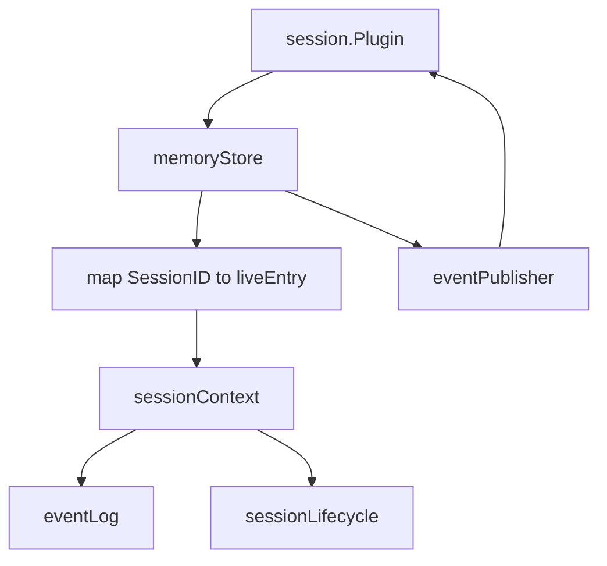
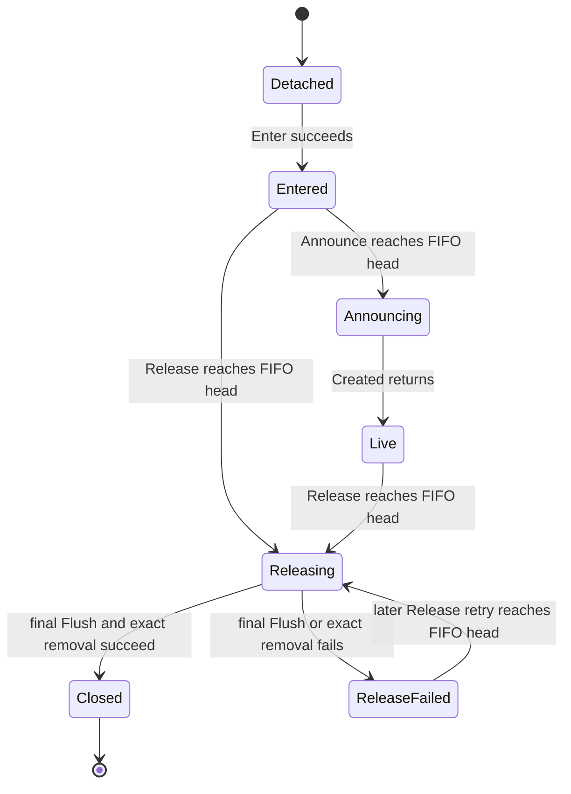

# Session Core、唯一写入口与生命周期设计

状态：Implemented

固定 DeepSeek Harness 基线：`47f943859bef60e4160492346772ded9b24f765a`

本文是 `session` Core 的唯一权威设计，拥有 Header、Event envelope、内存 append-only log、Surface、单 Session FIFO、LiveStore membership 与 Plugin Event publication。实现进度见[08](../../zh-CN/08-implementation-progress.md)，Persistence 见[19](../../zh-CN/19-session-persistence-and-sqlite.md)，Projection Cache 见[最终设计](../../zh-CN/SessionProjectionCache最终设计方案.md)，Context Compaction 见[24](../../zh-CN/24-context-compaction.md)。

## 1. 设计来源与 Go 差异

固定基线 `packages/core/session/src/index.ts` 中，`Session` 拥有 Header、append-only Event log、Surface 与 derived messages；`SessionStore` 拥有 prepare、enter、announce、flush 和 detach。Store attachment 是模块私有事实。`session/event` 在 Event 已进入内存 log 后发布，`session/created` 是可 veto 的 publication edge，Persistence 通过 `session/event`、`session/flush` 和 `session/disposed` 被动工作。

Go 允许多个 goroutine 同时使用一个 `Context`。因此 Goren 为每个 exact Session 增加一个 FIFO，以保证：

- `seq/time` 连续分配；
- state-dependent `WritePlan` 在队首读取最新 Snapshot；
- 一个 batch 全部验证后原子提交；
- Event publication、Flush 与 Release 不越过此前已准入的操作；
- 不同 Session 没有全局串行点。

这是并发安全适配，不增加第二个领域 coordinator，也不改变 wire 和 Event 语义。

## 2. 对象、所有权与依赖方向

| 对象 | 是什么 | 拥有 | 不拥有 |
| --- | --- | --- | --- |
| `sessionContext` | `session.Context` 的 concrete object | 一个 `eventLog`、一个 `sessionLifecycle`、Context 行为 | Store pointer、Plugin Runtime、Persistence、Projection |
| `eventLog` | 一个 Session 的内存事实与确定性派生状态 | Header、entries、Surface、derived cache、seq/time 分配 | lifecycle、membership、callback、I/O |
| `sessionLifecycle` | 一个 exact Session 的 lifecycle 和 operation admission owner | phase、FIFO waiters、membership token、event publisher、Release attempt | Event log、Store map、callback、I/O、goroutine |
| `memoryStore` | 进程内 live membership Store | `SessionID -> liveEntry`、进入顺序、Store close 状态 | Session 私有组件、durable facts、Plugin topology |
| `liveEntry` | 一次 exact Store membership | `sessionContext` 与不可复用 token 的配对 | 独立状态机、mutex、业务规则 |
| `sessionHandle` | 一次 exact membership 的 Release 能力 | Store 与 exact `liveEntry` | lifecycle 副本、Session ID 再解析 |
| `eventPublisher` | Core 使用的 typed publication port | Created/Appended/Flush/Disposed 调用形状 | Plugin Runtime 类型和注册策略 |
| `Plugin` | Session Core 到 Plugin Runtime 的 adapter | Service 发布、Event dispatch、post-commit failure reporting | Session phase、FIFO、Store membership |

对象图只有单向组合：



图中的 `Store -> eventPublisher -> Plugin` 是端口调用，不是 `sessionContext -> Store` 回指。`memoryStore` 只能调用 `sessionContext` 的 aggregate behavior，不能读取 `.log` 或 `.lifecycle` 私有成员；架构测试固定这一边界。

## 3. 公开 Context 契约

`session.New`、`LiveStore.Prepare/Get/List` 和 `Handle.Session` 返回 `Context`。公开接口只提供：

- `Header/ID/FirstLiveSeq/Seq/Events/Surface/Snapshot/DeriveMessages`；
- 唯一写入口 `Commit(context.Context, WritePlan)`。

返回的 Header、Event、Surface、Snapshot、Message 和 WriteResult 都与内部可变状态 detached。外部不能取得 aggregate mutex、FIFO、membership token 或具体实现类型。

Session Event envelope 保持：

```go
type Event struct {
    Type            string
    Seq             int64
    Time            int64
    Data            json.RawMessage
    SourceEventSeqs *[]int64
    SurfaceOp       *SurfaceOperation
}
```

`Seq` 是同一 Session Event log 中从零开始的连续位置；它不是 persistence revision。Revision 表示 durable log 的存储版本，归 Persistence 所有。

## 4. EventDraft、Surface 与 Event log

调用方先通过具名 Event definition 创建 `EventDraft`。draft 在进入 FIFO 前 detached；`eventLog` 在提交时验证 payload、safe integer、surface operation 与 provenance，并分配最终 `Seq/Time`。

Surface 只由 Event 的 append/replace operation 推导：

- append 将新 Event seq 加入当前 nodes；
- replace 只替换指定现存 span；
- provenance 保存在 Event 自身，不由 API 或 Projection 猜测；
- 一个 batch 的所有 transition 在临时状态上验证，任一失败则 entries 和 Surface 都不改变。

`eventLog` mutex 只保护 Header、entries、Surface 与 derived-message cache。它不会在锁内调用 Plugin、Store、Persistence、LLM、Tool、网络、文件或数据库。

## 5. 唯一写入口

### 5.1 固定 batch

普通 producer 使用：

```go
result, err := conversation.Commit(
    requestContext,
    session.Batch(firstDraft, secondDraft),
)
```

`Batch` 在 admission 前复制 drafts。固定 batch 的 `Build` 不需要读取 Snapshot；Session 仍然在 FIFO 队首验证并原子提交整个 batch。

### 5.2 基于队首状态构造 batch

只有结果必须依赖最新 Session 状态的 use case 才实现：

```go
type WritePlan interface {
    Build(context.Context, Snapshot) ([]EventDraft, error)
}
```

调用链是：

```text
Application -> sessionContext.Commit
  -> sessionLifecycle.beginCommit
  -> wait until this operation is FIFO head
  -> eventLog.snapshot
  -> WritePlan.Build
  -> prepare all drafts
  -> eventLog.commitBatch
  -> eventPublisher.Appended for each committed Event
  -> sessionLifecycle.finishOperation
```

`Build` 必须是短时、确定性的内存计算。LLM、Tool、网络、文件和数据库工作必须在 Commit 之前完成；plan 只重新校验并构造最终 drafts。

## 6. 单 Session FIFO

`sessionLifecycle` 的 FIFO 只保存：

```go
type operationWaiter struct {
    ready chan struct{}
}
```

业务参数保留在调用方栈上，不存在带 `kind/plan/store/context` 可选字段的 request union。`appendLocked` 把 waiter 放入队列；队首 waiter 的 `ready` 被关闭；`finishOperationLocked` 只在 lifecycle mutex 已持有时归还 baton 并唤醒下一位。

FIFO 排列 Commit、Enter、Announce、Flush 与 Release，但准入规则由 phase 决定：

- detached Session 可以 Commit，也可以进入一个 Store；
- Enter 安装 exact membership 后，Announce 发布 Created；
- Release admission 安装 `activeRelease`，从此拒绝新 Commit/Announce/Flush；
- Release 之前已经准入的 operation 继续按 FIFO 完成；
- final Flush 必须等到 Release waiter 到达队首才执行。

FIFO 没有常驻 goroutine，也没有跨 Session 全局锁。

## 7. Commit 结果、取消、panic 与重入

`WriteResult` 返回本次 batch 的 `FirstSeq/NextSeq/Barrier/Events`。空 plan 可以成功返回当前 barrier；无效 batch 不部分提交。

取消语义：

- admission 前已取消：不入队；
- FIFO 等待期间取消：到队首后不执行 plan，并归还 baton，避免在队列中删除中间节点；
- Build 后、commit 前取消：不提交；
- Event 已提交后取消：事实不回滚，observer failure 走 post-commit reporting。

`WritePlan.Build` panic 被转换成 error，并保证 FIFO 继续。Session publication context 带 exact `sessionContext` identity；同步 observer 对同一 Session 的 Commit、Flush 或 Release 返回 `ErrWriteReentry`，避免 callback 自锁。

## 8. LiveStore 与状态机

### 8.1 单 Session 生命周期

`sessionLifecycle` 是一个 exact Session 的唯一 phase owner。`sessionPhase` 只表示 Session 当前是什么；`releaseAttempt` 表示一次已准入的 Release 执行身份，两者不能互相替代：



| Phase | Session 是什么 | 允许的新动作 | 业务可见性 |
| --- | --- | --- | --- |
| `sessionDetached` | 尚未进入 Store 的 Session | Commit、Enter | 不在 Store 中 |
| `sessionEntered` | 已取得 exact membership、尚未完成 Created edge | Commit、Announce、Flush、Release | 可见，除非 Release 已准入 |
| `sessionAnnouncing` | Created callback 正在 FIFO 队首执行 | Commit、Flush、Release 可排队 | 可见，除非 Release 已准入 |
| `sessionLive` | Created edge 已完成的正常 live Session | Commit、Flush、Release | 可见，除非 Release 已准入 |
| `sessionReleasing` | terminal worker 正在 final Flush 和 exact removal | 不接受新业务操作 | 不可见 |
| `sessionReleaseFailed` | Release 失败但 exact membership 仍由原 Store 持有 | 仅允许 Release 重试 | 不可见 |
| `sessionClosed` | exact membership 已移除，Release 已完成 | Release 幂等返回 | 不可见 |

Release 可以在 `sessionAnnouncing` 期间准入，但它的 waiter 排在当前 Announce 后面；Created callback 完成后 phase 先进入 `sessionLive`，Release 到达 FIFO 队首时再进入 `sessionReleasing`。因此不需要另造 `releaseQueued` phase。

互斥事实不用多个 bool 表达：

- terminal admission 和并发 caller 共享的执行身份由 `activeRelease != nil` 表达；
- Enter/Announce 占位由对应 `operationWaiter` identity 表达；
- Created/Disposed 配对资格由 `creationState` 表达。

`activeRelease` 从 Release 准入持续到该 attempt 完成。它存在时，即使 phase 暂时仍是 `sessionEntered`、`sessionAnnouncing` 或 `sessionLive`，新 Commit/Announce/Flush 也会被拒绝，`Get/List` 也不再返回该 Session。Release 失败后 attempt 完成并清除，phase 进入 `sessionReleaseFailed`；后续 Release 创建新的 attempt。

`sessionLifecycle` 不调用 Store、Event observer 或 I/O。它在 mutex 内验证 phase、attempt 与 membership identity，并返回 `eventPublisher`、`releaseDecision` 等不可变引用；调用方释放 mutex 后执行副作用，再提交结果。

### 8.2 Store 准入与关闭

Store 不创建第二个 lifecycle 对象。`memoryStore` 自己拥有 `storePhase`：

| Phase | Store 是什么 | Prepare/Enter | Close |
| --- | --- | --- | --- |
| `storeOpen` | 正常接受 membership 的 Store | 接受 | 创建 `closeAttempt` 并进入 `storeClosing` |
| `storeClosing` | 已永久关闭准入、正在关闭或等待重试的 Store | 拒绝 | 有 `activeClose` 时共享该 attempt；没有时创建重试 attempt |
| `storeClosed` | 所有 exact membership 已释放的 Store | 拒绝 | 幂等成功 |

`closeAttempt` 只保存一次 Close 的完成信号和结果。`Close` 进入 `storeClosing` 后永久拒绝 Prepare/Enter，复制当前 `liveEntry` 顺序并在 Store mutex 外逆序 Release。并发 Close caller 等待同一个 `activeClose`；关闭失败后 phase 保持 `storeClosing`、旧 attempt 清除，后续 Close 创建新的 attempt 并重试仍处于 `sessionReleaseFailed` 的 membership；全部成功后进入 `storeClosed`。

Session 与 Store 使用同一套 `Phase + Attempt` 建模语言，但不是同一个状态机：一个 `storeClosing` 可以同时管理多个分别处于 `sessionLive`、`sessionReleasing`、`sessionReleaseFailed` 或 `sessionClosed` 的 Session。

### 8.3 exact membership

`liveEntry` 同时保存 exact `sessionContext` 与非零大小 `membershipToken`。Lifecycle 只接受当前 token；Store 删除时还必须验证 map 中仍是同一个 `liveEntry`。因此旧 Handle 不能影响后来复用同一 Session ID 的 Session。

`Get/List` 先取得 Store index snapshot，再调用 `sessionContext.visible()`。terminal admission 后 Session 立即不可见，即使 final Flush 尚未完成；失败后 `sessionReleaseFailed` Session 仍留在 Store 内供 exact Handle 或 Store Close 重试，但不恢复业务可见性。

`Announce/Flush` 的 exact membership 解析失败统一包裹 `ErrNotAttached`。这使消费方可以用 `errors.Is` 区分“当前对象已 detach 或不属于此 Store”和普通 Flush listener 失败，而不解析错误文本。

## 9. 调用链

### 9.1 Prepare、Enter、Announce

```text
Caller -> memoryStore.Prepare
  -> create detached sessionContext
Caller -> memoryStore.Enter
  -> sessionContext.beginEnter
  -> memoryStore.attachExact(liveEntry)
  -> sessionContext.finishEnter
Caller -> memoryStore.Announce
  -> sessionContext.beginAnnounce
  -> eventPublisher.Created
  -> sessionContext.finishAnnounce
```

Created callback 返回错误时，Announce 完成 publication edge 后请求同一个 Release 流程。已开始的 Created edge与成功移除后的 Disposed 配对。

### 9.2 Flush

```text
Caller -> memoryStore.Flush(exact Context)
  -> memoryStore.exactEntry
  -> sessionContext.beginFlush
  -> wait for FIFO head
  -> sessionContext.writeBarrier
  -> eventPublisher.Flush(Context, Session, Barrier)
  -> sessionContext.finishFlush
```

Persistence 被动满足 `Seq < Barrier.NextSeq` 的 committed prefix。Core 不查询 durable cursor，也不直接调用 SQLite。

### 9.3 Release

```text
Handle.Release -> memoryStore.release(exact liveEntry)
  -> sessionContext.requestRelease
  -> shared releaseAttempt.launch.Do(start terminal worker)
  -> caller waits releaseAttempt.done or its own Context

terminal worker -> sessionContext.startRelease
  -> wait for FIFO head
  -> eventPublisher.Flush(final barrier)
  -> memoryStore.removeExact(liveEntry)
  -> eventPublisher.Disposed when creationState requires pairing
  -> sessionContext.completeRelease
  -> close releaseAttempt.done
```

每个 caller 的等待 Context 可以取消，但 `releaseAttempt.requestContext` 使用 `context.WithoutCancel`，所以某个 waiter 放弃等待不会取消已取得所有权的 terminal cleanup。`sync.Once` 保证并发 Release caller 只启动一个 worker。

## 10. Plugin Event 语义

| Plugin Event | 时机 | 失败语义 |
| --- | --- | --- |
| `session/created` | exact membership 已进入 Store、业务可见前 | veto；随后通过 Release 回滚 membership |
| `session/event` | Event 已原子进入内存 log 后 | fail-soft；报告 `PostCommitFailure`，不回滚事实 |
| `session/flush` | Flush/Release 到达 FIFO 队首并取得 barrier 后 | 返回调用者；Release 失败进入 `sessionReleaseFailed` |
| `session/disposed` | exact membership 成功移除且 Created edge 已开始后 | best-effort cleanup notification |

`eventPublisher` 是 Core 内部 typed port；只有 `Plugin` 知道 `plugin.PublishEvent`、delivery policy 和 failure reporter。Event 名和 payload 保持固定基线兼容。`Plugin` 直接实现该端口；另加一个只转发到 Plugin 的 wrapper 不会形成新的职责。

## 11. 文件职责

| 文件 | 主要对象/协议 |
| --- | --- |
| `event_log.go` | `eventLog`、New、事实与 Surface/derived state |
| `event_types.go` | 固定 Session Event vocabulary 与 payload |
| `session_context.go` | `sessionContext` 的 Context read facade |
| `session_context_commit.go` | `sessionContext.Commit` 调用链 |
| `session_context_lifecycle.go` | Store 可调用的 `sessionContext` aggregate behavior |
| `session_lifecycle.go` | `sessionLifecycle`、FIFO、membership、Release attempt |
| `live_store.go` | `LiveStore`、Handle、typed `eventPublisher`、Plugin Event contract |
| `memory_store.go` | Store index、Prepare、Enter facade、exact lookup |
| `memory_store_lifecycle.go` | Enter/Announce/Flush/Release use case 编排 |
| `memory_store_close.go` | Store close phase、共享 attempt 与等待语义 |
| `plugin.go` | Plugin Runtime adapter 与 Event dispatch |

同一对象跨文件时使用公共前缀；Store 文件不访问 `sessionContext.log/lifecycle`，不保留旧 coordinator、request queue、state machine wrapper 或兼容路径。

## 12. 实现证据与验收

行为测试覆盖：

- state-dependent plan 在 FIFO 队首读取最新 Snapshot；
- batch 原子性、等待取消、Build 后取消、panic 与 draft detachment；
- Commit publication ordering 与同步重入拒绝；
- Flush/Release 顺序、terminal admission write seal、failed final Flush retry；
- Created veto、Disposed 配对、Announce/Release 并发；
- concurrent Release 共享一个 final Flush；
- Store Close 在 drain 前拒绝 Prepare/Enter；
- 旧 Handle 不影响复用 ID 的新 lifecycle。

架构测试固定：

- production 不再声明 `coordinator`、`requestQueue`、`lifecycleMachine`；
- `memory_store*.go` 不直接选择 `.log` 或 `.lifecycle`；
- public API、Event 名、wire field 和 dependency direction 不漂移。

全仓验证命令与最近结果由[08 实施进度](../../zh-CN/08-implementation-progress.md)统一记录。
