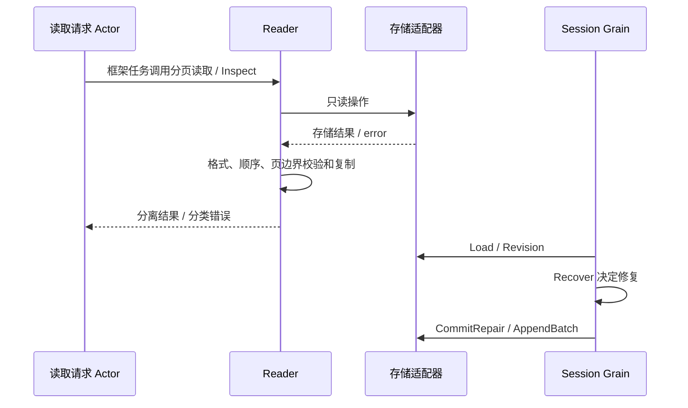

# Session Persistence

本包保留持久化读取校验、恢复业务规则与存储事务端口。旧 SessionLogStore Plugin、Factory、准备缓存和后台写入调度已删除；写入与 flush 由 Session Grain 负责。迁移设计见 [Persistence 模块](../../zh-CN/actor-design/26-session-persistence-module.md)。

## 主要对象与模块职责

| 对象 / 文件 | 职责 |
| --- | --- |
| Reader / reader.go | 校验并复制持久化读取结果，区分不存在、损坏、不支持格式 |
| ReadStorage / contracts.go | Reader 所需只读能力，不允许追加、修复或关闭适配器 |
| session/actor.Storage / RecoveryStorage | Session 消费方定义的追加与恢复端口；适配器实现相应方法 |
| Recovery / recovery_plan.go | 根据持久化事实生成恢复输入和 LogRepair |
| recovery.go | 日志格式、未知事件、中断 turn/tool 的业务校验与修复规则 |
| sqlite | database/sql 与 sqlc 存储适配器，执行请求的事务 |

Reader 只有存储读取依赖，没有 Session.Context、Plugin、锁、计时器、后台任务或准备记录。Recover 不执行 I/O。Reader 与 Session Grain 不互相持有对象。

## 交互流程

Inspect 不修复、不创建 Session；恢复只能由 Session 生命周期执行。ReadEventsFrom 保留 revision 供分页消费者核对。ReadEventsBefore 返回最新事件在前的连续窗口；ListSnapshots 保持创建时间降序与 SessionID 稳定排序。ReadRaw 返回适配器原始文本，不解释未知格式。

## 生命周期、错误与取消

组合根打开和关闭共享适配器。Reader 不拥有关闭权，存储请求使用调用方 context。不存在返回 NotFoundError；事件或身份损坏返回 CorruptionError；完整但不支持的版本或必需事件返回 UnsupportedFormatError。后端 I/O 错误原样传递，不伪装成 cache miss。

旧 liveWriter / sessionGates / preparedSessions 等不再承担重复生命周期。Session Grain 已有实际写入、flush、取消、恢复和关闭测试；这些测试不证明 Query、Title、API Proxy 或组合根已经迁移。

## 验证与剩余工作

Reader 测试覆盖页缺失、错误身份、版本与未知事件、序号缺口、空续页、存储错误和数据隔离；真实 SQLite 测试覆盖 Inspect、双向分页、列表 revision 和读取不修改日志。Recovery 业务与存储适配器测试保留。

尚需接入读取请求 Actor、Query/API Proxy/Cache 消费者和生产组合根，并删除 Session 根包的旧 Context / MemoryStore 及旧事件链。当前不能宣称整个 Session 已完成 Actor 重构。
