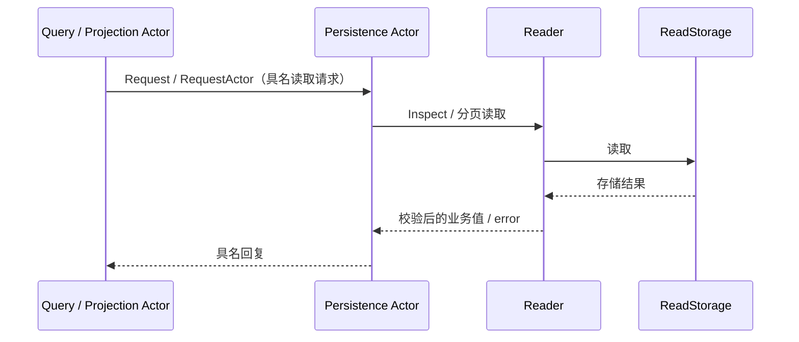

# Persistence 读取 Actor

本包通过具名请求暴露持久化读取，设计见 [Persistence 模块](../../../zh-CN/actor-design/26-session-persistence-module.md)。

`Actor` 串行调用业务 `Reader`；`messages.go` 定义日志检查、元数据列表和双向事件分页契约。Reader 负责格式与分页校验，存储适配器负责 I/O。Actor 不保存日志、不激活 Session、不修复或追加数据。

组合根传入已打开的存储，先停止 Actor，再关闭存储。Actor 不另建 worker、锁或队列；I/O 只占用自己的处理过程。请求上下文传入存储；不存在、损坏、取消等错误原样保留，不返回伪造的空日志。停止 Actor 不关闭共享适配器。
