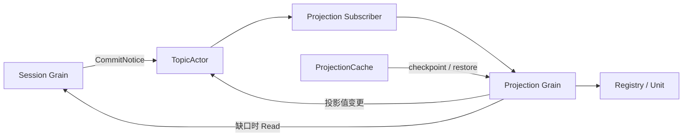

# Session Projection

本包实现领域 Unit 的注册、增量折叠与 checkpoint 恢复。Actor 重构设计与当前边界见 [模块设计](../../zh-CN/actor-design/23-session-projection-module.md)。

## 对象与职责

| 对象 | 职责 |
| --- | --- |
| Unit | 定义状态版本、初始状态、事件转换和视图；不执行 I/O |
| Registry | Unit 注册与移除、离线 checkpoint 恢复 |
| Projection | 一份日志的独立派生状态；单向引用 Registry |
| Snapshot / Change | 面向消费者的完整投影值 |
| Checkpoint | 按 Unit 保存版本、已处理序号与内部 JSON 状态 |

业务对象不依赖 Plugin、GoAkt 或存储，也不使用 mutex。调用方串行访问。状态转换及视图验证全部成功后才安装，失败保留旧游标；较旧快照不会倒退在线游标。注册返回值 ID，同一 ID 重复移除不影响后续注册。

## 事件与模块交互

框架入口位于 `actor`。连续事件由 Advance 直接计算，缺少前缀返回 ErrHistoryRequired；框架层异步读取 Session 后补齐。注册、快照、checkpoint 与离线恢复使用具名请求。Projection 变更通知采用尽力投递，不能作为日志或 checkpoint 的耐久性确认。

## ProjectionCache 的关系

Projection 负责计算，ProjectionCache 负责缓存持久化与冷读取加速。对外投影值不等于内部 checkpoint state；ProjectionCache 不能简单地把投影变更事件作为 checkpoint 存储。旧缓存监听 Session 追加与关闭事件，根据阈值、定时器或关闭流程请求 checkpoint，确认 Session flush 后写入。Actor 迁移保留这个职责关系。

## 尚未完成

运行身份已移到 Actor 层；业务层使用独立 Projection，不再接受 History 或 CreationID。ProjectionCache、subagent 与 API Proxy 调用者尚未迁移到新接口，旧 Factory 已删除，不提供兼容包装。ClosedNotice 已接入，释放投影后拒绝相同创建的迟到通知，并丢弃在途补读结果；依赖方的强关闭确认与缓存最终写入顺序仍待接入。当前测试通过不表示生产接线或整个 Session 重构完成。
