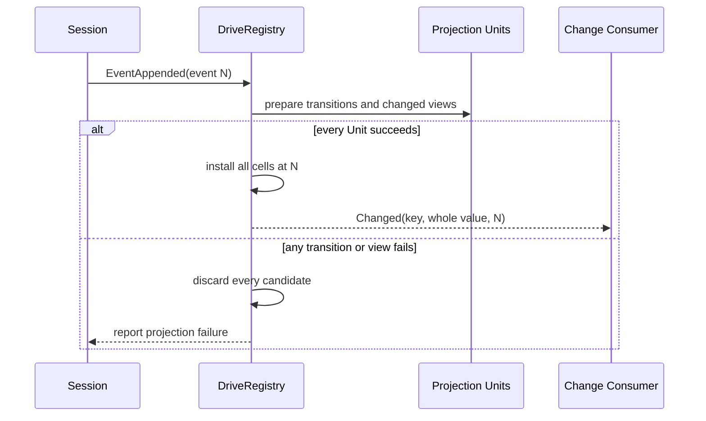

# Session Projection Registry

本包拥有 Session Projection 的注册表与同步 drive。它把 committed Session Event 折叠为领域 Unit 自己定义的可重建 state，提供一致 `Snapshot`、可持久化 `Checkpoint`、cold `Restore`，并以 `session/projection` 发布发生变化的 whole value。

## 职责与非职责

本包负责 Unit 注册与引用计数、每 Session cell、`observedSeq`、跨 Unit staged commit、迟注册或失败后的日志补折、版本化 checkpoint restore，以及 change feed。Unit 自己拥有 `InitialState`、`ApplyState`、`ViewState` 和 `StateVersion` 的领域规则。

本包不拥有 Session Event 事实、checkpoint 写入时机、SQLite、API Proxy frame、客户端 Projection Store 或具体 Projection 的业务含义。Session Log 始终是事实源；可重建 checkpoint 的持久化由 [`session/projectioncache`](../projectioncache/README.zh-CN.md) 负责。权威跨包设计见[Session Projection 与 Title](../../zh-CN/18-session-projection-and-title.md)，实施证据见[全仓进度](../../zh-CN/08-implementation-progress.md)。

## Live fold 与 staged commit

准备阶段不会修改 live cells。所有候选 transition 和所需 view 都成功后，Registry 才在同一个 lock 内安装全部 cells；随后解锁并按注册顺序逐 key 发布变化。`Changed=false` 不产生通知，但该 Unit 的 `observedSeq` 仍推进。

失败不能回滚已经 committed 的 Session Event。既有 cells 保留先前 cut；后续 live event 会先补折缺失 prefix，`Snapshot` 和 `Checkpoint` 也会从 `observedSeq+1` 补齐。补折仍失败时不跳过坏 event，也不伪造成功 projection。

## 读取、恢复与生命周期

`Snapshot` 和 `Checkpoint` 同样先准备全部 Unit，再统一安装补折后的 cells。`RestoreFloor` 根据当前注册 Unit、row 版本和 watermark 选择 durable suffix 起点；`Restore` 只接受连续 events，并返回同一 `endSeq` 上的 snapshot 与 refreshed checkpoint。

Unit 的最后一个注册 handle 释放后，key 和全部 cells 一起移除；Session dispose 删除该 Session 的所有 cells。Unit fold 是同步纯计算，不接收 `context.Context`、不执行 I/O，也没有独立取消边界。change 发布发生在 state commit 之后并采用 best-effort delivery；通知失败不能回滚 cells 或 Session facts，消费者通过 list/history baseline 恢复。
