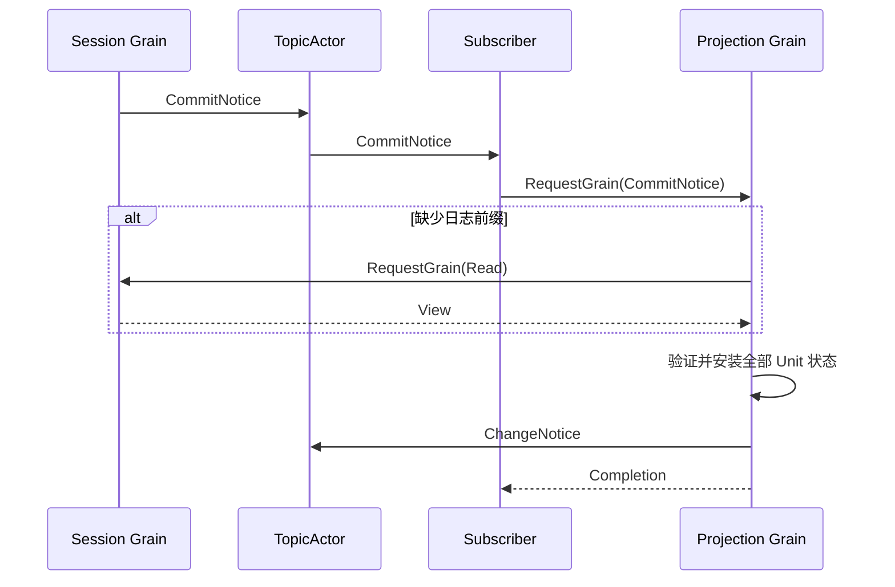

# Projection Actor 入口

本包负责 Session 事件订阅、Projection 请求处理与变更通知。业务计算位于父包，设计见 [Projection 模块设计](../../../zh-CN/actor-design/23-session-projection-module.md)。

`Grain` 独占 Registry 和按运行身份隔离的 Projection，以具名消息处理注册、读取、checkpoint 和恢复。`Subscriber` 是 TopicActor 所需的普通 Actor 订阅端，仅将 Session CommitNotice 通过 RequestGrain 转发给 Grain，不拥有投影状态。组合根使用启用 PubSub 的 ActorSystem，为订阅器开启请求重入，并等待 Subscribed 就绪确认后放行事件。

重复事件不重复发布；连续事件不读取 Session。补读失败或 Unit 失败返回 error，订阅器记录失败。异步补读不保留 GrainContext。投影通知属于尽力投递，查询仍须以日志为依据。

停止订阅器不会关闭 Projection 或 Session；TopicActor 监控会移除订阅。Grain 停用清除可重建状态，重新激活需要重新注册 Unit。运行身份已移出业务契约，ClosedNotice 已释放投影并保留关闭标记以拒绝迟到通知，跨组件强关闭确认仍未完成，生产启动流程尚未接入。

本包测试验证直接计算、重复事件、checkpoint 与恢复；`session/actor/projection_events_test.go` 使用真实 Session Grain 和 SQLite 验证提交事件订阅、缺口补读与后续增量计算。

Subscriber 按顺序确认提交与关闭两个 topic 的订阅后才发送 Subscribed。关闭通知清理与 Session 关闭回复是两个独立结果；测试分别验证。
