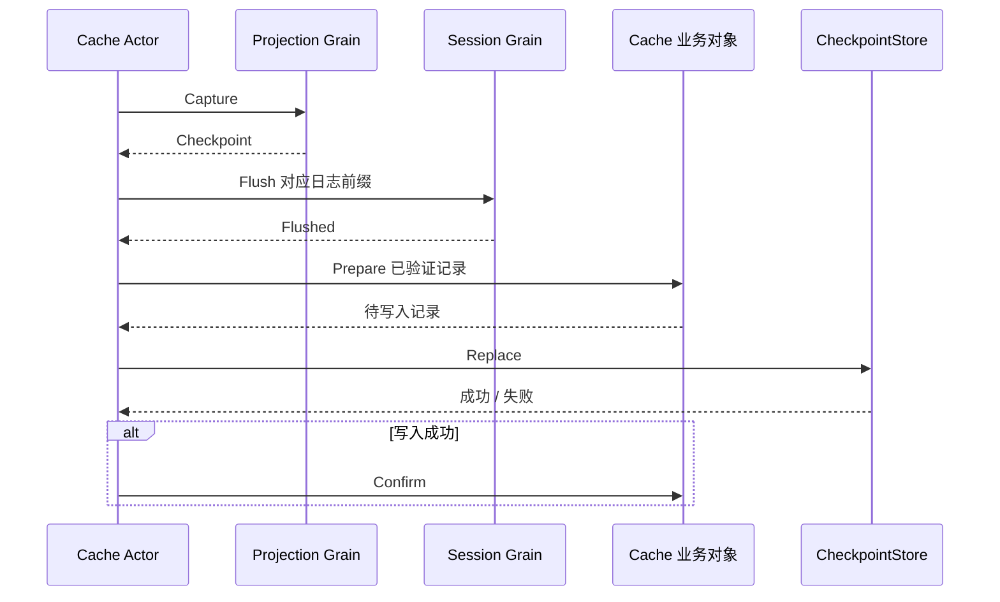

# Session Projection Cache

本包保存可重建的投影 checkpoint，Session 日志始终是唯一事实源。Actor 迁移契约和验证清单见 [模块设计](../../zh-CN/actor-design/24-projection-cache-module.md)。

## 已迁移的业务对象

| 对象 | 职责 |
| --- | --- |
| Cache | 按 SessionID 管理已确认持久化的记录；验证、准备、确认和分离读取 |
| CheckpointRecord | 日志身份与 Unit 状态集合，纯验证、复制和合并 |
| Progress | 日志前缀、turn/end 与写入期限的纯触发规则，不持有定时器 |
| Replay | 不执行 I/O 的分页重放进度、日志身份与 revision 校验 |
| LogIdentity | 通过 CreatedAt 与 CWD 区分持久化日志，不是 Actor 运行身份 |
| CheckpointStore | 消费者定义的存储端口；SQLite 实现只执行 I/O |

Cache 不持有存储、Session、Projection 或 Actor 引用，不使用锁。其所有者负责串行调用。Prepare 返回分离的待写入记录，nil 表示现有记录已经覆盖输入；只有存储成功后才 Confirm。读取返回已确认记录的副本，调用方修改副本不会改变缓存。

同一日志、相同 Unit 版本下逐行保留较新序号，防止混合新旧行时回退进度；新集合缺少的 Unit 行保留。日志身份变化时整体替换。NewCheckpoint 校验候选行共享同一 cut，且已被 Session durable barrier 覆盖。

## 依赖与交互

Projection 负责 Unit 算法和内部 state，Cache 负责缓存记录和存储策略。ChangeNotice 中的对外 view 不足以生成 checkpoint。调度仍应由 Session 提交、关闭、事件阈值和时间间隔驱动，持久化必须有 flush 确认。

## 当前迁移状态与验证边界

旧记录管理、同步读取器、facade、手写调度器、Plugin 和 Factory 已删除，未保留转发兼容层。业务对象、存储端口与 SQLite 适配器可以独立编译；[缓存 Actor](actor/README.zh-CN.md) 已实现每 Session 写入与确认入口；已有缓存读取与冷读取编排，API 消费者和生产启动已接入；自动 checkpoint 调度与冷读写回仍待完成。

业务测试覆盖记录复制、合并、写入前不可见、确认、日志身份、durable cut、分页 revision、失败不推进游标、重复通知、阈值、期限和 turn/end。SQLite 适配器测试验证记录存取与替换。Actor 测试另外验证了同 Session 串行写、不同 Session 独立推进、失败重试、关闭等待及外部超时不提前结束底层写入。

已删除的旧实现测试中，同 Session 串行写、不同 Session 独立推进、关闭排空、最终 checkpoint、分页 I/O、write-back 失败隔离仍是迁移要求，列在模块设计的验证清单中，后续用真实框架测试覆盖。

共享 actor.Registry 管理冷/热 Session 的缓存身份，API 的 actor.Cache 只提交原有读消息。正常关闭等待缓存 Close，再停止框架和关闭共享存储；强制中止冷读取时的 I/O 排空仍需进一步故障验证。生产重启标题与并发生命周期证据见 [集成记录](../../zh-CN/actor-design/40-integration-findings.md)。
