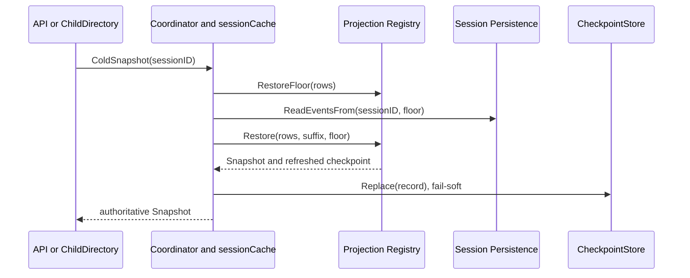
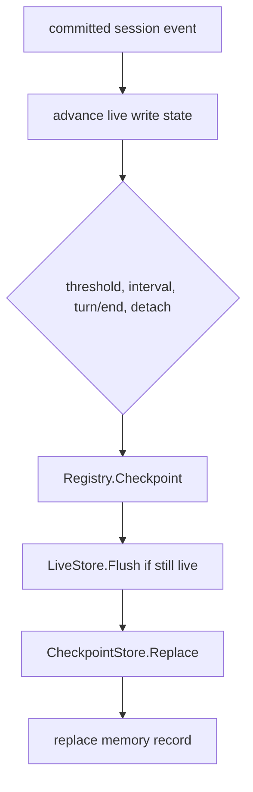

# Session Projection Cache

本包拥有可重建 Session Projection checkpoint 的业务模型。`Coordinator` 统一管理准入、依赖、关闭和 `SessionID -> sessionCache` 索引；每个 `sessionCache` 管理该 ID 的 exact lifecycle writer，`recordCache` 管理该 ID 的当前 record 与持久化替换。Session Event Log 始终是唯一事实源；删除、损坏或落后的 cache 只影响读取成本，不改变结果。

## 职责与非职责

本包负责：

- 由 `Coordinator` 为每个 Session ID 建立独立 `sessionCache`，不在全局对象保存所有 writer/record 锁状态；
- `recordCache` 保存一个当前 `CheckpointRecord`，record 内包含多个 Projection Unit row，并串行同 ID 的完整 Replace；
- `checkpointWriter` 对应一个 exact Session lifecycle，`checkpointSchedule` 用业务转换表达 dirty、rerun、retire 与 final attempt；
- 校验 `{createdAt, cwd}` Log Identity，禁止复用另一个 Session 生命周期的 state；
- 使用 `Registry.RestoreFloor`、`Persistence.ReadEventsFrom` 和 `Registry.Restore` 完成 suffix 恢复；
- 根据事件数量、时间、`turn/end` 和 detach 调度 checkpoint；
- 保证单 Session record 写入串行，以及 `Checkpoint -> LiveSessionFlusher.Flush -> CheckpointStore.Replace` 的耐久顺序；
- 在关闭时停止准入和 timer，排空已经进入存储边界的操作。

本包不负责 Session 事实、Projection Unit 业务规则、Plugin Runtime 适配、SQLite schema、`session.list/history` wire 映射或 Subagent identity 解释。业务层只消费自己定义的 `LiveSessionFlusher`、`DurableEventReader`、`CheckpointProjector` 和 `CheckpointStore` 最小端口；完整 Runtime Service 的解析与事件翻译位于 [`projectioncache/plugin`](./plugin/README.zh-CN.md)。跨模块最终契约见[Session Projection Cache 最终设计](../../zh-CN/SessionProjectionCache最终设计方案.md)，实施证据见[08 实施进度](../../zh-CN/08-implementation-progress.md)。

## 对象与文件职责

| 对象/文件 | 职责 |
| --- | --- |
| `Coordinator` / `coordinator*.go` | 全局 open/closing/closed、依赖、in-flight drain、per-Session cache 注册与 read/live use case |
| `sessionCache` / `session_cache.go` | 一个 Session ID 的 exact lifecycle writer 注册和 epoch 选择 |
| `recordCache` / `record_cache.go` | 一个 Session ID 的 record snapshot、merge、dominance 与 `CheckpointStore.Replace` 串行化 |
| `checkpointWriter` / `checkpoint_writer.go` | 一个 exact lifecycle 的 timer、projection/flush/replace I/O 编排 |
| `checkpointSchedule` / `checkpoint_schedule.go` | 无锁 dirty/rerun/retire/final-attempt 决策，不执行 I/O |
| `contracts.go`、`record.go` | 消费端口、配置、record/identity 值与纯校验规则 |

## 读取流程

`CachedSnapshot` 只读取内存 record index，不执行 SQLite 或 Session-log I/O。非空结果表示命中，`nil, nil` 表示正常未命中，`nil, err` 表示读取失败。它只选择当前已注册且 `StateVersion` 匹配的 row，并用所选 row 的最小 seq 作为安全的 `AsOfSeq`。`ColdSnapshot` 必须用当前 durable log 证明结果；identity、版本、anchor、row state 或 suffix 不足时从 `seq=0` 全量重放。

Registry 没有 Unit 时，`ColdSnapshot` 只读取最新一条事件：`Values` 为空，最新事件 seq 写入 `Snapshot.AsOfSeq`；空日志使用 `-1`。cut 属于整个 Snapshot，不属于空 `Values`。

## 写入与生命周期

同一 exact Session lifecycle 只有一个 `checkpointWriter`。写入期间到达的新事件由 `checkpointSchedule` 保留为 pending 或 immediate rerun，不会被成功回调盲目清零。`Retire` 把下一次 attempt 明确变为不再 Flush 的 one-shot final write；同 ID 新 lifecycle 取得更高 epoch 后，旧 writer 不能覆盖新 record。相同 lifecycle 的新 record 会保留 Registry 当前未注册的旧 row；Registry 读取时仍忽略未知 Unit。

内存 record 在准入和替换前完成校验与 detachment，`recordCache` 对外返回 detached snapshot，持久化只执行完整 record Replace。live writer 不保存无决策用途的 seq 副本；`checkpointSchedule` 以 observed/checkpointed event prefix 表达 pending 数，并以具名 attempt/completion 表达 live、final、continue、retry、idle 和 remove。

cache 可以落后 durable log，不能领先 durable log。后台写入或 cold write-back 失败通过 `FailureReporter` 报告；Session 权威读取失败、完整 fold 失败和请求取消返回调用者。
