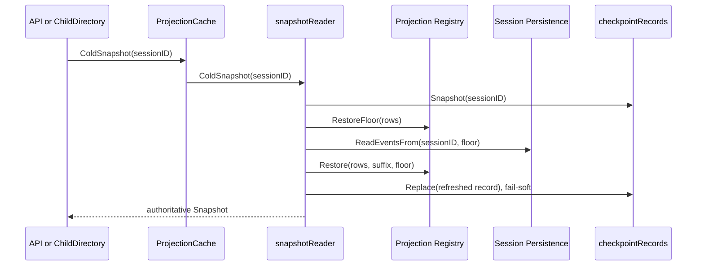
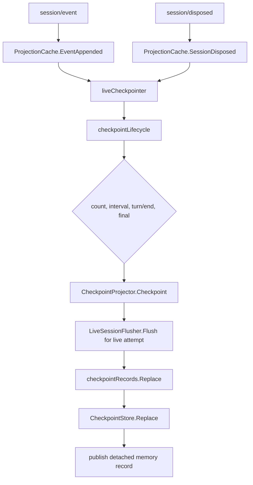

# Session Projection Cache

本包拥有可重建 Session Projection checkpoint 的业务模型。Session Event Log 始终是唯一事实源；checkpoint 删除、损坏、落后或被另一 Log Identity 覆盖，只能降低命中率，不能改变权威读取结果。跨模块契约见[Session Projection Cache 最终设计](../../zh-CN/SessionProjectionCache最终设计方案.md)，实现证据见[08 实施进度](../../zh-CN/08-implementation-progress.md)。

## 职责与非职责

本包负责：

- `ProjectionCache` 管理 `created -> opening -> open -> closing -> closed` 生命周期、调用准入和关闭排空；
- `liveCheckpointer` 根据事件数量、时间、`turn/end` 和 `session/disposed` 驱动 exact `session.Context` 的 checkpoint；
- `checkpointLifecycle` 表达一个 exact Session 从 clean、dirty、active、final 到 closed 的 checkpoint 生命周期，只迁移状态并产生命令，不执行 checkpoint I/O；
- `snapshotReader` 使用 checkpoint、restore floor 和 durable suffix 生成读取结果，必要时从 `seq=0` 全量回退；
- `checkpointRecords` 按 Session ID 保存一个完整 record，并用 per-ID `recordEntry` 串行 compare、merge、durable Replace 和内存发布；
- 通过 `{createdAt, cwd}` Log Identity 校验 record 是否属于调用方正在读取的 durable log。

本包不拥有 Session 事实、live membership、Projection Unit 业务规则、Plugin Runtime、SQLite schema、API wire 或 Subagent identity。它只消费自己定义的 `LiveSessionFlusher`、`DurableEventReader`、`CheckpointProjector` 和 `CheckpointStore` 端口。

## 对象与文件职责

| 对象/文件 | 职责 |
| --- | --- |
| `ProjectionCache` / `projection_cache.go` | 生命周期、公开调用准入、组件装配与关闭顺序 |
| `liveCheckpointer` / `live_checkpointer.go` | exact Session 索引、触发策略、异步 attempt 和 I/O 顺序 |
| `checkpointLifecycle` / `checkpoint_lifecycle.go` | 单 exact Session 的显式状态机、attempt identity、timer generation 与下一条执行命令 |
| `snapshotReader` / `snapshot_reader.go` | cached read、cold suffix restore、全量回退与 fail-soft write-back |
| `checkpointRecords`、`recordEntry` / `checkpoint_records.go` | record index、per-ID 串行替换、dominance、merge 和 durable-before-memory 发布 |
| `contracts.go`、`record.go` | 消费端口、配置、record/identity 值与纯校验规则 |

这些对象只有单向引用：`ProjectionCache` 构造三个组件；`liveCheckpointer` 和 `snapshotReader` 可以调用 `checkpointRecords`；子对象都不回指 `ProjectionCache`，`recordEntry` 也不持有父集合或 Store。

## 读取流程

`CachedSnapshot` 只读内存 record，不执行 SQLite 或 Session-log I/O。非空结果表示命中，`nil, nil` 表示身份或版本不兼容导致的正常 miss。它使用所选 row 的最小 seq 作为安全 `AsOfSeq`。

`ColdSnapshot` 先验证 durable Header 与 record identity，再从所有已注册 Unit 的 restore floor 读取 suffix。日志缩短、identity 变化、revision 变化或 checkpoint 无法继续时，从 `seq=0` 全量重放。Registry 没有 Unit 时只读取最新一条 Event 来确定 cut。

## 写入与生命周期

同一 exact Session 最多一个 active attempt；写入期间满足条件的新触发通过 `Queued` 合并为一次后续 attempt。`session/disposed` 请求一次不再 Flush 的 final attempt，即使此前没有收到 append 事件也会生成 checkpoint。失败保留 dirty prefix，通过 `FailureReporter` 报告，并等待后续 timer、事件或 final trigger，不在失败循环中忙重试。

live attempt 与 Session Release 竞争时，`LiveSessionFlusher.Flush` 可能返回 `session.ErrNotAttached`。这表示该 live attempt 已被 detach 淘汰，不作为缓存故障报告；dirty prefix 保留，随后由 `session/disposed` 的 final attempt 在不 Flush live Session 的情况下收敛。

Session ID 只是可复用 record slot。不同 Log Identity 不选举 current writer，也不保证完成顺序；最后完成的 Replace 可以覆盖 slot，但读取必须先验证 identity。相同 identity 的候选不得让已有 Unit row 倒退，并保留当前候选缺少的旧 Unit row。

`ProjectionCache.Close` 拒绝新调用，等待正在进行的 `Open` 收敛，排空已准入调用，停止 timer，等待 checkpoint goroutine，再关闭 `CheckpointStore`。业务对象自己保证这条生命周期顺序，不依赖 Plugin Runtime 的调用串行性。
