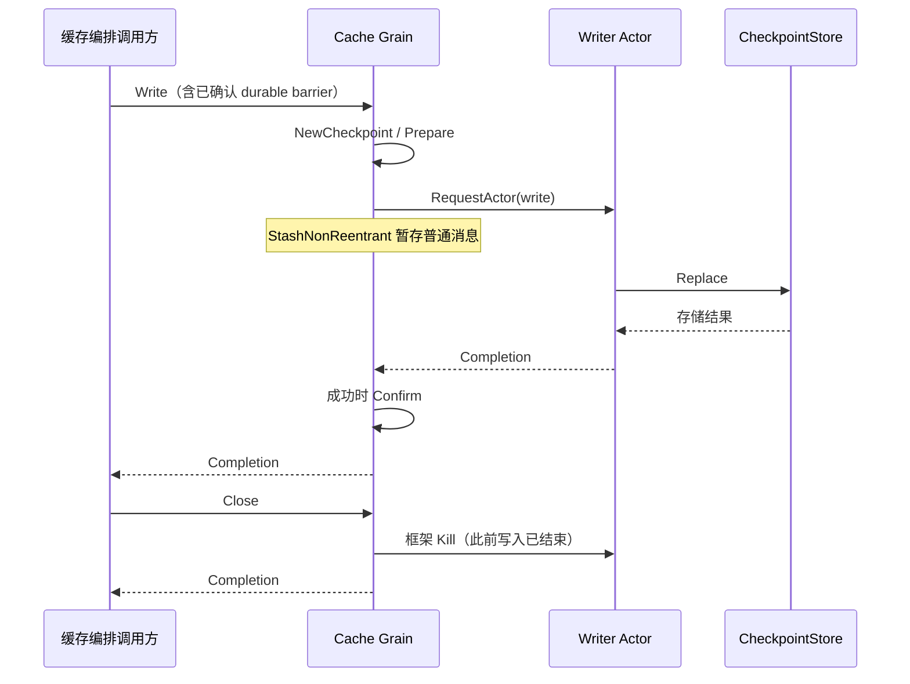
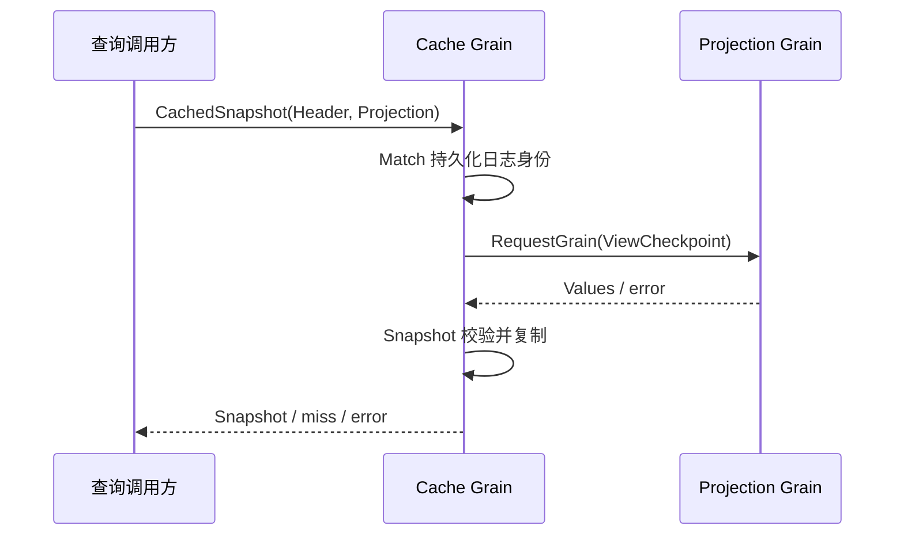
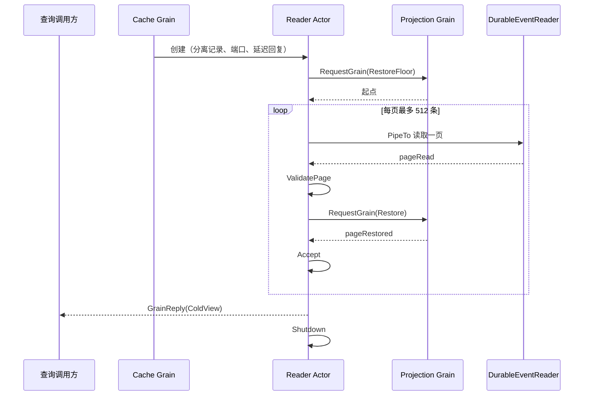

# ProjectionCache Actor

本包当前实现每 Session 的 checkpoint 写入、确认、已保存快照和分页冷读取入口。完整迁移契约见 [ProjectionCache 模块设计](../../../zh-CN/actor-design/24-projection-cache-module.md)。

## 对象职责

| 对象 | 职责 |
| --- | --- |
| Grain | 以 SessionID 为框架名称，拥有纯业务 Cache，校验并合并写入，成功后确认记录 |
| reader | 一次性恢复 Actor，驱动 Replay 分页读取与 Projection 恢复，回复后退出 |
| writer | 每个缓存 Grain 的独立 I/O Actor，仅调用共享 CheckpointStore.Replace |
| Initialize / Write / Read / CachedSnapshot / Close | 具名命令；Completion / Record / Snapshot 保留 error 与分离的读取结果 |

业务 Cache 不持有 Writer 或存储端口。Writer 不反向引用 Grain，也不决定写入 cut、合并或触发策略。共享存储适配器由组合根关闭。

## 消息与存储流程

Writer 创建时显式使用 LongLivedStrategy，空闲时不会由框架提前停用；它的生命周期由所属 Cache 的 Close / OnDeactivate 结束。Writer 在自己的 Receive 中执行存储调用，不创建 goroutine。它的阻塞只占用该 Session 的 I/O Actor；缓存 Grain 的请求是异步的，不同 Session 的 Writer 可以独立推进。

同一 Grain 的后续 Write、Read 和 Close 由 GoAkt 暂存至存储请求结束。内部存储请求不设超时；外部调用方超时只结束其等待，不能提前释放底层写入顺序。失败不调用 Confirm，后续可重试。Read 只返回已确认且日志身份匹配的记录。

Close 等待框架此前接收的写入，停止私有 Writer，不关闭共享存储。正常编排先 Close，再停用 Grain；OnDeactivate 只负责兜底释放 Writer，不能代替业务成功确认。

## 当前验证与剩余工作

真实框架测试使用可阻塞、可失败的存储验证：同 Session 写入顺序、不同 Session 独立推进、读取只见确认记录、失败重试、关闭等待以及外部超时不提前释放底层写入。SQLite 适配器另有真实存储测试。

自动通知订阅、Progress 定时触发、Read / Capture / Flush 的完整业务编排、启动 LoadAll、冷读取写回和生产接线尚未接入。本包通过测试不表示整个 ProjectionCache 迁移完成。

## 已保存快照读取

CachedSnapshot 接收 Header 与 Projection Grain 地址。Grain 校验 Session 与日志身份后，向 Projection 异步请求 ViewCheckpoint，再使用 CheckpointRecord.Snapshot 形成业务视图与公共 AsOfSeq。Projection 拥有 Unit 版本匹配和 ViewState 计算；Cache 不解释 Unit 的内部状态。没有记录或没有兼容 Unit 返回 nil，通信与计算失败返回 error。

真实框架测试覆盖缓存缺失、无 Unit、版本变更、日志身份变更、视图与内部状态分离、返回数据隔离，以及计算失败不能伪装成 miss。这个入口不读取最新 Session 日志，分页冷读取使用下述独立 Reader。

## 分页冷读取

ColdSnapshot 提供共享日志读取端口与 Projection 地址。Grain 复制已确认记录，将延迟回复交给一次性 reader；reader 不持有 Cache 对象。Replay 拥有业务校验与游标，reader 只安排框架任务和消息。各页必须具有同一 Header 和 revision。

缓存日志身份不匹配或 Projection 恢复失败时，有初始 checkpoint 的读取最多丢弃它并重试一次；存储错误、通信错误和跨页日志变化直接返回 error。没有 Unit 也读取到日志末尾。reader 停止前尚未成功回复时返回明确错误，不伪造完成。

冷读取独立于缓存写入，不关闭共享适配器。当前 ColdView 返回证明后的视图和 checkpoint，尚未自动写回。缓存 Close 仅保证先前写入结束；组合根对共享存储的最终关闭仍需覆盖全部读取使用者。

框架测试覆盖 1100 条事件的多页恢复、跳过已保存前缀、错误日志身份从零重试、无 Unit 的末尾序号、跨页 revision 变化与 I/O 失败。

## 生命周期与服务地址

Projection Cache Grain 使用 `<sessionID>.projection-cache` 名称，Initialize 显式携带 SessionID。Writer、Reader 和记录校验使用该业务 ID，不从 Actor 名称恢复 ID。RuntimeName 位于消息契约文件。

## 生产 Registry 与客户端

`registry.go` 的 Registry 只负责每 Session Grain 的启动登记与关闭，具有固定身份 projection-caches。ConfigureRegistry 安装分离的 LoadAll 基线；CacheForSession 在 Initialize 回复成功后才返回地址；CloseRegistry 停止取得并关闭登记项，失败保留责任。业务算法仍在原 Cache/Replay，API actor.Cache 只提交 CachedSnapshot / ColdSnapshot；共享存储由 Server 最后关闭。并发取得、写入与重复关闭使用真实 SQLite 验证。完整方案见上述模块设计。
