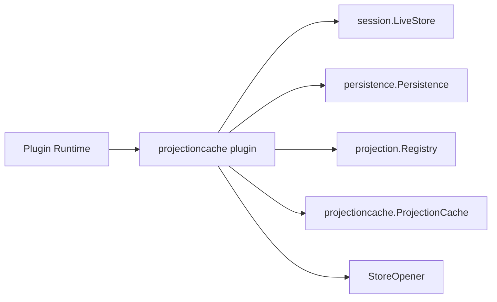

# Session Projection Cache Plugin

本包是 `projectioncache.ProjectionCache` 与 Plugin Runtime 之间的 adapter，不拥有 checkpoint 状态、调度算法、恢复规则或 SQLite。

`Manifest` 发布只读 `projectioncache.Cache`，要求 Session LiveStore、Persistence 和 Projection Registry，只订阅 `session/event` 与 `session/disposed`。固定基线没有 `session/created` 输入；checkpoint lifecycle 在第一条 append 或 dispose 到达时按 exact `session.Context` 惰性建立。

`Apply` 解析完整 Runtime Service、打开 `CheckpointStore`，再调用 `ProjectionCache.Open` 注入业务层定义的最小端口。`ObserveEvent` 只完成两种翻译：`session.EventAppended -> EventAppended`、`session.Disposed -> SessionDisposed`。`Dispose` 调用 `ProjectionCache.Close`。

`ProjectionCache` 自己拥有并发 Open/Close、准入和关闭排空；本 adapter 不把 Plugin Runtime 调用顺序当作业务正确性前提。本包也不定义 Factory config、不导入 SQLite adapter、不解释 Projection Unit，不实现 API 或 Subagent 用例。完整契约见[最终设计](../../../zh-CN/SessionProjectionCache最终设计方案.md)，实现证据见[08 实施进度](../../../zh-CN/08-implementation-progress.md)。
