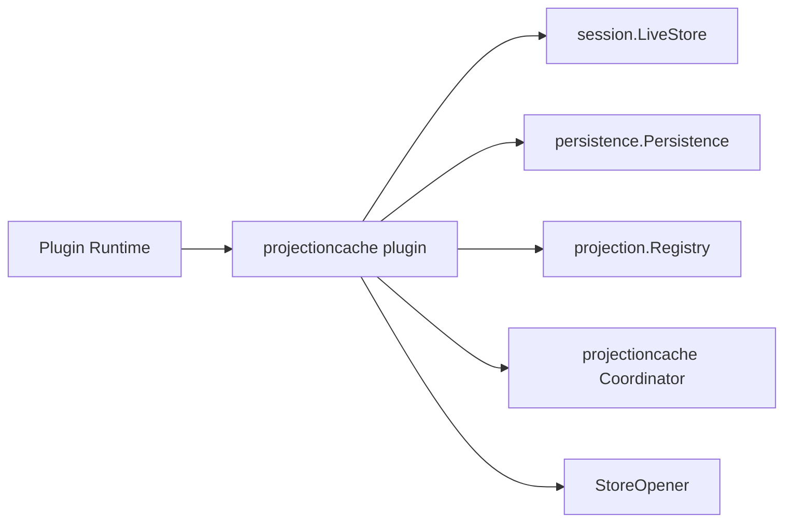

# Session Projection Cache Plugin

本包是 `projectioncache.Coordinator` 与 Plugin Runtime 之间的生命周期 adapter，不拥有 checkpoint 状态、调度算法或 SQLite。

`Manifest` 发布 `projectioncache.Cache`，要求 Session LiveStore、Persistence 和 Projection Registry，并订阅 `session/created`、`session/event` 与 `session/disposed`。`Apply` 解析完整 Runtime Service、打开 `CheckpointStore`，再把它们作为业务层拥有的最小端口注入 `Coordinator.Open`；事件 observer 只分别翻译为 `Begin`、`Advance`、`Retire`；`Dispose` 调用 `Coordinator.Close`。业务包不导入 Plugin Runtime，也不通过 marker interface 反向耦合 Plugin。

本包不定义 Factory config、不导入 SQLite adapter、不解释 Projection Unit，也不实现 API 或 Subagent 用例。完整契约见[最终设计](../../../zh-CN/SessionProjectionCache最终设计方案.md)，真实实现证据见[08 实施进度](../../../zh-CN/08-implementation-progress.md)。
