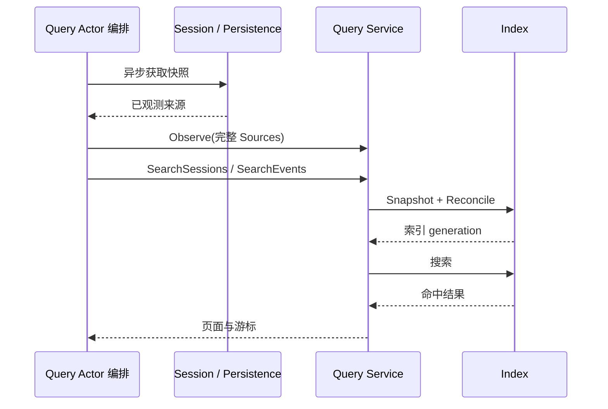

# Session Query

本包负责来源选择、精确查询、标题与事件关系、全文索引协调和分页游标。架构与交互契约见[Query 模块设计](../../zh-CN/actor-design/29-session-query-module.md)。

## 主要对象与职责划分

| 对象 / 文件 | 职责 |
| --- | --- |
| `Service` / `service.go` | 查询策略、全文检索、游标和索引协调 |
| `Source` / `service_sources.go` | 完整来源观测的原子替换、live 优先、内容版本与深拷贝 |
| `exact.go` | Session/标题/Surface 读取、过滤、亲缘与事件追踪 |
| `documents.go` | 日志到检索文档与 Surface 分类的纯转换 |
| `Index` / `types.go` | Query 定义的索引存储操作及原子 Reconciliation |
| `sqlite.Adapter` | SQLite 索引 I/O 与 sqlc 数据映射 |

## 依赖和交互流程

Service 不查找其他 Service，不依赖 Plugin、LiveStore 或可变 Session 对象。Actor 获取来源快照，再调用 `Observe` 发布完整观测；精确查询只使用这些已取得的值。搜索通过 Index 接口更新并读取派生索引。

相同 Session 的 live/persisted Header 必须一致，live 日志优先；选中的日志校验失败时，整个 Observe 不生效。输入和读取结果都经过深拷贝。全文索引版本依据日志内容计算，重复发布同样的数据不会仅因对象身份变化使游标失效。

## 生命周期、失败和实施边界

调用方串行使用同一 Service。Service 不启动 goroutine，不维护锁，也不打开或关闭索引。组合根拥有适配器生命周期，Actor 负责 I/O 调度、来源读取失败、取消与关闭排空。

标题批次读取保留逐 Session 错误；缺失身份、来源冲突、非法日志和过期游标使用 Query 错误。完整观测为空表示当前可查询语料为空，不表示来源读取失败；Actor 不得将失败读取或未完成的分页发布成完整观测。

业务测试通过真实 SQLite 验证 live 优先、Surface/事件关系、亲缘查询、检索、游标失效与未变数据的游标保持，以及失败观测原子性和防别名边界。[Query Actor](actor/README.zh-CN.md) 已通过具名框架请求接通业务与 SQLite 索引；来源快照获取与生产 API 接线仍待实现，不能据此宣称端到端查询已迁移。
