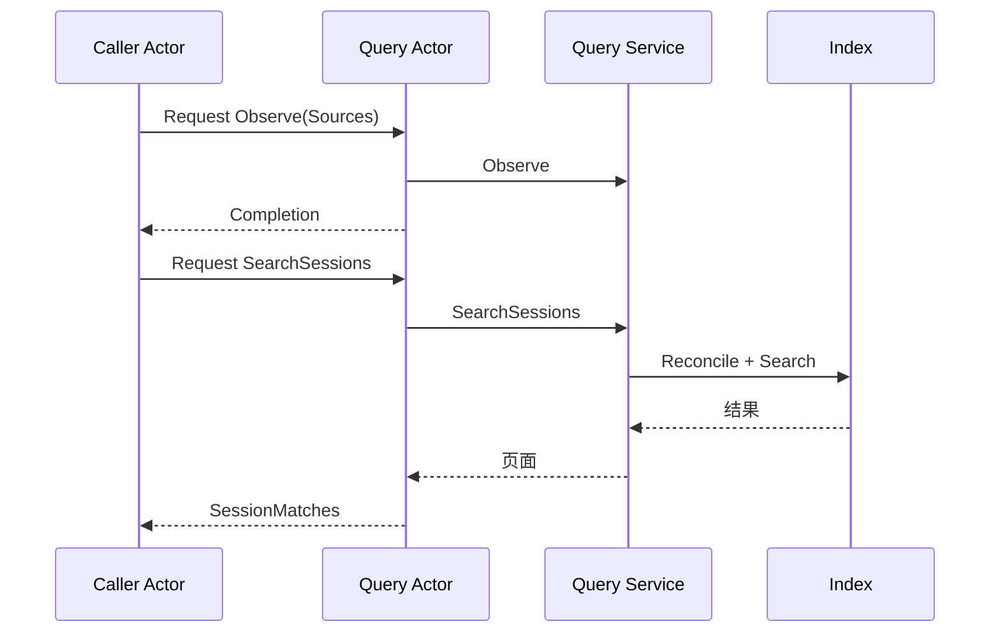

# Query Actor

本包使用一个普通 GoAkt Actor 承接 Session Query 请求。业务与来源契约见[Query](../README.zh-CN.md)，设计见[Query 模块设计](../../../zh-CN/actor-design/29-session-query-module.md)。

## 对象与职责

`Actor` 持有单个 `query.Service`。`messages.go` 定义具名命令和回复，`actor.go` 将命令交给业务对象处理。框架邮箱负责串行顺序，Actor 不再添加锁、任务队列、goroutine 或 Grain 转发层。

构造时传入已经打开的 Index 与配置。调用方先发送完整的 `Observe`，成功后可执行列表、过滤、日志/标题/事件/Surface 读取、关系追踪和全文检索。每种回复以具名字段返回数据，以 `Err error` 返回失败。

## 依赖与交互

普通 Actor 调用方使用 GoAkt `Request` 或 `RequestName`；Grain 调用方使用 `RequestActor`。等待索引 I/O 的是 Query Actor，自身串行处理请求，调用方可以按自己的重入策略继续处理消息。

## 生命周期与失败

来源获取与完整观测发布由上游编排；Actor 不查询旧 LiveStore，也不会将获取失败转换为空语料。存储打开/关闭由组合根负责，停止 Actor 不关闭共享 Index。运行期的框架停止与索引 I/O 排空还需要生产组装时协调，不能把请求超时当作 I/O 已结束。

测试已通过真实框架请求访问 SQLite，验证来源观测、日志/标题/Surface 查询、标题批次错误、关系与全文检索，并确认停止 Actor 后共享索引仍可读取。Collector 来源收集已实现；生产 API 接线仍待完成。

## 来源收集

`Collector` 是单次完整观测的编排 Actor。上游 Grain 通过 DeferResponse 移交回复句柄，按 AllowAll 重入方式 Spawn Collector；同一 Query 的下一次收集必须等本次完成。Collector 顺序读取 Registry 在线列表、各在线 Session 日志、持久化分页和离线日志，最后向 Query 发送一次 Observe。在线项保留 live 日志，持久化列表只补充其 Header 与存在性，合并规则仍由业务 Service 执行。

Collector 只保存本次收集数据，完成或失败后回复 Completion 并退出，不关闭依赖。读取失败不会发布部分来源。框架停止中断发布时，错误不代表发布一定未发生；启动方需要先排空旧收集，再决定重试。真实 GoAkt/SQLite 测试覆盖跨页收集、在线合并以及失败后保留旧观测。
