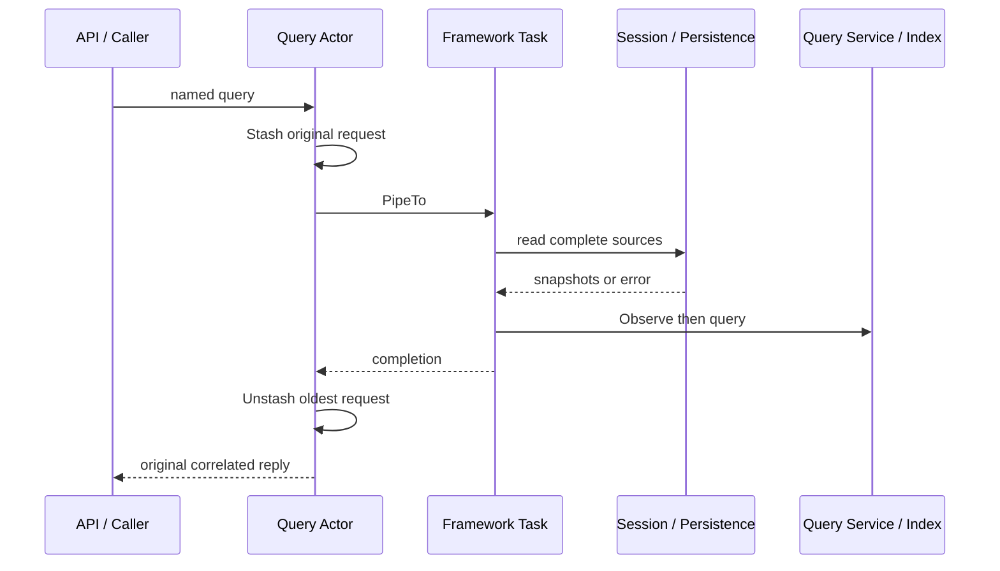

# Query Actor

本包编排来源读取和查询执行，业务规则由 query.Service 负责。设计见 [Query 模块](../../../zh-CN/actor-design/29-session-query-module.md)，集成证据见 [问题记录](../../../zh-CN/actor-design/40-integration-findings.md)。

Actor 持有 Service 和 query.Sources 接口。Logs 是来源适配器，借用 Session Registry 和 persistence.Reader，读取带 CreationID 的在线日志及完整持久化分页；它不持有可变 Session 对象，不创建新的业务状态或决定 live 合并规则。New 只绑定依赖，组合根 Spawn 时必须开启 WithStashing。

每次请求都先取得完整来源，再 Observe 和查询；API 不发送单独 Observe。原单次 Collector 与测试专用启动 Grain 已删除。

后续请求由框架 stash 排队，不保存 pooled ReceiveContext 或自行实现请求队列。来源失败返回当前查询类型的 Err，不发布部分观测、不返回旧观测冒充成功。执行时源读取和索引 I/O 只由一个框架任务访问 Service。PostStop 取消并等待该任务，再由组合根关闭 Index；调用者超时不能证明底层任务已结束。

测试覆盖精确查询、SQLite 检索、在线与超过一页的耐久来源、读取失败，以及 API 客户端调用。生产 Server 已接入 Logs 与查询 Actor；更广的取消/关闭并发故障验收仍需继续。
