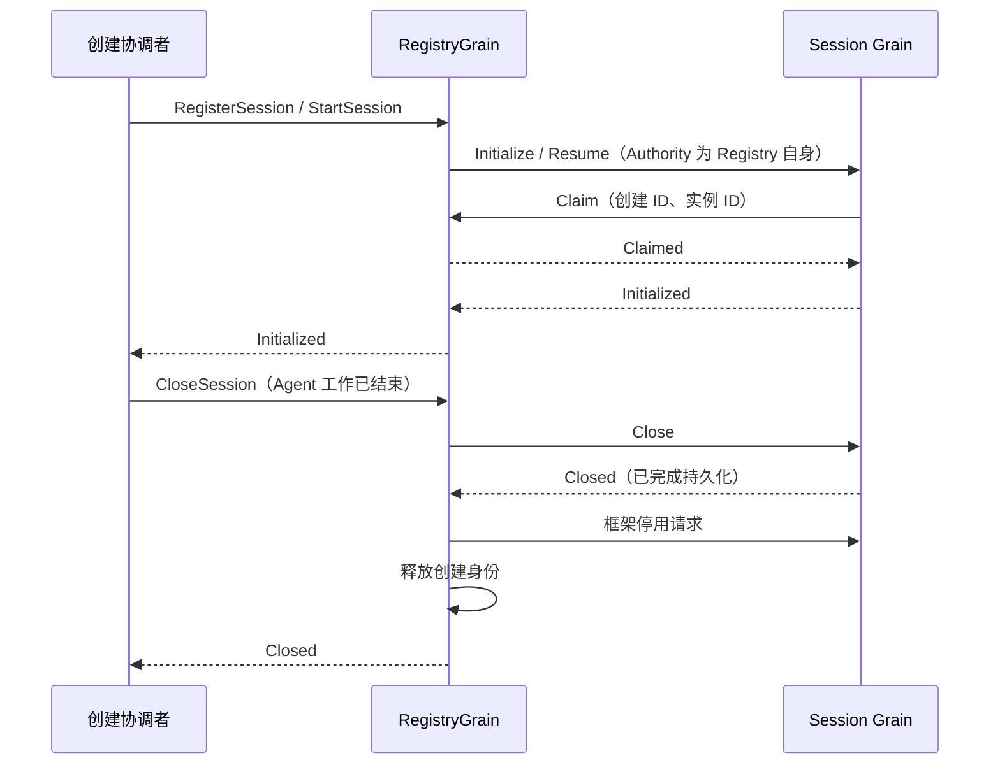

# Session Registry Grain

本包负责 Session 创建配置、创建授权与关闭协调。契约和状态字段的含义见 [Session 模块设计](../../zh-CN/actor-design/22-session-module.md)。

## 对象职责与依赖

| 对象 | 职责 |
| --- | --- |
| RegistryGrain | 串行处理注册、在线列表和生命周期请求；通过 GoAkt 请求 Session Grain |
| registry.authority | 运行生命周期的创建身份预留、实例绑定、撤销与释放 |
| lifecycle | 单个 Session 创建尝试的初始化、关闭进度与最终关闭结果 |
| initialization | 原始初始化输入、等待结果的调用方和本次尝试结束信号 |
| closure | 共享关闭操作的回复句柄、已完成的业务关闭结果和框架任务取消句柄 |

Registry 不持有 Session 日志，不执行存储 I/O，也不维护框架地址表。它依赖 `session/actor` 的消息与 Grain 类型；Session Grain 不反向导入本包。授权消息 `Claim` 和 `Claimed` 位于 `session/actor`，不属于 Session 业务协议。

## 交互与生命周期

注册不激活 Session，也不读写存储。重复初始化固定原输入并共享正在进行的结果；同一创建身份不得切换创建方式或选项。Authority 是内部框架路由，不是可由外部协议指定的授权配置。

初始化尚未结束时，关闭操作等待其结果。关闭失败明确回复错误并保留身份与已确认进度，允许重试；完成日志持久化和框架停用后才释放身份。旧创建的延迟结果不能修改新创建。Registry 自身停用会取消所拥有的等待任务并失败回复，不自动关闭所有 Session。

真实框架、SQLite、重复创建、关闭等待和旧身份隔离的集成验证暂位于 `session/actor/registry_*_test.go` 等外部测试文件，共用 Session 集成设施。生产 AgentLoop 接线仍在迁移中。

业务 drain、框架停用和身份释放成功后发布 `sessionactor.ClosedNotice`，然后回复关闭请求；失败不发布成功通知。通知的 barrier 对应最终耐久日志前缀。关闭回复不表示所有订阅者已完成清理。

`ListSessions` 返回已成功初始化且创建授权尚未撤销的 Session，按 Session ID 排序。每项包含独立复制的 Header 和后续读取所需的 CreationID；预留中、初始化中及已撤销的创建不进入列表。Registry 只保留不可变创建元数据，不缓存日志，也不会为了列举而激活 Session。

Query 先取得列表，再向对应 Session Grain 读取日志。列表不构成跨 Session 的事务快照；列举后发生关闭时，后续读取必须显式处理失败，不能把未读到的 Session 当成不存在并发布不完整查询数据。

`ResolveSession{SessionID, CreationID}` 返回已初始化创建的 Endpoint。地址在初始化成功时保留，不通过查询重新调用 GrainOf；未初始化、已退役或旧 CreationID 返回明确错误。
该地址不取消 Session.Read 自身的 CreationID 检查：解析和读取之间可能发生关闭或替换。
Registry 保留的是框架地址和不可变 Header，不持有 Session 业务对象或日志。

外部 API 要通过 AskGrain 调用使用 DeferResponse 的生命周期操作时，组合入口必须在创建 Registry Grain 时配置 `WithGrainReentrancy`。
在第一次 Receive 内临时 EnableReentrancy 无法改变已送达请求的回复形式。
实测见 [Session API 快照测试](../../apiproxy/session/events/actor/snapshots_test.go) 和 [集成问题记录](../../zh-CN/actor-design/40-integration-findings.md)。
