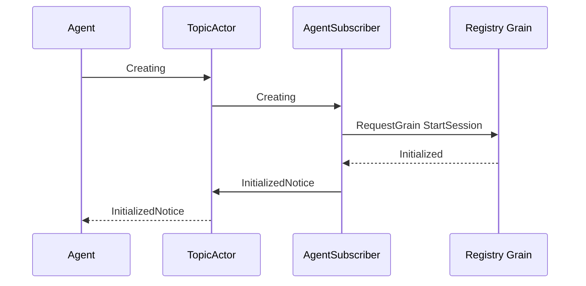

# Session 事件订阅

本包负责将 Agent 创建事件转换为 Session 初始化请求。设计与迁移边界见 [Session 模块设计](../../zh-CN/actor-design/22-session-module.md)。

## 主要对象与依赖

`AgentSubscriber` 是普通 GoAkt Actor，保存 Registry 的 GrainIdentity 和启动观察者 PID。它依赖 [Session Registry](../registry/README.zh-CN.md) 的请求契约与 Session Grain 的初始化结果。它订阅 `agent/creating`，向 Registry 发送 `StartSession`，将结果作为 `InitializedNotice` 发布到 `session/initialized`。消息保留 SessionID、CreationID 和 error。

`AgentsSubscribed` 表示订阅已经确认。组合根应等待该消息后再允许发出创建事件。订阅器不拥有配置、Session 日志、创建授权或初始化操作；这些状态属于 Registry 和 Session Grain。

## 生命周期与失败

PostStart 发起订阅，SubscribeAck 后报告就绪。停止时由 TopicActor 监控清除订阅；已经发出的初始化仍由 Registry 负责。RequestGrain 的延迟结果不保留 ReceiveContext。

缺少注册、创建身份过期、恢复失败或请求失败均通过结果事件的 error 表达。发布失败写入框架日志。PubSub 不保证可靠投递；调用方可以通过同一创建身份重发初始化请求，并由 Registry 保证不重复创建。结果消费方必须检查 SessionID 与 CreationID，组件初始化成功不等于整个 Agent 就绪。

真实 Registry、Session 与 SQLite 的集成测试位于 `session/actor/agent_subscriber_test.go`。生产 AgentLoop 的事件接线尚未完成。
