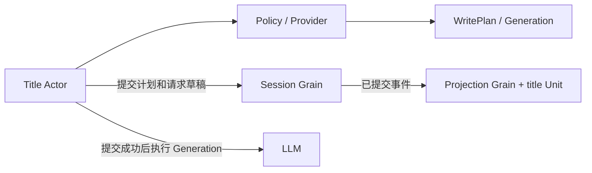

# Session Title

本包实现标题业务规则、持久化事件、Projection 算法和辅助 LLM 调用。Actor 调度方案及跨模块契约见 [Title 模块设计](../../zh-CN/actor-design/28-session-title-module.md)。

## 主要对象与职责划分

| 对象 / 文件 | 职责 |
| --- | --- |
| `Policy` / `policy.go` | 规范化 rename、生成 fallback 写入计划、校验模型结果与过期输入 |
| `ShouldGenerate` / `automatic.go` | 无状态判定人工消息是否触发自动生成，不依赖主请求 |
| `EventData` / `types.go` | 标题来源、消息序号、持久化事件严格编码与配置校验 |
| `Fold`、`CollectMessages` / `fold.go` | 从日志读取标题和可用于生成的人工消息 |
| `Unit` / `projection.go` | 为 Projection owner 提供 title 折叠算法 |
| `LLMProvider` / `llm_provider.go` | 准备模型输入、请求日志草稿、输出校验与调用超时 |
| `Generation` / `provider.go` | 一次已准备的辅助调用；不读取或写入 Session |
| `normalize.go` | 控制字符过滤、UTF-8 安全截断与 fallback 文本规则 |

## 依赖关系与交互

本包依赖 Session 的值与 WritePlan 契约、Projection 的 Unit 契约、LLM 的窄流接口。没有 Plugin、LiveStore、可变 Session 引用或内部调度线程。配置与 Provider 由上游组合；Projection 注册由 Actor 完成。

Policy 的 fallback 计划在当前 Session 快照已有标题时不写入。模型结果计划在提交时校验原标题事件序号和人工消息快照；新 rename 或新人工消息使旧结果返回 `ErrSuperseded`。显式刷新可以替换发起时的人工标题，但不能覆盖随后提交的新命名。

生成入口先提交 fallback，再读取输入快照；Provider 准备或执行失败时仍保留 fallback。Provider.Prepare 不做 I/O，Actor 必须先提交请求日志再调用 Generate。Generate 接收调用 context、执行配置超时并关闭流；Session 提交失败时不得调用它。[Title Grain](actor/README.zh-CN.md) 已接通基础查询、rename、fallback、模型生成与取消排空。无 Provider 的显式刷新也已接通；人工消息的 Topic 自动触发已接通；标题模型必须配置自己的 provider/model，不读取主请求路由。激活授权、Provider 更新及生产组装尚待迁移。

## 验证范围

业务测试覆盖规范化、wire 空数组、fallback、人工锁定、过期模型结果、来源序号、模型路由、输入限制、输出验证与超时。Actor 生命周期和跨 Actor 交互仍需集成测试。
