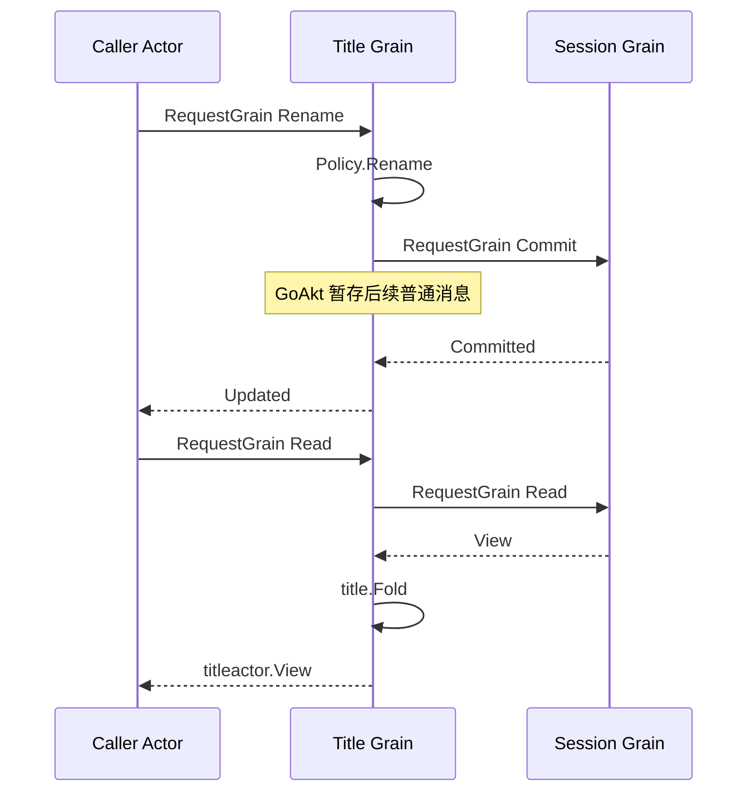

# Title Actor

本包通过 GoAkt Grain 承接标题查询和 Session 写入请求。业务规则见[Title](../README.zh-CN.md)，整体方案见[模块设计](../../../zh-CN/actor-design/28-session-title-module.md)。

## 对象、依赖与职责

`Grain` 使用 `<sessionID>.title` 作为框架名字，`bindings` 按 CreationID 保存 Session Grain 身份和 `title.Policy`。初始化必须提供同名 Session 身份；没有 Session 指针、日志副本或业务锁。`binding` 表示一份创建绑定，不负责 Session 生命周期。

`messages.go` 定义请求及回复；`grain.go` 处理绑定、校验和异步请求。当前支持 `Initialize`、`Read`、`Rename`、`EnsureFallback`、`Generate`、`Close`。`grain_generation.go` 负责先提交 fallback、再读取快照、准备调用、提交请求日志、执行模型和条件提交结果；`worker.go` 只执行独立模型 I/O。所有跨 Actor 调用使用 `RequestGrain`；错误在具名回复的 `Err error` 字段返回。

## 生命周期与失败

Session 请求使用内部无限等待，外部请求超时不能提前释放框架的请求屏障。`Close` 因而在前序 Session 请求返回后才处理，只释放该 CreationID 的策略绑定。nil 记录拒绝本次 activation 内旧身份的后续访问，不能替代系统重新激活时的授权。若 Session 请求一直不返回，关闭也不会虚假确认成功。

未初始化、已关闭、非法标题、Session 错误及不符合契约的回复均返回明确错误。`Updated` 只确认内存提交；持久化 flush 由 Session 负责。关闭先取消当前生成，再请求 Worker 排空；Worker 实际返回后才释放绑定。模型调用使用 AllowAll，Session 请求与 Worker 排空使用 StashNonReentrant。

## 实施边界

已使用真实 Session Grain 和 SQLite 验证 fallback、rename、读取、关闭后的拒绝以及独立 Session 生命周期。模型生成已接通，并验证 Provider 准备失败时仍保留 fallback、请求日志先于调用、生成期间 rename 可处理、关闭等待实际调用结束、迟到结果不覆盖 rename。显式刷新在没有 Provider 时使用 fallback，已有自动标题不重写；相关业务与集成测试通过。人工消息事件已通过 Subscriber 自动触发生成，已验证不需要主 LLM 请求。重新激活授权、Provider 更新和生产组装尚未接通。不得将这里的基础请求测试视为完整 Title Actor 验证。

自动入口见 `grain_automation.go`：仅处理人工消息与人工标题事件。`Subscriber` 过滤 Session/Creation 身份并转发 Topic 通知。Title 没有 MainRequest、日志消费游标或等待路由状态，模型来自独立标题配置。

## 生命周期与服务地址

Title Grain 使用 `<sessionID>.title` 名称，Session 业务身份来自初始化 Header.ID 和事件 SessionID。Session 地址使用 Session.RuntimeName；订阅筛选和 provider 请求不解析 Actor 名称。

Subscriber 的 Ready 通道在 Appended 与 Closed 两项订阅确认后关闭；Title Registry 等待该信号再确认组件就绪。订阅者使用显式 SessionID 和 CreationID 筛选，不解析框架名称，也不需要额外启动观察 Actor。
