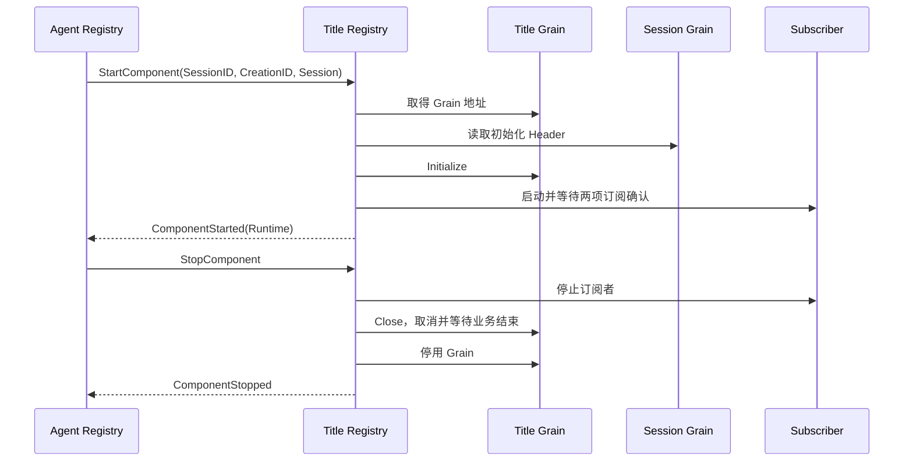

# Title 生命周期 Registry

本包接收 Agent Registry 的组件生命周期请求，只负责编排 Title Grain 和 Session 事件订阅者。标题策略、生成资格与日志变更归 [Title 业务](../README.zh-CN.md)，模型调用与写入调度归 [Title Actor](../actor/README.zh-CN.md)。跨模块契约见 [API 方案](../../../zh-CN/actor-design/38-api-proxy-module.md)，实施进度见 [进度记录](../../../zh-CN/08-implementation-progress.md)。

## 对象与接口

Grain 是全局 `titles` 生命周期入口。Configure 在启动组件前一次性提供经过校验的策略配置、Provider 和超时。instances 以 SessionID 为键，保存最近一次创建的框架地址、启动/关闭阶段和等待回复，不保存标题或 Session 业务对象。

grain_start.go 负责 StartComponent、Title 初始化和订阅就绪；grain_close.go 负责 StopComponent、取消启动、停止订阅、等待 Title 关闭和框架停用。异步任务捕获配置与地址，完成结果回到邮箱后更新生命周期阶段。

实际启动先取得 Title 框架地址，再读取 Session Header，随后发送 Initialize。API 从 Agent Registry 的就绪 Components 获取 Title 地址，不调用 GrainOf。组合根须在首次外部请求前为本 Registry 配置 AllowAll 重入。

## 失败与取消

启动失败仍保存已取得的资源，直到 StopComponent 完成清理；启动中的关闭会取消启动任务并等待其交回资源地址。关闭成功前不接受新创建，关闭失败保留进度以便重试。重复关闭幂等；已关闭创建不能重新启动，旧 CreationID 不能关闭新创建。

正常系统关闭必须先经 Agent Registry 关闭组件，再停止共享 Registry。OnDeactivate 只终止在途等待，不能替代上述资源关闭顺序。

真实集成测试 `TestTitleComponentRecoversAfterSessionBindingFailure` 验证 Session 拒绝绑定后的部分资源回收、重复关闭、旧身份拒绝和新创建启动；`TestDomainClientsUseIndependentTitleAndAgentOwners` 验证正常生命周期与独立 API 客户端。生产组合根接线仍未完成。
